# Minecraft Seed Searcher (`dynamic-envelope-2048-v3`) — Full-Depth Repository Audit Context

> **Auditor Instructions for Claude:**
> This document is a complete, self-contained architectural dossier of the `minecraft-seed-searcher` codebase as of commit `886e9cc` on `main`. It contains the full system architecture, mathematical specifications, C11 kernel mechanics, Python runtime bindings, Web UI contracts, historical audit remediations, benchmark figures, and known open architectural questions. Use this context to conduct a rigorous, zero-assumption, full-depth repository audit covering correctness, mathematical parity, memory safety, concurrency, throughput headroom, and product integration.

---

## 1. Executive Overview & System Purpose

The **Minecraft Bedrock Seed Searcher** is an ultra-high-throughput, multi-threaded C11/Python search engine engineered to discover the **"Master Seed"** for Minecraft Bedrock 1.21+.

A **"Master Seed"** is an extraordinary seed where all essential progression, rare macro, and luxury structures generate in close proximity within a compact playable envelope, surrounded by scenic terrain and a comprehensive diversity of biomes.

### Technology Stack
* **Native Kernel (`native/`):** C11 extension compiled with Clang 19, utilizing **OpenMP multi-threading**, **PGO (Profile-Guided Optimization)**, **LTO (Link-Time Optimization)**, **AVX2**, **FMA**, and `-march=native`. Integrates and wraps `vendor/cubiomes-bedrock` for Bedrock climate generation and structure positioning.
* **Orchestration & Scoring Oracle (`src/seed_search/`):** Python 3.13 runtime providing CFFI bindings (`Prototype`), SQLite persistence (`RealmStore`), high-level CLI (`seed_search scan`), and an exact Python reference evaluator (`evaluate_dynamic_seed`).
* **Web UI & Server (`web-ui/`, `src/seed_search/web/`):** React 18 + TypeScript + Vite frontend with Tailwind CSS and Lucide icons; Python `http.server` backend exposing REST endpoints for live sweep orchestration, telemetry, candidate inspection, and Bedrock Dedicated Server (BDS) world generation verification.

### Active Revision Contract: `dynamic-envelope-2048-v3`
* **Search Center:** Dynamically placed center $(C_x, C_z)$ satisfying $|C_x| \le 512$, $|C_z| \le 512$.
* **Overworld Envelope:** Exact $2048 \times 2048$ box $[C_x - 1024, C_x + 1024) \times [C_z - 1024, C_z + 1024)$.
* **Nether Envelope:** Exact $1024 \times 1024$ box in Nether space $[C_{nx} - 512, C_{nx} + 512) \times [C_{nz} - 512, C_{nz} + 512)$ where $C_n = \lfloor C / 8 \rfloor$, sampled on a 64-block lattice ($16 \times 16 = 256$ interior points).
* **Miss Budget:** Strict zero miss tolerance ($B = 0$). All 14 structure categories enforce mandatory non-negotiable hard floors (`flexible_mask = 0`).
* **Scoring System:** Pure additive **1,250-point model** ($650\text{ Core Surplus} + 200\text{ Optional} + 265\text{ Luxury Biomes} + 135\text{ Spatial/Nether}$).

---

## 2. Mathematical Scoring Architecture (1,250 Points Max)

The scoring architecture is strictly additive with zero negative deficit penalties under $B = 0$:

$$\text{Total Score} = S_{\text{core}} + S_{\text{optional}} + S_{\text{biomes}} + S_{\text{spatial}} = 1,250\text{ pts Max}$$

```
+---------------------------------------------------------------------------------------+
|                              1,250-POINT SCORE HIERARCHY                              |
+---------------------------------------------------------------------------------------+
|  1. Core Surplus (650 pts)    : 14 Structure categories above hard minimums           |
|  2. Optional Structures (200) : 5 Rare structures (+40 pts each, max +200)            |
|  3. Luxury Biomes (265 pts)   : 17 Luxury Biomes (+15) + Pale Garden (+25)            |
|  4. Spatial & Nether (135 pts): Hub (45) + Nether Core (20) + Scenic (25)            |
|                                 + Village Spread (25) + Treasure Bastion (20)         |
+---------------------------------------------------------------------------------------+
```

### Component A: Core Surplus (650 Points Maximum)
All 14 required structure categories must meet their **Hard Floor**. Counts strictly above the floor earn progressive surplus points:

| Index | Structure Category | Hard Floor ($k$) | Surplus Ladder Steps | Max Surplus Pts | Dimension |
| :---: | :--- | :---: | :--- | :---: | :--- |
| `0` | **Woodland Mansion** | $\ge 1$ | 2nd (+40), 3rd (+25) | **65 pts** | Overworld |
| `1` | **Jungle Temple** | $\ge 1$ | 2nd (+20), 3rd (+20), 4th (+10) | **50 pts** | Overworld |
| `2` | **Desert Pyramid** | $\ge 1$ | 2nd (+20), 3rd (+20), 4th (+10) | **50 pts** | Overworld |
| `3` | **Ocean Monument** | $\ge 1$ | 2nd (+25), 3rd (+25), 4th (+10) | **60 pts** | Overworld |
| `4` | **Ancient City** | $\ge 2$ | 3rd (+20), 4th (+20), 5th (+10) | **50 pts** | Overworld |
| `5` | **Village** | $\ge 6$ | 7th–10th (+15 each), 11th–12th (+10), 13th+ (+5) | **85 pts** | Overworld |
| `6` | **Trial Chamber** | $\ge 8$ | 9th–12th (+10 each), 13th–14th (+5) | **50 pts** | Overworld |
| `7` | **Ruined Portal** | $\ge 8$ | 9th–10th (+10 each) | **20 pts** | Overworld |
| `8` | **Shipwreck** | $\ge 4$ | 5th–7th (+10 each) | **30 pts** | Overworld |
| `9` | **Mineshaft** | $\ge 10$| 11th–12th (+10 each) | **20 pts** | Overworld |
| `10`| **Nether Fortress** | $\ge 1$ | 2nd (+30), 3rd (+20), 4th (+10) | **60 pts** | Nether |
| `11`| **Bastion Remnant** | $\ge 2$ | 3rd (+25), 4th (+15), 5th (+10) | **50 pts** | Nether |
| `12`| **Pillager Outpost** | $\ge 1$ | 2nd (+15), 3rd (+15), 4th (+10) | **40 pts** | Overworld |
| `13`| **Stronghold** | $\ge 1$ | 2nd (+20) | **20 pts** | Overworld |
| **SUM**| | | | **650 pts** | |

*Note on Outpost Floor:* Audit fix F9 explicitly calibrated Outpost floor to $1$ (ladder: $c=1 \to 0$, $c=2 \to +15$, $c=3 \to +30$, $c \ge 4 \to +40$).

### Component B: Optional Structures (200 Points Maximum)
Five optional structure types provide +40 pts each when $\ge 1$ is present within the Overworld window:
1. **Witch Hut** (+40 pts)
2. **Igloo** (+40 pts)
3. **Warm Ocean Ruin** (+40 pts)
4. **Cold Ocean Ruin** (+40 pts)
5. **Buried Treasure** (+40 pts)
$$\text{Max Optional} = 5 \times 40 = \mathbf{200\text{ pts}}$$

### Component C: Luxury Biomes (265 Points Maximum)
Awarded for luxury biome families present in the Overworld palette:
* **16 Standard Luxury Biomes:** Badlands, Bamboo Jungle, Cherry Grove, Deep Dark, Desert, Dripstone Caves, Eroded Badlands, Flower Forest, Ice Spikes, Jagged Peaks, Jungle, Lush Caves, Mangrove Swamp, Mushroom Fields, Old Growth Taiga, Snowy Slopes (+15 pts each = 240 pts).
* **Pale Garden:** +25 pts.
$$\text{Max Luxury Biomes} = 240 + 25 = \mathbf{265\text{ pts}}$$

### Component D: Spatial, Hub & Nether Bonuses (135 Points Maximum)
Verified in [`src/seed_search/realm/blueprint.py`](file:///Users/lucasraicu/Downloads/minecraft-seed-searcher/src/seed_search/realm/blueprint.py#L669) and [`native/blueprint_dynamic.inc`](file:///Users/lucasraicu/Downloads/minecraft-seed-searcher/native/blueprint_dynamic.inc#L1132-L1152):
1. **Hub Structures Bonus (max 45 pts):**
   * Starter Hub Village $\le 256\text{m}$ of center: +15 pts.
   * Other core structures $\le 512\text{m}$ of center: +5 pts each (capped at +30 pts).
2. **Nether Portal Core Bonus (20 pts):**
   * Fortress $\le 256\text{m}$ in Nether (+10 pts) AND Bastion $\le 256\text{m}$ in Nether (+10 pts).
3. **Scenic Mountain-Ocean Pair (25 pts):**
   * Qualifying high peak (Jagged/Frozen/Stony Peaks) within 384m of a Deep Ocean / Ocean biome.
4. **Village Radial Spread (25 pts):**
   * Villages distributed across at least 3 distinct directional quadrants relative to center.
5. **Treasure Bastion Variant (20 pts):**
   * At least one qualifying Bastion identified as the `treasure` room variant.
$$\text{Max Spatial} = 45 + 20 + 25 + 25 + 20 = \mathbf{135\text{ pts}}$$

$$\mathbf{Total = 650 + 200 + 265 + 135 = 1,250\text{ pts}}$$

---

## 3. High-Performance C11 Kernel Pipeline

The native sweep evaluates seeds through a progressive multi-stage rejection pipeline (`native/blueprint_dynamic.inc`):

```mermaid
flowchart TD
    S0["Input Seed (uint64_t)"] --> S1A["Stage 1A: Macro Envelope (1024m Overworld / 512m Nether)"]
    S1A --> P0["Low-32 PRNG Preflight (~90.8% pass)"]
    P0 --> P1["Woodland Mansion Dark Forest Filter (~27.8% pass)"]
    P1 --> P2["Woodland Mansion Viability (~4.1% pass)"]
    P2 --> P3["Stronghold Viability (~3.4% pass)"]
    P3 --> P4["Outpost Viability (~3.2% pass)"]
    P4 --> P5["Rare Overworld Check: Pyramid, AC, Temple, Monument (~0.27% pass)"]
    P5 --> P6["Nether Generation & Macro Check: Fortress & Bastion (~0.26% pass)"]
    P6 --> P7["Remaining Overworld: Village, Shipwreck, TC, Portal, Mineshaft (~0.25% pass)"]
    P7 --> S1B["Stage 1B: Candidate Sliding Grid & Upper-Bound Cutoff"]
    S1B --> C1["Prune: max_core + 600 < cutoff_score"]
    C1 --> C2["2D Coordinate Event Snapping & Sliding Cells"]
    C2 --> C3["Cell Hard Floors Check (Rarity Order)"]
    C3 --> S2["Stage 2: Full Rasterization & Scoring"]
    S2 --> B1["2D Biome Palette Prefix Generation (Cubiomes)"]
    B1 --> B2["Luxury Biome Score & Prune: core + lux + 335 < cutoff_score"]
    B2 --> O1["Optional Structures Evaluation & Prune: core + lux + opt + 135 < cutoff_score"]
    O1 --> SP["Spatial & Cache Scoring: Hub, Nether Core, Scenic, Spread, Treasure Bastion"]
    SP --> RET["Retain Survivor Record into Native Batch Ring Buffer"]
```



### Key Zero-False-Negative Kernel Optimizations:
1. **Macro Rarity Ordering (Commit `c5d2d76`):**
   * Stage 1A evaluates rare Overworld structures `{Desert Pyramid (2), Ancient City (4), Jungle Temple (1), Monument (3)}` **before** initializing Nether generation.
   * Nether seeds are only generated and tested for the ~9% of seeds that satisfy those rare Overworld floors, eliminating >91% of expensive Nether evaluations.
2. **Sliding Cell Feasibility Rarity (Commit `0689bb9`):**
   * Cells check structure floors in strict rarity order: `{4 (AC), 2 (Pyramid), 1 (Temple), 0 (Mansion), 11 (Bastion), 12 (Outpost), 10 (Fortress), 3 (Monument), 5 (Village), 8 (Shipwreck), 6 (TC), 7 (Portal), 9 (Mineshaft)}`.
3. **Multi-Stage Upper-Bound Cutoff Pruning:**
   * Gate 1 (after Core): `max_core + 600 < cutoff_score -> abort seed`
   * Gate 2 (sliding cell): `cell_max_potential < cutoff_score -> skip cell`
   * Gate 3 (after Biomes): `core + lux + 335 < cutoff_score -> skip cell`
   * Gate 4 (after Optional): `core + lux + opt + 135 < cutoff_score -> skip cell`
4. **Dynamic Top-50 Feedback Loop (Commit `886e9cc`):**
   * `scripts/pilot_v3_2048.py` extracts `tracker.cutoff_score() or 0` before each batch and feeds it to `prototype.sweep(..., cutoff_score=current_cutoff)`. As the top-50 min-heap fills, the pruning bar rises dynamically without native locks or bus contention.

---

## 4. Repository Structure & Key File Map

| Path | Purpose & Key Details |
| :--- | :--- |
| **`native/blueprint_dynamic.inc`** | Core C11 dynamic sweep kernel. Implements Stage 1A/1B/2, coordinate snapping, sliding window candidate cell generation, and multi-stage cutoff pruning. |
| **`native/blueprint_batch.inc`** | Native OpenMP parallel batch runner (`nb_sweep`), worker memory management (`NBWorker`), and CFFI export wrappers. |
| **`native/blueprint_batch.h`** | Header defining `NBPolicy`, `NBCandidate`, `NBDynamicCell`, and engine flags. |
| **`native/build.py`** | Clang build script compiling the native extension (`_blueprint_batch.abi3.so`). |
| **`src/seed_search/realm/config.py`** | Specification source of truth: `dynamic_v3_blueprint_config()` defines the 14 hard floors, goals, optional targets, and geometry. |
| **`src/seed_search/realm/native_batch.py`** | Python CFFI wrapper class `Prototype`, buffer decoding (`retained_records`), and production SQLite persistence runner (`persist_pipeline`). |
| **`src/seed_search/realm/top_tracker.py`** | `Top50Tracker`: bounded min-heap priority queue with `RevStr(raw_id)` lexical tie-breaking and nested anchor score extraction. |
| **`src/seed_search/realm/blueprint.py`** | Exact Python reference scoring oracle (`evaluate_dynamic_seed`). Implements the identical 1,250-point additive model for differential testing. |
| **`src/seed_search/realm/reports.py`** | Implements `_candidate_rescore()` with revision dispatch ensuring idempotent score preservation for v3 candidates. |
| **`src/seed_search/realm/dynamic.py`** | Python spatial helpers: 256-point Nether lattice sampler, centroid calculation, scenic Mountain-Ocean pair inspection, and village spread testing. |
| **`src/seed_search/web/server.py`** | Web backend server (`/api/sweep/start`, `/api/sweep/status`, `/api/sweep/stop`, `/api/bds/verify`). |
| **`web-ui/src/constants/searchProfiles.json`** | Web profiles; contains canonical `dynamic2048` profile. |
| **`web-ui/src/components/SeedDetailModal.tsx`** | Seed inspection UI: displays 1,250 Pts Max breakdown, Nether Core badge (+20), and hides deficit labels when deficits are zero. |
| **`web-ui/src/utils/ranking.ts`** | Score-first sorting comparator (`compareCandidateRank`). |
| **`scripts/pilot_v3_2048.py`** | High-throughput sweep driver with dynamic Top-50 min-heap feedback and rich funnel analytics. |
| **`scripts/rebuild_pgo_v3.py`** | Clang PGO training, llvm-profdata merging, and production LTO compilation harness. |
| **`scripts/measure_v3_floors.py`** | Diagnostic script measuring step-by-step pass rates across 10,000 seeds. |

---

## 5. Summary of Audit Remediations (Commits `83ae680` to `886e9cc`)

The following critical issues were identified during audits and have been completely remediated and verified:

| Finding | Defect / Vulnerability | Remediation Landed | Status |
| :---: | :--- | :--- | :---: |
| **F1** | Web UI & Server launched historical v2 1664m policy instead of v3 2048m | Added `dynamic2048` profile to `searchProfiles.json`, updated `server.py` and `cli.py` defaults to v3 with zero miss budget. | **VERIFIED** |
| **F2** | `_candidate_rescore()` silently rescored v3 candidates under v2 scoring rules | Added explicit `dynamic_v3_policy` dispatch in `reports.py`; added idempotence unit tests. | **VERIFIED** |
| **F3** | Nether lattice sampled 17×17 (289 pts) on half-open $[lo, lo+1024)$, creating boundary coordinate leak | Fixed lattice to exact 16×16 (256 points) interior points in both C and Python. | **VERIFIED** |
| **F4** | Independent oracle defaulted to historical 832/416 window sizes | Threaded `ow_half=1024, nw_half=512` into all radial and variant bonus helpers in `blueprint.py`. | **VERIFIED** |
| **F5** | Top-50 tracker extracted `NULL` scores from nested anchors; min-heap tie-break had inverted lexical order | Extracted score from `anchors[0]['baseline_score_observed']`; wrapped ID in `RevStr(raw_id)` to match SQLite `ORDER BY score DESC, id ASC`. | **VERIFIED** |
| **F6** | Specification documentation claimed 600 Core Surplus and 1,200 Total | Re-normalized documentation and full stack to pure additive **650 Core Surplus** and **1,250 Grand Total**. | **VERIFIED** |
| **F7** | Cutoff score was static/unwired in sweeps | Added `p->cutoff_score` to C kernel; wired `tracker.cutoff_score()` into `pilot_v3_2048.py`. | **VERIFIED** |
| **F8** | Web UI displayed obsolete 1,200 pt scale and missed Nether Core badge | Updated `SeedDetailModal.tsx` to 1,250 Pts Max, added Nether Core badge (+20), conditionally hide deficit chips when 0. | **VERIFIED** |
| **F9** | Outpost floor was set to 2, causing massive over-filtering | Lowered Outpost floor to 1; mapped surplus ladder $\{0, 15, 30, 40\}$. | **VERIFIED** |

---

## 6. Throughput & Funnel Benchmarks

### Measured Throughput on 34 Threads (Clang PGO + LTO + AVX2 + FMA):
* **Initial baseline:** $\sim 24,000\text{ seeds/sec}$
* **Wave 1 (Macro + sliding cell rarity):** $53,185\text{ seeds/sec}$
* **Wave 2 (Rare Overworld before Nether):** **$59,171.5\text{ seeds/sec}$** (50,000 seeds in 0.845s, batch 16,384)
* **Wave 3 (Dynamic Top-50 cutoff feedback):** **$63,128.1\text{ seeds/sec}$** peak batch throughput.

### Stage-by-Stage Funnel on 10,000 Natural Seeds:
```
1. Inputs scanned                          |    10,000 | 100.00%
2. Passed Step 1A PRNG preflight           |     9,077 |  90.77%
3. Passed Mansion dark forest filter       |     2,784 |  27.84%
4. Passed Mansion macro viability          |       410 |   4.10%
5. Passed Stronghold macro discovery       |       341 |   3.41%
6. Passed Outpost macro viability          |       320 |   3.20%
7. Passed Rare OW (Pyramid, AC, Temple, Mon)|       27 |   0.27%
8. Passed Nether (Fortress & Bastion)      |        26 |   0.26%
9. Passed All 14 Structures macro          |        25 |   0.25% (1 in 400)
10. Had cells satisfying all 14 hard floors|         0 |   0.00% (< 1 in 1M)
```

---

## 7. Open Architectural Invariants & Questions for the Audit

When auditing this repository, please evaluate the following core architectural dimensions:

1. **Zero-Yield Poisson Paradox ($B=0$ with 14 Floors):**
   * Macro survival is 1 in 400 seeds ($0.25\%$).
   * However, fitting all 14 structures simultaneously inside a single $2048 \times 2048$ Overworld / $1024 \times 1024$ Nether window requires contradictory biome combinations (Desert, Jungle, Dark Forest, Deep Dark, Deep Ocean, Warm/Cold Ocean).
   * Mathematical expectation predicts a survival rate of $< 1 \text{ in } 2.5 \times 10^9$ seeds.
   * *Audit Question:* Is the search policy viable for empirical discoveries without relaxing floors or introducing a tightly calibrated flexible miss budget ($B=1$ or $B=2$)?
2. **C11 Memory Allocation & Buffer Realloc Safety:**
   * Review `native/blueprint_dynamic.inc`: `w->dyn_ex`, `w->dyn_ez`, and `w->dyn_cells`.
   * Check dynamic memory growth, realloc patterns, alignment, and thread safety across OpenMP threads.
3. **Centroid Snapping & Coordinate Grid Geometry:**
   * Review `nb_dynamic_centroid` and `nb_dynamic_snap` (8m and 16m chunk boundary snapping).
   * Confirm whether snapped evaluation centers $(C_x, C_z)$ can ever drift outside the legal $[-512, 512]^2$ search box.
4. **Rescoring Idempotence & Cross-Platform Parity:**
   * Review `_candidate_rescore()` in `reports.py` and `evaluate_dynamic_seed()` in `blueprint.py`.
   * Verify that any candidate evaluated natively in C produces identical score, identical component breakdown, and identical rank keys when rescored in Python or verified via BDS world generation.
5. **Multi-Threaded Cutoff Synchronization:**
   * Review the interaction between OpenMP threads and `p->cutoff_score`.
   * Assess whether implementing C-level `_Atomic int g_live_cutoff_score` provides measurable value over the current 270ms batch-boundary propagation.

---

## 8. Verification Commands

To verify the repository locally, execute the following test suites:

```bash
# 1. Run Python v3 Core & Integration Tests (56 tests)
.venv/bin/pytest tests/test_dynamic_v3_2048.py tests/test_dynamic_integration.py tests/test_blueprint_coastal.py

# 2. Run Web UI Policy & Score Contract Tests (13 tests)
node tests/web_structure_policy.cjs

# 3. Measure Funnel Survivor Count (Exact bit-for-bit parity check)
.venv/bin/python scripts/measure_v3_floors.py --count 10000

# 4. Measure PGO Production Kernel Throughput
.venv/bin/python scripts/pilot_v3_2048.py --count 50000 --threads 34 --batch-size 16384
```
