# Minecraft Seed Searcher (`dynamic-envelope-2048-v3`) — Full-Depth Repository Audit Context

> **Auditor Instructions for Claude:**
> This document is a complete, self-contained architectural and mathematical dossier of the `minecraft-seed-searcher` codebase as of commit `886e9cc` on `main`. It contains the full system architecture, mathematical specifications, verbatim C11 kernel functions, Python reference oracle code, Web UI contracts, historical audit remediations, benchmark figures, and known open architectural questions. Use this context to conduct a rigorous, zero-assumption, full-depth repository audit covering correctness, mathematical parity, memory safety, concurrency, throughput headroom, and product integration.

---

## 1. Executive Overview & System Purpose

The **Minecraft Bedrock Seed Searcher** is an ultra-high-throughput, multi-threaded C11/Python search engine engineered to discover the **"Master Seed"** for Minecraft Bedrock 1.21+.

A **"Master Seed"** is an extraordinary seed where all essential progression, rare macro, and luxury structures generate in close proximity within a compact playable envelope, surrounded by scenic terrain and a comprehensive diversity of biomes.

### Technology Stack
* **Native Kernel (`native/`):** C11 extension compiled with Clang 19, utilizing **OpenMP multi-threading**, **PGO (Profile-Guided Optimization)**, **LTO (Link-Time Optimization)**, **AVX2**, **FMA**, and `-march=native`. Integrates and wraps `vendor/cubiomes-bedrock` for Bedrock climate generation and structure positioning.
* **Orchestration & Scoring Oracle (`src/seed_search/`):** Python 3.13 runtime providing CFFI bindings (`Prototype`), SQLite persistence (`RealmStore`), high-level CLI (`seed_search scan`), and an exact Python reference evaluator (`evaluate_dynamic_seed`).
* **Web UI & Server (`web-ui/`, `src/seed_search/web/`):** React 18 + TypeScript + Vite frontend with Tailwind CSS and Lucide icons; Python `http.server` backend exposing REST endpoints for live sweep orchestration, telemetry, candidate inspection, and Bedrock Dedicated Server (BDS) world generation verification.

### Active Revision Contract: `dynamic-envelope-2048-v3`
* **Search Center:** Dynamically placed center $(C_x, C_z)$ satisfying $|C_x| \le 976$, $|C_z| \le 976$ (in v2 it was $\le 336$ for $1664 \times 1664$).
* **Overworld Envelope:** Exact $2048 \times 2048$ box $[C_x - 1024, C_x + 1024) \times [C_z - 1024, C_z + 1024)$.
* **Nether Envelope:** Exact $1024 \times 1024$ box in Nether space $[C_{nx} - 512, C_{nx} + 512) \times [C_{nz} - 512, C_{nz} + 512)$ where $C_n = \lfloor C / 8 \rfloor$, sampled on a 64-block lattice ($16 \times 16 = 256$ interior points).
* **Miss Budget:** Strict zero miss tolerance ($B = 0$). All 14 structure categories enforce mandatory non-negotiable hard floors (`flexible_mask = 0`).
* **Scoring System:** Pure additive **1,250-point model** ($650\text{ Core Surplus} + 200\text{ Optional} + 265\text{ Luxury Biomes} + 135\text{ Spatial/Nether}$).

---

## 1.1 Architectural Rationale: Why We Compare Python with C11

The searcher employs a **Dual-Engine / Differential Oracle pattern**:

| Dimension | C11 Native Kernel (`native/`) | Python Reference Oracle (`src/seed_search/`) |
| :--- | :--- | :--- |
| **Role** | Sprint engine (raw speed) | Reference Oracle & Ground Truth (veracity) |
| **Throughput** | **~60,000 seeds/sec** (34 threads) | **~50 seeds/sec** (single thread) |
| **Primary Tasks** | Evaluates millions of seeds; discards 99.75% via macro filters; computes candidate cells. | Validates candidates, computes final report, powers Web UI, seeds SQLite, verifies BDS. |
| **Implementation** | Pointer math, bitmasks, Clang AVX2/FMA vectorization, early-abort pruning. | High-level set operations, coordinate dictionaries, auditable math. |

### The Parity Invariant
Because C11 relies on aggressive early-abort pruning and sliding-window event grids, **differential testing against Python is mandatory**:
1. **Zero False Negatives:** C11 must never prune a seed that Python's reference mathematical specification would qualify.
2. **Zero Phantom Candidates:** Every candidate retained by C11 must produce the **exact same score, exact same structure counts, exact same biomes, and exact same coordinate center** when independently rescored in Python or verified via Bedrock Dedicated Server (BDS) world generation.

---

## 2. Specification Configuration: `dynamic_v3_blueprint_config()`

Source: [`src/seed_search/realm/config.py`](file:///Users/lucasraicu/Downloads/minecraft-seed-searcher/src/seed_search/realm/config.py#L382-L408)

```python
def dynamic_v3_blueprint_config():
    """Active player-envelope policy (v3, 2048x2048 overworld, 1024x1024 nether)."""
    cfg = dynamic_v2_blueprint_config()
    cfg['screening_revision'] = 'dynamic-envelope-2048-v3'
    cfg['deployment'] = {'overworld_side_blocks': 2048, 'nether_side_blocks': 1024}
    cfg['discovery'] = {'overworld_bounds': [-2000, -2000, 2000, 2000],
                        'nether_bounds': [-634, -634, 634, 634]}
    cfg['structures']['minimum_counts'].update(
        village=6, trial_chamber=8, ancient_city=2, desert_pyramid=1,
        jungle_temple=1, monument=1, ruined_portal=8, shipwreck=4,
        mineshaft=10, outpost=1, mansion=1
    )
    cfg['structures']['nether_minimum_counts'] = {'fortress': 1, 'bastion': 2}
    cfg['structures']['hard_floors'] = {
        'stronghold': 1, 'mansion': 1, 'village': 6, 'trial_chamber': 8,
        'ancient_city': 2, 'desert_pyramid': 1, 'jungle_temple': 1,
        'monument': 1, 'ruined_portal': 8, 'shipwreck': 4, 'mineshaft': 10,
        'outpost': 1, 'fortress': 1, 'bastion': 2
    }
    cfg['search']['centroid_weights'] = {
        'village': 3, 'trial_chamber': 2, 'ruined_portal': 0, 'ancient_city': 2,
        'outpost': 1, 'desert_pyramid': 2, 'jungle_temple': 2, 'mansion': 2,
        'monument': 1, 'stronghold': 1, 'shipwreck': 0
    }
    cfg['search']['max_misses'] = 0
    return cfg
```

---

## 3. Mathematical Scoring Architecture (1,250 Points Max)

The scoring architecture is strictly additive with zero negative deficit penalties under $B = 0$:

$$\text{Total Score} = S_{\text{core}} + S_{\text{optional}} + S_{\text{biomes}} + S_{\text{spatial}} = 1,250\text{ pts Max}$$

```
+---------------------------------------------------------------------------------------+
|                              1,250-POINT SCORE HIERARCHY                              |
+---------------------------------------------------------------------------------------+
|  1. Core Surplus (650 pts)    : 14 Structure categories above hard minimums           |
|  2. Optional Structures (200) : 5 Rare structures (+40 pts each, max +200)            |
|  3. Luxury Biomes (265 pts)   : 17 Luxury Biomes (+15) + Pale Garden (+25)            |
|  4. Spatial & Nether (135 pts): Hub (45) + Nether Core (20) + Scenic (25)            |
|                                 + Village Spread (25) + Treasure Bastion (20)         |
+---------------------------------------------------------------------------------------+
```

### Component A: Core Surplus (650 Points Maximum)
All 14 required structure categories must meet their **Hard Floor**. Counts strictly above the floor earn progressive surplus points:

| Index | Structure Category | Hard Floor ($k$) | Surplus Ladder Steps | Max Surplus Pts | Dimension |
| :---: | :--- | :---: | :--- | :---: | :--- |
| `0` | **Woodland Mansion** | $\ge 1$ | 2nd (+55), 3rd+ (+30) | **85 pts** | Overworld |
| `1` | **Jungle Temple** | $\ge 1$ | 2nd (+25), 3rd (+20), 4th+ (+15) | **60 pts** | Overworld |
| `2` | **Desert Pyramid** | $\ge 1$ | 2nd (+25), 3rd (+20), 4th+ (+15) | **60 pts** | Overworld |
| `3` | **Ocean Monument** | $\ge 1$ | 2nd (+25), 3rd (+15), 4th+ (+10) | **50 pts** | Overworld |
| `4` | **Ancient City** | $\ge 2$ | 3rd (+20), 4th (+20), 5th (+15), 6th+ (+10) | **65 pts** | Overworld |
| `5` | **Village** | $\ge 6$ | 7th..11th+ (+10 each) | **50 pts** | Overworld |
| `6` | **Trial Chamber** | $\ge 8$ | 9th (+10), 10th (+8), 11th (+7), 12th+ (+5) | **30 pts** | Overworld |
| `7` | **Ruined Portal** | $\ge 8$ | 9th..12th+ (+5 each) | **20 pts** | Overworld |
| `8` | **Shipwreck** | $\ge 4$ | 5th..8th+ (+5 each) | **20 pts** | Overworld |
| `9` | **Mineshaft** | $\ge 10$| 11th..20th+ (+2 each) | **20 pts** | Overworld |
| `10`| **Nether Fortress** | $\ge 1$ | 2nd (+20), 3rd (+15), 4th+ (+15) | **50 pts** | Nether |
| `11`| **Bastion Remnant** | $\ge 2$ | 3rd (+20), 4th (+15), 5th+ (+15) | **50 pts** | Nether |
| `12`| **Pillager Outpost** | $\ge 1$ | 2nd (+15), 3rd (+15), 4th (+10) | **40 pts** | Overworld |
| `13`| **Stronghold** | $\ge 1$ | 2nd (+20), 3rd+ (+30) | **50 pts** | Overworld |
| **SUM**| | | | **650 pts** | |

*Note on Outpost Floor:* Audit fix F9 explicitly calibrated Outpost floor to $1$ (ladder: $c=1 \to 0$, $c=2 \to +15$, $c=3 \to +30$, $c \ge 4 \to +40$).

### Component B: Optional Structures (200 Points Maximum)
Five optional structure types provide points when present within the Overworld window (Swamp Hut max 60, Trail Ruins max 50, Igloo max 40, Ocean Ruins max 20, Buried Treasure max 30):
$$\text{Max Optional} = 60 + 50 + 40 + 20 + 30 = \mathbf{200\text{ pts}}$$

### Component C: Luxury Biomes (265 Points Maximum)
Awarded for luxury biome families present in the Overworld palette at $Y=63$:
* 10 distinct luxury scoring buckets totaling 240 pts + threshold bonuses:
  * $\ge 5$ distinct luxury biomes: +10 pts
  * $\ge 7$ distinct luxury biomes: +25 pts
$$\text{Max Luxury Biomes} = 240 + 25 = \mathbf{265\text{ pts}}$$

### Component D: Spatial, Hub & Nether Bonuses (135 Points Maximum)
1. **Hub Structures Bonus (max 45 pts):**
   * Starter Hub Village $\le 256\text{m}$ of center: +15 pts.
   * Other core structures $\le 512\text{m}$ of center: +5 pts each (capped at +30 pts).
2. **Nether Portal Core Bonus (20 pts):**
   * Fortress $\le 256\text{m}$ in Nether (+10 pts) AND Bastion $\le 256\text{m}$ in Nether (+10 pts).
3. **Scenic River Pairing (25 pts):**
   * Qualifying scenic surface biome (Plains, Sunflower Plains, Meadow, Cherry Grove) within 192m of evaluation center paired with a qualifying River within 128m of it.
4. **Village Radial Spread (25 pts):**
   * Villages distributed across at least 3 distinct directional quadrants relative to center.
5. **Treasure Bastion Variant (20 pts):**
   * At least one qualifying Bastion identified as the `treasure` room variant.
$$\text{Max Spatial} = 45 + 20 + 25 + 25 + 20 = \mathbf{135\text{ pts}}$$

$$\mathbf{Total = 650 + 200 + 265 + 135 = 1,250\text{ pts}}$$

---

## 4. Verbatim C11 Kernel Scoring Functions

Source: [`native/blueprint_dynamic.inc`](file:///Users/lucasraicu/Downloads/minecraft-seed-searcher/native/blueprint_dynamic.inc#L316-L525)

```c
static inline int nb_clamp_i32(int val, int lo, int hi) {
    return val < lo ? lo : (val > hi ? hi : val);
}

static int nb_dynamic_v3_core_bonus(const int *counts, int strong) {
    static const int temple_lut[4] = {0, 25, 45, 60};
    static const int wm_lut[3]     = {0, 55, 85};
    static const int ac_lut[5]     = {0, 20, 40, 55, 65};
    static const int sh_lut[3]     = {0, 20, 50};
    static const int om_lut[4]     = {0, 25, 40, 50};
    static const int ba_lut[4]     = {0, 20, 35, 50};
    static const int ft_lut[4]     = {0, 20, 35, 50};
    static const int vi_lut[6]     = {0, 10, 20, 30, 40, 50};
    static const int op_lut[4]     = {0, 15, 30, 40};
    static const int tc_lut[5]     = {0, 10, 18, 25, 30};

    int score = 0;
    score += wm_lut[nb_clamp_i32(counts[0] - 1, 0, 2)];
    score += temple_lut[nb_clamp_i32(counts[1] - 1, 0, 3)];
    score += temple_lut[nb_clamp_i32(counts[2] - 1, 0, 3)];
    score += om_lut[nb_clamp_i32(counts[3] - 1, 0, 3)];
    score += ac_lut[nb_clamp_i32(counts[4] - 2, 0, 4)];
    score += vi_lut[nb_clamp_i32(counts[5] - 6, 0, 5)];
    score += tc_lut[nb_clamp_i32(counts[6] - 8, 0, 4)];
    score += nb_clamp_i32(counts[7] - 8, 0, 4) * 5;
    score += nb_clamp_i32(counts[8] - 4, 0, 4) * 5;
    score += nb_clamp_i32(counts[9] - 10, 0, 10) * 2;
    score += ft_lut[nb_clamp_i32(counts[10] - 1, 0, 3)];
    score += ba_lut[nb_clamp_i32(counts[11] - 2, 0, 3)];
    score += op_lut[nb_clamp_i32(counts[12] - 1, 0, 3)];
    score += sh_lut[nb_clamp_i32(strong - 1, 0, 2)];
    return score;
}

static int nb_dynamic_v3_optional(const int *opt_counts) {
    static const int hut_lut[4]   = {0, 30, 50, 60};
    static const int trail_lut[4] = {0, 25, 40, 50};
    static const int igloo_lut[3] = {0, 25, 40};
    static const int or_lut[3]    = {0, 10, 20};
    static const int bt_lut[5]    = {0, 10, 20, 25, 30};

    int score = hut_lut[nb_clamp_i32(opt_counts[0], 0, 3)]
              + igloo_lut[nb_clamp_i32(opt_counts[1], 0, 2)]
              + trail_lut[nb_clamp_i32(opt_counts[2], 0, 3)]
              + or_lut[nb_clamp_i32(opt_counts[3], 0, 2)]
              + bt_lut[nb_clamp_i32(opt_counts[4], 0, 4)];
    return score;
}

static int nb_dynamic_v3_biome_bonus(unsigned int bonus) {
    static const int points[10] = {25, 35, 40, 35, 20, 15, 10, 20, 25, 15};
    int score = 0, n_lux = 0;
    for(int i = 0; i < 10; i++) {
        if(bonus & (1u << i)) {
            score += points[i];
            n_lux++;
        }
    }
    if(n_lux >= 7) score += 25;
    else if(n_lux >= 5) score += 10;
    return score;
}

static int nb_dynamic_v3_hub(const NBObservation *macro, int x, int z, int *nearest_village, int ow_half) {
    int v_hub = 0;
    int best_d2 = 512*512 + 1, best_vx = 0, best_vz = 0;
    const NBPoints *vp = &macro[5].viable;
    for(int i = 0; i < vp->n; i++) {
        int px = vp->xz[2*i], pz = vp->xz[2*i+1];
        if(nb_dynamic_captured(px, pz, x, z, ow_half)) {
            int64_t dx = px - x, dz = pz - z;
            int64_t d2 = dx*dx + dz*dz;
            if(d2 <= 256*256) v_hub = 15;
            else if(d2 <= 512*512 && v_hub < 10) v_hub = 10;
            if(d2 <= 512*512 && ((int)d2 < best_d2 || ((int)d2 == best_d2 && (px < best_vx || (px == best_vx && pz < best_vz))))) {
                best_d2 = (int)d2; best_vx = px; best_vz = pz;
            }
        }
    }
    if(nearest_village) {
        if(best_d2 <= 512*512) { nearest_village[0] = best_vx; nearest_village[1] = best_vz; }
        else { nearest_village[0] = 0; nearest_village[1] = 0; }
    }
    int other = 0;
    const int other_slots[4] = {2, 1, 12, 4};
    for(int j = 0; j < 4; j++) {
        const NBPoints *p = &macro[other_slots[j]].viable;
        for(int i = 0; i < p->n; i++) {
            int px = p->xz[2*i], pz = p->xz[2*i+1];
            if(nb_dynamic_captured(px, pz, x, z, ow_half)) {
                int64_t dx = px - x, dz = pz - z;
                if(dx*dx + dz*dz <= 512*512) {
                    other += 6;
                    if(other >= 30) { other = 30; goto done_v3_hub; }
                }
            }
        }
    }
    {
        const NBPoints *p = &macro[7].viable;
        for(int i = 0; i < p->n; i++) {
            int px = p->xz[2*i], pz = p->xz[2*i+1];
            if(nb_dynamic_captured(px, pz, x, z, ow_half)) {
                int64_t dx = px - x, dz = pz - z;
                if(dx*dx + dz*dz <= 512*512) {
                    other += 4;
                    if(other >= 30) { other = 30; goto done_v3_hub; }
                }
            }
        }
    }
done_v3_hub:
    return v_hub + (other > 30 ? 30 : other);
}

static int nb_dynamic_v3_nether_core(const NBObservation *macro, int x, int z) {
    int pnx = floordiv(x, 8), pnz = floordiv(z, 8);
    int bonus = 0;
    const NBPoints *fort = &macro[10].viable;
    for(int i = 0; i < fort->n; i++) {
        int64_t dx = fort->xz[2*i] - pnx, dz = fort->xz[2*i+1] - pnz;
        if(dx*dx + dz*dz <= 256*256) { bonus += 10; break; }
    }
    const NBPoints *bast = &macro[11].viable;
    for(int i = 0; i < bast->n; i++) {
        int64_t dx = bast->xz[2*i] - pnx, dz = bast->xz[2*i+1] - pnz;
        if(dx*dx + dz*dz <= 256*256) { bonus += 10; break; }
    }
    return bonus;
}
```

---

## 5. Verbatim Python Reference Oracle Code

Source: [`src/seed_search/realm/blueprint.py`](file:///Users/lucasraicu/Downloads/minecraft-seed-searcher/src/seed_search/realm/blueprint.py#L588-L695)

```python
def dynamic_v3_score(counts, biome_names=(), hub=0, scenic=False, village_spread=False,
                     treasure_bastion=False, optional_counts=None, nether_core=0):
    """Pure additive scoring model for dynamic-envelope-2048-v3.
    
    Maximum achievable score = 1,250 points:
      - Core Surplus: 650 points
      - Optional Structures: 200 points
      - Luxury Biomes: 265 points
      - Spatial / Hub / Nether Core: 135 points
    """
    def c(k): return counts.get(k, 0)
    def opt(k): return (optional_counts or {}).get(k, 0)

    # Core Surplus (650 Max)
    core = 0
    wm = c('mansion'); core += (55 if wm >= 2 else 0) + (30 if wm >= 3 else 0)
    jt = c('jungle_temple'); core += (25 if jt >= 2 else 0) + (20 if jt >= 3 else 0) + (15 if jt >= 4 else 0)
    dp = c('desert_pyramid'); core += (25 if dp >= 2 else 0) + (20 if dp >= 3 else 0) + (15 if dp >= 4 else 0)
    om = c('monument'); core += (25 if om >= 2 else 0) + (15 if om >= 3 else 0) + (10 if om >= 4 else 0)
    ac = c('ancient_city'); core += (20 if ac >= 3 else 0) + (20 if ac >= 4 else 0) + (15 if ac >= 5 else 0) + (10 if ac >= 6 else 0)
    sh = c('stronghold'); core += (20 if sh >= 2 else 0) + (30 if sh >= 3 else 0)
    ft = c('fortress'); core += (20 if ft >= 2 else 0) + (15 if ft >= 3 else 0) + (15 if ft >= 4 else 0)
    ba = c('bastion'); core += (20 if ba >= 3 else 0) + (15 if ba >= 4 else 0) + (15 if ba >= 5 else 0)
    vil = c('village'); core += 10 * min(5, max(0, vil - 6))
    op = c('outpost'); core += (15 if op >= 2 else 0) + (15 if op >= 3 else 0) + (10 if op >= 4 else 0)
    tc = c('trial_chamber'); core += (10 if tc >= 9 else 0) + (8 if tc >= 10 else 0) + (7 if tc >= 11 else 0) + (5 if tc >= 12 else 0)
    rp = c('ruined_portal'); core += 5 * min(4, max(0, rp - 8))
    sw = c('shipwreck'); core += 5 * min(4, max(0, sw - 4))
    ms = c('mineshaft'); core += 2 * min(10, max(0, ms - 10))

    # Optional Structures (200 Max)
    optional = 0
    sh_opt = opt('swamp_hut'); optional += (30 if sh_opt >= 1 else 0) + (20 if sh_opt >= 2 else 0) + (10 if sh_opt >= 3 else 0)
    tr = opt('trail_ruins'); optional += (25 if tr >= 1 else 0) + (15 if tr >= 2 else 0) + (10 if tr >= 3 else 0)
    ig = opt('igloo'); optional += (25 if ig >= 1 else 0) + (15 if ig >= 2 else 0)
    oru = opt('ocean_ruin'); optional += (10 if oru >= 1 else 0) + (10 if oru >= 2 else 0)
    bt = opt('buried_treasure'); optional += (10 if bt >= 1 else 0) + (10 if bt >= 2 else 0) + (5 if bt >= 3 else 0) + (5 if bt >= 4 else 0)

    # Luxury Biomes (265 Max)
    luxury = 0
    names = set(biome_names)
    distinct_lux = 0
    for points, members in DYNAMIC_V3_LUXURIES:
        if names.intersection(members):
            luxury += points
            distinct_lux += 1
    if distinct_lux >= 7: luxury += 25
    elif distinct_lux >= 5: luxury += 10

    # Spatial & Nether Core (135 Max)
    hub_pts = min(45, max(0, hub))
    scenic_pts = 25 if scenic else 0
    spread_pts = 25 if village_spread else 0
    tbast_pts = 20 if treasure_bastion else 0
    nether_core_pts = min(20, max(0, nether_core))
    bonus_total = core + optional + luxury + hub_pts + nether_core_pts + scenic_pts + spread_pts + tbast_pts

    final_score = bonus_total
    components = {
        'score_revision': 'dynamic-envelope-2048-v3',
        'final_score': final_score,
        'bonus_total': bonus_total,
        'deficit_penalty': 0,
        'core_surplus': core,
        'optional_bonus': optional,
        'luxury_biomes': luxury,
        'hub_bonus': hub_pts,
        'nether_core_bonus': nether_core_pts,
        'scenic_bonus': scenic_pts,
        'village_spread_bonus': spread_pts,
        'treasure_bastion_bonus': tbast_pts,
    }
    return final_score, components, []
```

---

## 6. High-Performance C11 Kernel Pipeline

The native sweep evaluates seeds through a progressive multi-stage rejection pipeline (`native/blueprint_dynamic.inc`):

```mermaid
flowchart TD
    S0["Input Seed (uint64_t)"] --> S1A["Stage 1A: Macro Envelope (1024m Overworld / 512m Nether)"]
    S1A --> P0["Low-32 PRNG Preflight (~90.8% pass)"]
    P0 --> P1["Woodland Mansion Dark Forest Filter (~27.8% pass)"]
    P1 --> P2["Woodland Mansion Viability (~4.1% pass)"]
    P2 --> P3["Stronghold Viability (~3.4% pass)"]
    P3 --> P4["Outpost Viability (~3.2% pass)"]
    P4 --> P5["Rare Overworld Check: Pyramid, AC, Temple, Monument (~0.27% pass)"]
    P5 --> P6["Nether Generation & Macro Check: Fortress & Bastion (~0.26% pass)"]
    P6 --> P7["Remaining Overworld: Village, Shipwreck, TC, Portal, Mineshaft (~0.25% pass)"]
    P7 --> S1B["Stage 1B: Candidate Sliding Grid & Upper-Bound Cutoff"]
    S1B --> C1["Prune: max_core + 600 < cutoff_score"]
    C1 --> C2["2D Coordinate Event Snapping & Sliding Cells"]
    C2 --> C3["Cell Hard Floors Check (Rarity Order)"]
    C3 --> S2["Stage 2: Full Rasterization & Scoring"]
    S2 --> B1["2D Biome Palette Prefix Generation (Cubiomes)"]
    B1 --> B2["Luxury Biome Score & Prune: core + lux + 335 < cutoff_score"]
    B2 --> O1["Optional Structures Evaluation & Prune: core + lux + opt + 135 < cutoff_score"]
    O1 --> SP["Spatial & Cache Scoring: Hub, Nether Core, Scenic, Spread, Treasure Bastion"]
    SP --> RET["Retain Survivor Record into Native Batch Ring Buffer"]
```



### Key Zero-False-Negative Kernel Optimizations:
1. **Macro Rarity Ordering (Commit `c5d2d76`):**
   * Stage 1A evaluates rare Overworld structures `{Desert Pyramid (2), Ancient City (4), Jungle Temple (1), Monument (3)}` **before** initializing Nether generation.
   * Nether seeds are only generated and tested for the ~9% of seeds that satisfy those rare Overworld floors, eliminating >91% of expensive Nether evaluations.
2. **Sliding Cell Feasibility Rarity (Commit `0689bb9`):**
   * Cells check structure floors in strict rarity order: `{4 (AC), 2 (Pyramid), 1 (Temple), 0 (Mansion), 11 (Bastion), 12 (Outpost), 10 (Fortress), 3 (Monument), 5 (Village), 8 (Shipwreck), 6 (TC), 7 (Portal), 9 (Mineshaft)}`.
3. **Multi-Stage Upper-Bound Cutoff Pruning:**
   * Gate 1 (after Core): `max_core + 600 < cutoff_score -> abort seed`
   * Gate 2 (sliding cell): `cell_max_potential < cutoff_score -> skip cell`
   * Gate 3 (after Biomes): `core + lux + 335 < cutoff_score -> skip cell`
   * Gate 4 (after Optional): `core + lux + opt + 135 < cutoff_score -> skip cell`
4. **Dynamic Top-50 Feedback Loop (Commit `886e9cc`):**
   * `scripts/pilot_v3_2048.py` extracts `tracker.cutoff_score() or 0` before each batch and feeds it to `prototype.sweep(..., cutoff_score=current_cutoff)`. As the top-50 min-heap fills, the pruning bar rises dynamically without native locks or bus contention.

---

## 7. In-Memory Top-50 Tracker & Tie-Breaking Invariants

Source: [`src/seed_search/realm/top_tracker.py`](file:///Users/lucasraicu/Downloads/minecraft-seed-searcher/src/seed_search/realm/top_tracker.py#L61-L220)

```python
class RevStr:
    """Helper wrapper that inverts string comparison for min-heap tie-breaking."""
    def __init__(self, s: str): self.s = str(s)
    def __lt__(self, other): return self.s > str(other)
    def __le__(self, other): return self.s >= str(other)
    def __gt__(self, other): return self.s < str(other)
    def __ge__(self, other): return self.s <= str(other)
    def __eq__(self, other): return self.s == str(other)

class Top50Tracker:
    """Bounded in-memory priority queue maintaining the top N candidates."""
    def __init__(self, capacity: int = 50):
        self.capacity = capacity
        self._heap = []
        self._seed_map = {}
        self._counter = 0

    def _extract_key(self, record):
        anchor = record.get('anchors', [{}])[0] if record.get('anchors') else {}
        score = int(record.get('score') or anchor.get('baseline_score_observed') or 0)
        tier = int(record.get('tier') or anchor.get('tier') or 1)
        misses = int(record.get('deficits') or len(anchor.get('deficit_categories', [])))
        radial_key = int(anchor.get('radial_key') or 0)
        orig_dist_sq = int(anchor.get('origin_distance_squared') or 0)
        center = record.get('evaluation_center') or anchor.get('evaluation_center') or [0, 0]
        cx, cz = int(center[0]), int(center[1])
        raw_id = str(record.get('id') or anchor.get('id') or record.get('seed') or '')
        # Returns tuple where larger key is better. Worst entry is at heap root.
        return (-tier, score, -misses, -radial_key, -orig_dist_sq, -cx, -cz, RevStr(raw_id))
```

---

## 8. Summary of Audit Remediations (Commits `83ae680` to `886e9cc`)

| Finding | Defect / Vulnerability | Remediation Landed | Status |
| :---: | :--- | :--- | :---: |
| **F1** | Web UI & Server launched historical v2 1664m policy instead of v3 2048m | Added `dynamic2048` profile to `searchProfiles.json`, updated `server.py` and `cli.py` defaults to v3 with zero miss budget. | **VERIFIED** |
| **F2** | `_candidate_rescore()` silently rescored v3 candidates under v2 scoring rules | Added explicit `dynamic_v3_policy` dispatch in `reports.py`; added idempotence unit tests. | **VERIFIED** |
| **F3** | Nether lattice sampled 17×17 (289 pts) on half-open $[lo, lo+1024)$, creating boundary coordinate leak | Fixed lattice to exact 16×16 (256 points) interior points in both C and Python. | **VERIFIED** |
| **F4** | Independent oracle defaulted to historical 832/416 window sizes | Threaded `ow_half=1024, nw_half=512` into all radial and variant bonus helpers in `blueprint.py`. | **VERIFIED** |
| **F5** | Top-50 tracker extracted `NULL` scores from nested anchors; min-heap tie-break had inverted lexical order | Extracted score from `anchors[0]['baseline_score_observed']`; wrapped ID in `RevStr(raw_id)` to match SQLite `ORDER BY score DESC, id ASC`. | **VERIFIED** |
| **F6** | Specification documentation claimed 600 Core Surplus and 1,200 Total | Re-normalized documentation and full stack to pure additive **650 Core Surplus** and **1,250 Grand Total**. | **VERIFIED** |
| **F7** | Cutoff score was static/unwired in sweeps | Added `p->cutoff_score` to C kernel; wired `tracker.cutoff_score()` into `pilot_v3_2048.py`. | **VERIFIED** |
| **F8** | Web UI displayed obsolete 1,200 pt scale and missed Nether Core badge | Updated `SeedDetailModal.tsx` to 1,250 Pts Max, added Nether Core badge (+20), conditionally hide deficit chips when 0. | **VERIFIED** |
| **F9** | Outpost floor was set to 2, causing massive over-filtering | Lowered Outpost floor to 1; mapped surplus ladder $\{0, 15, 30, 40\}$. | **VERIFIED** |

---

## 9. Throughput & Funnel Benchmarks

### Measured Throughput on 34 Threads (Clang PGO + LTO + AVX2 + FMA):
* **Initial baseline:** $\sim 24,000\text{ seeds/sec}$
* **Wave 1 (Macro + sliding cell rarity):** $53,185\text{ seeds/sec}$
* **Wave 2 (Rare Overworld before Nether):** **$59,171.5\text{ seeds/sec}$** (50,000 seeds in 0.845s, batch 16,384)
* **Wave 3 (Dynamic Top-50 cutoff feedback):** **$63,128.1\text{ seeds/sec}$** peak batch throughput.

### Stage-by-Stage Funnel on 10,000 Natural Seeds:
```
1. Inputs scanned                          |    10,000 | 100.00%
2. Passed Step 1A PRNG preflight           |     9,077 |  90.77%
3. Passed Mansion dark forest filter       |     2,784 |  27.84%
4. Passed Mansion macro viability          |       410 |   4.10%
5. Passed Stronghold macro discovery       |       341 |   3.41%
6. Passed Outpost macro viability          |       320 |   3.20%
7. Passed Rare OW (Pyramid, AC, Temple, Mon)|       27 |   0.27%
8. Passed Nether (Fortress & Bastion)      |        26 |   0.26%
9. Passed All 14 Structures macro          |        25 |   0.25% (1 in 400)
10. Had cells satisfying all 14 hard floors|         0 |   0.00% (< 1 in 1M)
```

---

## 10. Open Architectural Invariants & Questions for the Audit

When auditing this repository, please evaluate the following core architectural dimensions:

1. **Zero-Yield Poisson Paradox ($B=0$ with 14 Floors):**
   * Macro survival is 1 in 400 seeds ($0.25\%$).
   * However, fitting all 14 structures simultaneously inside a single $2048 \times 2048$ Overworld / $1024 \times 1024$ Nether window requires contradictory biome combinations (Desert, Jungle, Dark Forest, Deep Dark, Deep Ocean, Warm/Cold Ocean).
   * Mathematical expectation predicts a survival rate of $< 1 \text{ in } 2.5 \times 10^9$ seeds.
   * *Audit Question:* Is the search policy viable for empirical discoveries without relaxing floors or introducing a tightly calibrated flexible miss budget ($B=1$ or $B=2$)?
2. **C11 Memory Allocation & Buffer Realloc Safety:**
   * Review `native/blueprint_dynamic.inc`: `w->dyn_ex`, `w->dyn_ez`, and `w->dyn_cells`.
   * Check dynamic memory growth, realloc patterns, alignment, and thread safety across OpenMP threads.
3. **Centroid Snapping & Coordinate Grid Geometry:**
   * Review `nb_dynamic_centroid` and `nb_dynamic_snap` (8m and 16m chunk boundary snapping).
   * Confirm whether snapped evaluation centers $(C_x, C_z)$ can ever drift outside the legal $[-976, 976]^2$ search box.
4. **Rescoring Idempotence & Cross-Platform Parity:**
   * Review `_candidate_rescore()` in `reports.py` and `evaluate_dynamic_seed()` in `blueprint.py`.
   * Verify that any candidate evaluated natively in C produces identical score, identical component breakdown, and identical rank keys when rescored in Python or verified via BDS world generation.
5. **Multi-Threaded Cutoff Synchronization:**
   * Review the interaction between OpenMP threads and `p->cutoff_score`.
   * Assess whether implementing C-level `_Atomic int g_live_cutoff_score` provides measurable value over the current 270ms batch-boundary propagation.

---

## 11. Verification Commands

To verify the repository locally, execute the following test suites:

```bash
# 1. Run Python v3 Core & Integration Tests (56 tests)
.venv/bin/pytest tests/test_dynamic_v3_2048.py tests/test_dynamic_integration.py tests/test_blueprint_coastal.py

# 2. Run Web UI Policy & Score Contract Tests (13 tests)
node tests/web_structure_policy.cjs

# 3. Measure Funnel Survivor Count (Exact bit-for-bit parity check)
.venv/bin/python scripts/measure_v3_floors.py --count 10000

# 4. Measure PGO Production Kernel Throughput
.venv/bin/python scripts/pilot_v3_2048.py --count 50000 --threads 34 --batch-size 16384
```
