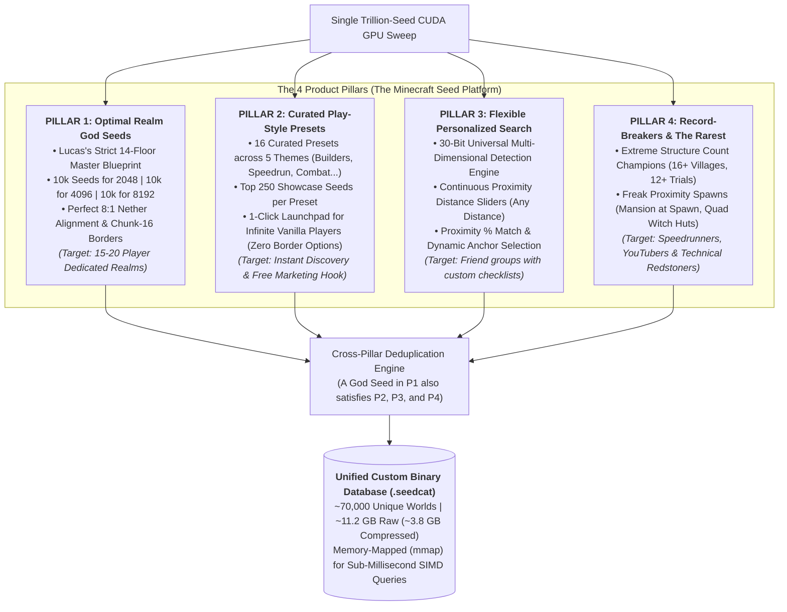
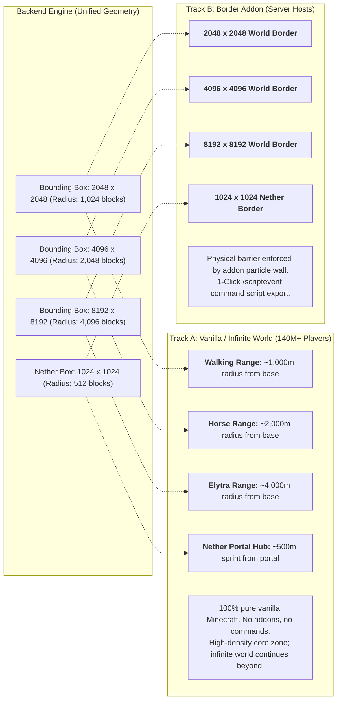
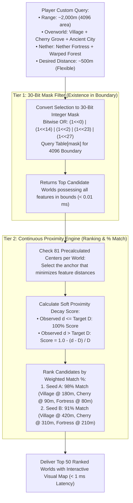
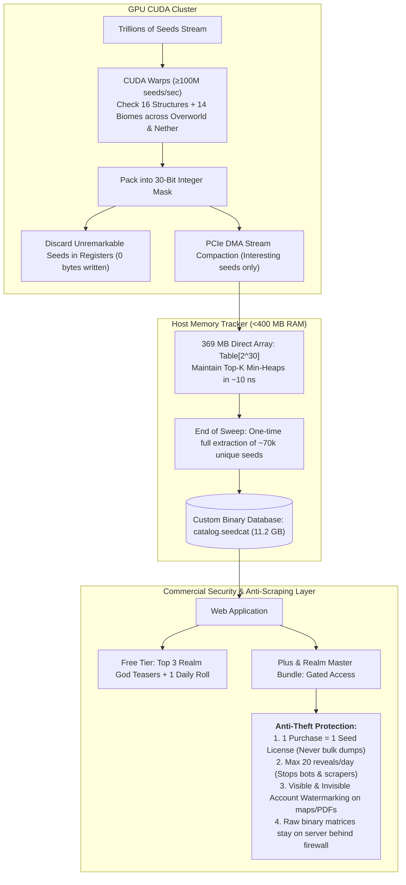

# System Architecture & Flow Diagrams: Minecraft Seed Searcher

This document contains the visual architecture diagrams for the **Minecraft Seed Searcher** public platform, custom database engine, and GPU trillion-seed harvest pipeline.

---

## Diagram 1: The 4-Pillar Product Ecosystem

---

## Diagram 2: Dual-Mode Experience (Infinite Vanilla Worlds vs. Bordered Realms)

---

## Diagram 3: The 30-Bit Universal Bitmask & $O(1)$ Search Engine

---

## Diagram 4: GPU Trillion-Seed Harvest & Anti-Leak Commercial Model

