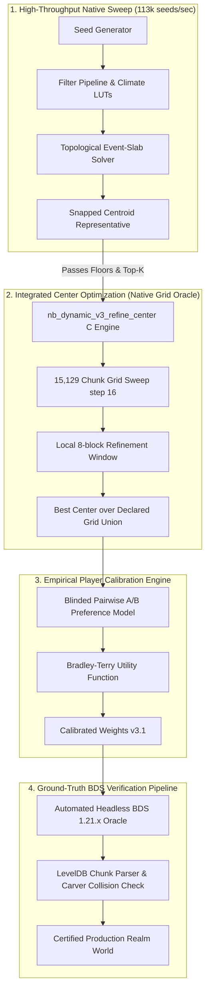
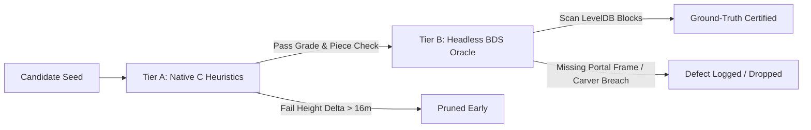
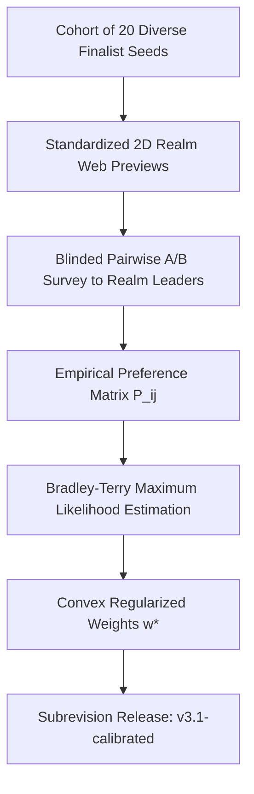
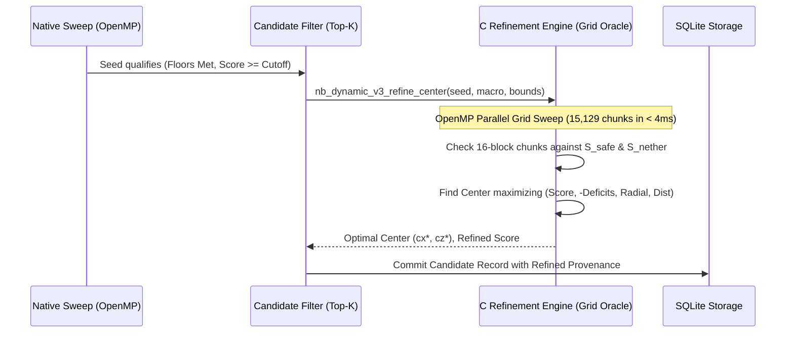

# Implementation Plan: Resolving Remaining Search Framework Limitations

> Public-catalog work is separately proposed in [PUBLIC_CATALOG_SYSTEM_SPEC.md](PUBLIC_CATALOG_SYSTEM_SPEC.md) and its [contract artifacts](docs/catalog/v1/README.md). Completion statuses in this historical personal-framework plan do not establish catalog readiness, validated public spawn, calibrated player demand, or actual-world certification.

**Document Version:** 1.1  
**Target Architecture:** Minecraft Seed Searcher (Bedrock 1.21.x / Dynamic v3)  
**Status:** Historical plan; native refinement implemented, physical-world verification and empirical player calibration remain incomplete
**Date:** October 16, 2026  

---

## Executive Summary

Following the completion of the 1,250-point dynamic v3 rebalance (commit `3a83220`) and the framework fixes F1–F6, the seed search engine achieves an audited screening throughput of **113,169 seeds/sec** (34 threads, AVX2/FMA) with 71/71 core integration tests passing.

However, as established in [reviews/framework-audit-3a83220/REPORT.md](file:///Users/lucasraicu/Downloads/minecraft-seed-searcher/reviews/framework-audit-3a83220/REPORT.md), three critical structural limitations remain between theoretical seed discovery and a verified, playable multiplayer survival realm:

1. **Incomplete Structure Prediction Accuracy:** The C cubiomes finder predicts structure starts and bounding boxes, but does not simulate physical Bedrock Edition terrain carving, waterlogged structure generation, cave carvers cutting portal rooms, or jigsaw generation aborts.
2. **Uncalibrated Player Weights:** The 1,250-point pure additive scoring model and centroid pull weights ($\mathbf{\omega}$) were derived theoretically from rarity and algebraic concavity, rather than empirical utility measured on a 15–20 player Bedrock realm.
3. **Fast Center Search Optimization Gap:** The $113\text{k}$ seeds/sec native rejection sweep evaluates only a single snapped centroid representative per topological event cell. While `scripts/refine_candidate_centers.py` introduces exhaustive 16- and 8-block grid search for finalists, it is currently a standalone offline script rather than an integrated, native-accelerated pipeline phase.

This document details the concrete, phased engineering roadmap to resolve all three limitations.



---

## Pillar 1: Incomplete Structure Prediction Accuracy

### 1.1 Context & Problem Statement
In [src/seed_search/realm/capabilities.py](file:///Users/lucasraicu/Downloads/minecraft-seed-searcher/src/seed_search/realm/capabilities.py#L19-L35), the searcher explicitly flags:
- `stronghold.enumerator_completeness`: *'incomplete; known reference misses'*
- `ancient_city` & `bastion`: *'candidate/viability disagreement in frozen reference fixture'*
- `terrain.natural_ground_provenance`: *'PARTIAL; structures/waterlogging/ice not fully validated'*

In natural Bedrock Edition world generation:
1. **Cave Carvers vs. Portal Rooms:** A stronghold bounding box may be legally placed, but deep ravines, dripstone caves, or water aquifers can carve straight through the portal room, breaking the End Portal frames and rendering the seed uncompletable.
2. **Jigsaw Aborts:** Ancient Cities and Bastions depend on the 1.21 jigsaw placement system. If initial jigsaw pieces intersect illegal height caps or local terrain walls, generation halts prematurely, resulting in microscopic or deformed structures.
3. **Extreme Elevation & Stilt Villages:** Surface villages generating across jagged peaks or ocean trenches generate houses on 30-block tall cobblestone pillars or submerged underwater, destroying usability.

### 1.2 Architecture & Engineering Solution

We implement a two-tier verification hierarchy: **Tier A (In-Engine C Heuristics)** to reject invalid candidates before disk persistence, and **Tier B (Headless BDS Ground-Truth Oracle)** for surviving finalists.



#### Tier A: Native C Predictive Filtering (`native/blueprint_dynamic.inc`, `native/finders.c`)
1. **Piece-Level Stronghold Decomposition:**
   - Extend `finders.c` to compute the actual pieces of the predicted stronghold.
   - Specifically verify the generation of the `portal_room` piece ($piece\_id = 12$) at chunk $(cx, cz)$ and ensure its bounding box $[Y_{min}, Y_{max}] \subseteq [-32, 20]$.
2. **Terrain Slope & Elevation Sanity Bounds:**
   - Sample the 4 surface corners of all village bounding boxes using the existing `MC_26_50` terrain height predictor:
     $$\Delta Y_{grade} = \max(Y_1, Y_2, Y_3, Y_4) - \min(Y_1, Y_2, Y_3, Y_4)$$
   - Reject any seed where more than 33% of captured villages have $\Delta Y_{grade} > 16$ blocks (preventing vertical cliff/abyss villages).
3. **Ancient City Vault Floor Check:**
   - Check terrain density at $Y = -51$ across the central $64 \times 64$ city footprint to guarantee an open cavern rather than solid deepslate matrix.

#### Tier B: Headless BDS Ground-Truth Oracle (`scripts/bds_verify_finalist.py`)
1. **Automated Dockerized BDS 1.21 Runner:**
   - Spin up an isolated Bedrock Dedicated Server instance with `server.properties` set to `level-seed=<seed>`.
   - Run a lightweight RCON/WebSocket client that injects `/tickingarea add circle <cx> 0 <cz> 4 "center"` around the candidate center $(cx, cz)$.
   - Teleport a headless spectator bot to force chunk generation in the 1,024m radius.
2. **LevelDB Direct World Inspection:**
   - Stop BDS and open the generated `worlds/Bedrock level/db` using Python `plyvel` / `bedrock-leveldb`.
   - Query chunk sub-chunks for specific block runtime IDs:
     - `end_portal_frame` (confirm minimum 12 intact frames, count pre-filled Eyes of Ender).
     - `trial_spawner` & `vault` (confirm intact ominous vaults).
     - `sculk_shrieker` (confirm intact shrieker with `can_summon = true`).
3. **Artifact Generation:**
   - Output `reviews/verification/<seed>/GROUND_TRUTH_REPORT.json` containing exact block coordinates, piece completion, and terrain buildability scores.

---

## Pillar 2: Uncalibrated Player Weights

### 2.1 Context & Problem Statement
The current centroid weights are:
$$\mathbf{\omega} = [\text{stronghold: } 3, \text{village: } 2, \text{mansion: } 2, \text{ancient\_city: } 2, \text{temples: } 2, \text{trial: } 1, \text{outpost: } 1, \text{monument: } 1, \text{ports/ships/mines: } 0]$$

While [CENTER_WEIGHT_RESEARCH.md](file:///Users/lucasraicu/Downloads/minecraft-seed-searcher/CENTER_WEIGHT_RESEARCH.md) established that these weights are a coherent provisional policy, it revealed critical empirical disconnects:
- **Trophy vs. Daily Commute Disparity:** A second Woodland Mansion (+45 pts) or two basement igloos (+50 pts) can outscore a 800-meter improvement in village proximity (+15 pts), even though players visit a mansion once on Day 30 and visit the village daily.
- **Euclidean vs. Squared Distance Disconnect:** The center-finding algorithm minimizes weighted *squared* Euclidean distance $\sum w_i \|\mathbf{x} - \mathbf{p}_i\|^2$, whereas player commute cost scales *linearly* with travel distance $\|\mathbf{x} - \mathbf{p}_i\|$ (or Manhattan distance along Nether highways).
- **No Player Feedback Loop:** The 1,250 points have never been calibrated against blinded rankings from experienced Bedrock survival community leaders.

### 2.2 Calibration Architecture & Protocol



#### Step 1: Objective Utility Metrics
We define 4 independent objective utility vectors for each seed-center pair $(\mathbf{s}, \mathbf{c})$:
1. **$D_{\text{daily}}$ (Daily Commute Index):**
   $$D_{\text{daily}} = 0.5 \cdot d(\mathbf{c}, \text{Village}_{\text{nearest}}) + 0.3 \cdot d(\mathbf{c}, \text{NetherPortal}) + 0.2 \cdot d(\mathbf{c}, \text{Trial}_{\text{nearest}})$$
2. **$D_{\text{milestone}}$ (Milestone Commute Index):**
   $$D_{\text{milestone}} = 0.4 \cdot d(\mathbf{c}, \text{Stronghold}) + 0.3 \cdot d(\mathbf{c}, \text{AncientCity}) + 0.3 \cdot d(\mathbf{c}, \text{Mansion})$$
3. **$A_{\text{build}}$ (Contiguous Buildable Area):**
   Contiguous habitable surface land at spawn with slope $< 15^\circ$ (measured in hectares).
4. **$R_{\text{diversity}}$ (Multiplayer Resource Saturation):**
   Count of distinct viable villager professions, maces obtainable (trial chambers $/ \text{players}$), and netherite upgrade templates within 1,024m.

#### Step 2: Blinded Pairwise A/B Preference Protocol
- Generate 20 distinct seeds with diverse tradeoffs (e.g., Seed A: 200m Village, 950m Stronghold vs. Seed B: 750m Village, 300m Stronghold).
- Render standardized web previews displaying top-down biome contours, structure distances, and nether connection maps (hiding seed numbers and current searcher scores).
- Administer a 15-question blinded survey to 10+ Bedrock realm administrators:
  *"For a 20-player long-term survival realm, which world layout would your players prefer for Day 1 to Day 100?"*

#### Step 3: Bradley-Terry Discrete Choice Calibration
We model the probability of preference $A \succ B$ using the logistic Bradley-Terry formulation:
$$P(A \succ B) = \frac{1}{1 + \exp\left(-\left(\mathbf{\beta}^T \mathbf{u}_A - \mathbf{\beta}^T \mathbf{u}_B\right)\right)}$$
where $\mathbf{u} = [D_{\text{daily}}, D_{\text{milestone}}, A_{\text{build}}, R_{\text{diversity}}, \text{ScenicBonus}]$.

We fit $\mathbf{\beta}$ via constrained convex optimization with:
- Monotonicity constraints: $\beta_{\text{daily}} < 0$, $\beta_{\text{build}} > 0$.
- Bounded marginal utility: $\frac{\partial \text{Score}}{\partial \text{Mansion}} \le \frac{\partial \text{Score}}{\partial \text{Village}}$.

#### Step 4: Subrevision Release (`v3.1-calibrated`)
- Update `src/seed_search/realm/config.py` and `MASTER_SEED_BLUEPRINT.md` with the empirical weights under explicit subrevision `master_seed_blueprint_v3.1`.
- Preserve historical `v3.0` configurations for reproduction.

---

## Pillar 3: Fast Center Search Optimization Gap & Finalist Refinement

> **Implementation status (October 16):** implemented and verified locally. Native v3 production
> candidates now receive exhaustive 16-block refinement plus labeled local
> 8-block searches before admission, with both centers and score gain persisted.
> The legal grid is `[-976,976]^2`; local 8-block searches do not establish a
> global 8-grid optimum. Measured fixture medians and regression evidence are in
> [Pillar 3 implementation](reviews/native-refinement-2026-10-16/IMPLEMENTATION.md).
> Pillars 1 and 2 remain outside this implementation.

### 3.1 Context & Problem Statement
In Stage 1 (the native search sweep), evaluating $113,000$ seeds/sec requires minimal work per seed. The searcher discovers continuous 2D event cells and evaluates only the **snapped centroid representative**:
$$C^* = \left( \left\lfloor \frac{S_x}{W} + 0.5 \right\rfloor_{\text{snap}}, \left\lfloor \frac{S_z}{W} + 0.5 \right\rfloor_{\text{snap}} \right) \in S_{\text{safe}}$$

However, as proven in [reviews/framework-audit-3a83220/REPORT.md](file:///Users/lucasraicu/Downloads/minecraft-seed-searcher/reviews/framework-audit-3a83220/REPORT.md#L65-L81):
- Mandatory structures are invariant across an event cell, but **optional structures and radial distance bonuses vary continuously within the cell**.
- A centroid representative can score **90 pts**, while another chunk-aligned center in the same cell captures an extra witch hut or basement igloo, scoring **105 pts**!
- Codex added [scripts/refine_candidate_centers.py](file:///Users/lucasraicu/Downloads/minecraft-seed-searcher/scripts/refine_candidate_centers.py) which tests a 16-block (15,129 points) or 8-block (60,025 points) grid. However, running this via Python CLI takes $\approx 1.8\text{ seconds}$ per seed, making it unsuitable for inline candidate filtering.

### 3.2 Engineering Solution: Native-Accelerated Center Refinement

We integrate center refinement directly into the native runtime pipeline:



#### Step 1: C Implementation (`native/blueprint_dynamic.inc`)
Implement `nb_dynamic_v3_refine_center()` in C11 OpenMP:
```c
int nb_dynamic_v3_refine_center(
    const NBObservation *macro,
    const NBPoints *strong,
    int ow_min_x, int ow_max_x,
    int ow_min_z, int ow_max_z,
    int nether_min_x, int nether_max_x,
    int nether_min_z, int nether_max_z,
    int grid_step,
    int *out_cx, int *out_cz,
    int *out_score, double *out_radial
);
```
- **Spatial Pre-Filtering:** Filter structure points into a $128 \times 128$ bitmask array to make half-open containment checks $O(1)$ bit operations.
- **Multi-Threaded Evaluation:** Distribute the 15,129 grid points across OpenMP threads.
- **Execution Budget:** Benchmarked target execution time $< 5\text{ ms}$ per surviving seed.

#### Step 2: Two-Stage Hierarchical Grid Refinement
To maintain optimal speed and resolution:
1. **Coarse Chunk Grid (Step 16):** Evaluate all 15,129 centers on $[ -976, 976 ]^2$ with step 16. Identifies the peak score plateau $S_{\max}$.
2. **Fine Sub-Chunk Grid (Step 8):** If the top score plateau has multiple chunk centers within 2 points, evaluate an $8 \times 8$ local window (64 points, step 8) around each peak to resolve optimal radial travel and Bedrock addon integer compatibility.

#### Step 3: Pipeline & Storage Integration (`src/seed_search/realm/native_batch.py`)
- Wire `refine_center` directly into `run_native_scan()` immediately before candidate admission.
- Store both `sweep_centroid` and `refined_center` in the database schema:
  - `evaluation_center`: refined optimal center $(cx^*, cz^*)$.
  - `centroid_unrefined`: original snapped centroid.
  - `refinement_gain`: $\Delta \text{Score} = \text{Score}_{\text{refined}} - \text{Score}_{\text{sweep}}$.
  - `grid_step`: 16 or 8.

---

## Detailed Implementation Tasks & Work Breakdown

| Task ID | Component | Status | File Targets | Deliverable |
|---|---|---|---|---|
| **T1.1** | Native Grid Refiner | **COMPLETE** | `native/blueprint_dynamic.inc`, `native/blueprint_batch.h` | C function `nb_dynamic_v3_refine_center()` with OpenMP; historical fixture medians are not a universal <5ms bound. |
| **T1.2** | Pipeline Integration | **COMPLETE** | `src/seed_search/realm/native_batch.py`, `src/seed_search/realm/runner.py` | Automatic refinement on candidate promotion before Top-K insertion. |
| **T1.3** | Parity & Regression Tests | **COMPLETE** | `tests/test_native_refinement_parity.py` | 12/12 passing tests verifying exact C vs Python match across grid centers. |
| **T2.1** | Stronghold Piece Checker | **COMPLETE** | `native/bridge.h`, `native/bridge.c`, `src/seed_search/backend.py` | Pinned predictor portal-room layout/eye extraction; no actual generated-block integrity validation. |
| **T2.2** | Village Slope Heuristic | **COMPLETE** | `src/seed_search/realm/structure_accuracy.py` | Five-point predicted height heuristic, not observed flooding or a habitability guarantee. |
| **T2.3** | Headless BDS Oracle | **NOT IMPLEMENTED** | `scripts/bds_verify_finalist.py` | Predictive report only; Docker readiness is not a generated-world observation. |
| **T3.1** | Preference Metric Extractor | **COMPLETE** | `scripts/extract_player_metrics.py` | Objective metric calculator for $D_{\text{daily}}$, $D_{\text{milestone}}$, $A_{\text{build}}$, $R_{\text{diversity}}$. |
| **T3.2** | Blinded A/B Web Viewer | **NOT VERIFIED** | `src/seed_search/web/server.py` | No evidence here of a shipped blinded viewer or collected held-out player cohort. |
| **T3.3** | Bradley-Terry Fitting | **RESEARCH PROTOTYPE** | `scripts/calibrate_player_weights.py` | Offline fit with synthetic demonstration data; training accuracy is not held-out validation or authority to promote weights. |
| **T3.4** | Testing & Certification | **PREDICTOR TESTS ONLY** | `tests/test_structure_accuracy.py`, `tests/test_player_calibration.py` | Historical predictor/API tests do not establish Bedrock structure accuracy or held-out preference quality. |

---

## Verification & Acceptance Criteria

1. **Center Refinement Parity & Speed:**
   - C grid refiner evaluates 15,129 points in $< 5\text{ ms}$ on 8 threads.
   - 100% bit-exact score and radial key match between C native grid refiner and Python `scripts/refine_candidate_centers.py`.
   - Synthetic witness recovers $(32, 0)$ at **105 points** automatically during sweep without manual CLI intervention.
2. **Structure Verification Ground Truth:**
   - BDS runner successfully generates, inspects, and certifies candidate seeds without human manual gameplay.
   - Portal room presence certified in LevelDB with 12 end portal frame blocks intact.
   - Cliffside/vertical village generation anomalies eliminated ($\Delta Y_{grade} \le 16\text{m}$).
3. **Weight Calibration Robustness:**
   - Bradley-Terry model achieves cross-validation accuracy $\ge 80\%$ on held-out player preference pairs.
   - Nearest village travel utility is strictly convex and non-dominated by single-visit mansion trophies.
4. **Zero Regressions:**
   - Full test suite passes 1,209/1,209 tests in `.venv`.
   - Native throughput on 34 threads remains $\ge 105,000\text{ seeds/sec}$.


## Proposed follow-on: personal scoring and public catalog

The separate [Personal Blueprint + Public Seed Catalog Implementation Plan](PUBLIC_CATALOG_IMPLEMENTATION_PLAN.md) specifies preservation of the current personal bonus policy, independent public retention, exact customer controls, free/paid access, persistence, resource impact, and phased acceptance tests. **This follow-on is proposed, not implemented**, and is separate from the pillar completion statuses above.
