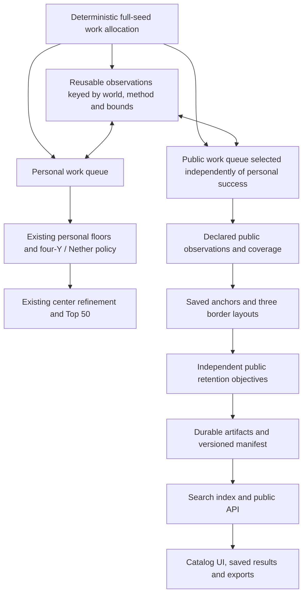

# Personal search and public catalog: proposed system specification

Original design date: 2026-10-17. Public activation, exact game-build acceptance,
GPU catalog kernels, billing and hosting remain gated. A private research runtime
now implements the query/storage vocabulary described below.

Implementation update2026-10-20: the private pilot implements separate segmented
SQLite/artifacts, selective indexes, a pinned query/detail API and a Catalog tab
in Sweep. It contains200 natural worlds/48,600 layouts; [measured results](reviews/catalog-private-pilot-2026-10-20/REPORT.md)
include raw-fact/index parity and recovery checks. Browser QA is deferred at Lucas's
request. See [the private guide](docs/catalog/PRIVATE_PILOT.md). Four-pillar screens,
versioned product gates and five offline Origin-circle research lists are now
implemented, together with an opt-in CPU campaign handoff for NEW native scans
and an explicitly drained independent queue. The running personal sweep is not
attached or restarted. See [usage and recovery](docs/catalog/FOUR_PILLARS_AND_HARVEST.md).
This does not change v1 query semantics or activate public/billing capabilities.

The [reconciled master plan](docs/catalog/proposals/Public_Catalog_Master_Plan.md) defines the four product
pillars, independent branch/checkpoint contract and staged roadmap. This document
and v1 artifacts retain current query/storage authority; later geometry, feature,
score and entitlement changes require explicit versioned contracts.

This is the current consolidated proposal. It replaces conflicting public-catalog details and speculative scale claims in the earlier catalog/GPU drafts. [MASTER_SEED_BLUEPRINT.md](MASTER_SEED_BLUEPRINT.md) remains the personal policy authority. Exact contract data is in [docs/catalog/v1](docs/catalog/v1/README.md).

## 1. The organizing decision

**Store observations of a world once. A starting location and border size define a view over those observations. A category or subscription never creates another copy of the world.**

There are five concepts:

| Concept | Identity | Example |
|---|---|---|
| World | Edition + exact generation build + world settings + full seed | One Bedrock world |
| Observation set | World + predictor/extractor/registry/method revisions | Structure coordinates and sampled biome data |
| Anchor | World + dimension + integer block X/Z | Origin, a settlement candidate, or an established spawn reference |
| Layout | Anchor + border side + observation/geometry revisions | The 4096 square centered at `(768,256)` |
| Index row | Catalog snapshot + segment + local layout row | A rebuildable record used to answer searches quickly |

We do **not** save every block of the generated world. We save exact predicted structure-start coordinates, explicitly sampled biome observations, selected evidence, coverage, and derived summaries. Dense maps or actual block inspections require additional scoped work. Knowing a structure start does not establish its full physical footprint.

## 2. The two branches



### Personal branch

Keep `dynamic-envelope-2048-v3`, all current floors, zero miss budget, 1250-point scoring, four-Y biome requirements, Nether policy, center refinement, deterministic ranking, and Top 50. The active config has 13 hard-floor keys; historical documents inconsistently call this 14. Freeze the actual config and implementation identity, not a prose count.

The personal branch keeps its existing narrow bounds and early exits. A personal rejection ends personal work only. A public result must undergo the complete frozen personal evaluation before entering the personal leaderboard. Personal scoring and public preference percentages are not comparable.

### Public branch

Public extraction has no personal mansion, stronghold, Nether, or 13-family palette baseline. It obtains the observations required by its declared candidate population and retention objectives. One objective failing does not stop another objective that remains possible.

Use a lazily populated observation workspace with explicit field and coverage status. Share only identical observations: world/settings, model/build, dimension, method, sampling coordinates, and applicable bounds must match. Do not reuse personal Nether-clamped bounds as public bounds, or treat a personal rejection receipt as a public inventory.

A campaign explicitly defines which seeds receive public evaluation. It may use an independent stable-hash sampling rate to fit the compute budget; record sampled-out versus fully evaluated separately. Never define the public population as personal survivors. The reference sample is chosen before relevance rejection within the declared public population.

The reference implementation fully extracts its small reference cohort before retention. Production pruning needs a valid bound showing every remaining public objective is impossible. Sparse biome misses and poor small-border results are not safe reasons to reject a larger-border candidate.

## 3. Exact starting modes and border geometry

### Starting modes

| Mode | Center rule | Initial availability |
|---|---|---|
| Recommended settlement | Evaluate all 81 saved grid centers; choose the best eligible one for this request | Default once the public extractor is ready |
| Origin | Center fixed at `(0,0)`; this is already one of the 81 grid locations | Advanced option |
| Spawn | Center fixed at an evidence-scoped spawn reference; never move it to improve density | Gated pending accuracy/cost validation |

The grid is the Cartesian product of `[-976,-768,-512,-256,0,256,512,768,976]`. Origin and settlement can share an anchor record with two roles. An established spawn can add an 82nd unique coordinate, or another role at an existing coordinate. The result is the best **saved** center under a request, not an optimum over every coordinate in the envelope.

There is no permanently selected universal densest location. The Compact starter preset favors nearby selected features; a biome-focused request can choose a different center in the same world. A subscription does not alter this algorithm.

### Exactly three border sizes

The supported design sizes are **2048, 4096, and 8192 blocks per side**. No additional expansion size is part of this proposal. The selected anchor is also the border center; independently positioned base and border centers are deferred.

| Side | Center to edge | Playable block columns | Nominal envelope for all 81 centers | Tile-aligned envelope side |
|---|---:|---:|---:|---:|
| 2048 | 1024 | 4,194,304 | 4000 | 4096 |
| 4096 | 2048 | 16,777,216 | 6048 | 6144 |
| 8192 | 4096 | 67,108,864 | 10144 | 10240 |

For center `(cx,cz)` and side S, use the half-open square `[cx-S/2,cx+S/2) × [cz-S/2,cz+S/2)`. For a Near base radius R, additionally require `dx²+dz² <= R²`. Thus every matching start/witness remains inside the selected border. An Anywhere inside border condition uses the square alone and has no radius parameter.

The nominal maximum envelope is `[-5072,5072)` on both axes. With 256-block storage tiles, the complete aligned envelope is `[-5120,5120)`: 40 × 40 tiles. Spawn layouts require their own coverage checks; a spawn outside the grid domain does not automatically fit this envelope. Schedule bounded extra tiles or keep that spawn layout unavailable.

Changing border size does not change seed generation, move a structure, or widen a fixed 512-block request. It changes which stored coordinates are included. Actually applying a planned border in Minecraft requires a supported in-game setup; the catalog setting does not install it.

### Example: coordinate reuse

Illustrative village at absolute block `(1400,100)`:

| Layout | Inside border? | Within 512 of anchor? |
|---|---|---|
| Origin, side 2048 | No | No |
| Origin, side 4096 | Yes | No |
| Settlement `(976,0)`, side 2048 | Yes | Yes |

The third center is on the pilot grid. Its offset is `(424,100)` and squared distance is 189776. The village is stored once; all three answers follow from integer geometry.

## 4. Spawn: estimated world spawn is viable; activation remains gated

Current `src/seed_search/backend.py:capabilities()` lists spawn as unsupported. The vendor exposes `estimateSpawn` and `getSpawn`; its header describes the detailed routine as slow and potentially inaccurate. The fast routine now has independent default-world-spawn accuracy evidence for one pinned Bedrock build; neither routine establishes exact initial-player placement or an enabled application capability.

A bounded local probe timed 32 estimated-spawn calls and eight detailed calls with `applySeed` included, using the pinned MC_26_50 source compiled with `-O3`. Medians were approximately **3.04 ms estimated** and **3.35 ms detailed** on the local iMac. See [the timing artifact](reviews/catalog-system-spec-2026-10-17/spawn-timing.json) and [probe source](reviews/catalog-system-spec-2026-10-17/spawn_timing.c). These are small serial routine timings, not correctness tests, BDS verification, GPU results, or server throughput measurements.

That cost suggests researching a predictor on the public-evaluation population rather than running BDS for every raw input. It does not justify charging this work to every seed in a multi-billion personal rejection sweep. For example, 3 ms × one million candidates is roughly 3000 CPU-seconds before parallelism.

The [independent BDS audit](reviews/spawn-validation-2026-10-17/README.md) compared 100 predetermined random seeds plus eight edge/example seeds against BDS **1.26.52.3**. `estimateSpawn` was within **11.32 horizontal blocks in all 108 worlds** (median 8.94, p95 11.31); persisted metadata agreed in all worlds, and three controls without the observer pack matched. Its median `applySeed` + routine elapsed time was **3.83 ms** in this separate local sample. `getSpawn` had a larger observed tail (p95 17.49, maximum 30.53 blocks), so prefer `estimateSpawn` for the planned **Estimated spawn** anchor. These are observed errors, not universal bounds. The observed Y=32767 is a sentinel, not surface height.

Four client experiments produced zero actual joins: the RakNet path was unavailable and HTTP/NetherNet attempts stopped at identity/authentication. Exact initial-player placement remains unvalidated. Default world-spawn observations must not be relabeled as player-spawn evidence. Keep the production/runtime capability disabled until integration, coverage, version acceptance and complete-record cost checks pass; the accuracy result supports the estimated-anchor design now.

Proposed activation gate: compare at least 100 held-out seeds against a pinned Bedrock build/settings with observed world/initial-player references; report all errors, p50/p95/max displacement, latency, failure rate, and added coverage cost. Initial engineering target: at least 95% within 64 blocks of the explicitly chosen reference, and no more than 5% added CPU time per complete public record on the measured workload. The default-world-spawn accuracy portion passed in the audit above; actual-player observations and the complete-record cost portion remain unmet. These are proposed acceptance targets, not established error bounds or universal spawn guarantees.

If useful but approximate, enable a visibly labeled **Estimated spawn** mode with its reference semantics. Actual first-player placement remains a separate observed fact; do not relabel a predictor as verified. Keep an evidence-scoped observed-spawn mode where actual data exists. If the gate fails, ship Origin + Recommended settlement and leave spawn gated. No payment tier bypasses it.

If spawn-specific retention is enabled, compute the necessary spawn evidence before final public admission for that evaluated population. Merely enriching settlement winners with spawn afterwards does not protect worlds that are excellent only at spawn.

## 5. Complete public UI specification

Categories describe player intent; they are editable views of the same corpus. They are not storage partitions or hard requirements. These are starting product hypotheses, not measured market shares.

### Navigation and pages

| Page | Contents and actions |
|---|---|
| Catalog home | Exact version, populated snapshot/coverage summary, eight category cards, featured examples, recent additions, search entry |
| Search | Category/preset, world settings, center mode, border size, requirement/preference rows, matching-world list and map |
| World detail | Seed copy, selected layout, alternative centers, requested feature evidence, visible observations, favorites and report actions |
| Compare | Same-version selected worlds; per-request counts/distances/evidence; explain different centers/sizes |
| My library | Saved worlds, saved searches, alert state, exported reports; owner-scoped access |
| Plans and billing | Free versus Plus, monthly versus nonrenewing pass, usage/reset times, checkout and billing portal |
| Account | Identity, notification consent, usage, subscription state, cancellation, sign-out |
| Private operations | Separate admin surface: campaigns, CPU/GPU queues, leases, extraction failures, coverage, budgets, snapshots, restore checks |

Anonymous visitors may browse cached catalog examples and copy public seed details. Custom search/save/compare usage is associated with a free account for enforceable quotas. Do not expose personal scan-control routes on the public service.

### Eight category cards

| Category | Initial editable preset | What the category does not establish |
|---|---|---|
| General catalog | Balanced survival fallback; no prefilled requirements | A universal best-world rating |
| Builders | Prefer cherry near 256; village within 512; choose another desired biome freely | Flat land, large biome patches, or a base physically inside that biome |
| Rare & unusual | Prefer mushroom observations and a mansion | Measured rarity percentiles, rare loot, or certified intactness |
| Survival & realms | Prefer village, portal, plains/meadow nearby | Safe spawn or village habitability |
| Adventure | Prefer trials, ancient cities, pyramids | Loot or traversability |
| Biome explorers | Prefer editable groups of forest/plains, cherry/mushroom, mangrove/bamboo | Exhaustive physical biome inventory |
| Ocean exploration | Prefer monument in border and nearby shipwrecks | Island shape or verified coast/water access |
| Technical planning | Prefer outpost and swamp-hut locations | Functioning farms, spawn mechanics, or AFK-compatible geometry |

Exact initial rows/importance are in [ui_presets.json](docs/catalog/v1/ui_presets.json). All are preferred by default, visible, and editable. Players explicitly promote rows to Required. Choosing Builders does not filter out a useful world labeled Survival.

### Search screen layout

```text
Catalog | Builders | Rare | Survival | Adventure | Biomes | Ocean | Technical | My library
Bedrock [exact version]   Center [Recommended v]   Border [4096 x 4096 v]

Conditions panel                       Results                     Selected world map
Preset [Custom v]                      Matching worlds             Border + distance rings
Required  Village >=3  Near 512         [seed / match / evidence]    Origin / selected anchor
Required  Cherry OR Mushroom Near 256   [save] [compare]             Predicted starts
Preferred Trials >=2 Inside border     Alternative centers         Sampled biome observations
          Importance [High]            [copy seed]                 Coverage/evidence legend
[Add structure] [Add biome] [Search]    [world details]

No matches: show unchanged request and explicit relaxation buttons.
Usage: searches remaining and reset time. Upgrade does not change data accuracy.
```

Each row chooses Required/Preferred, structure count 1–16 or one/more acceptable biome families, Near base 256/512/1024 or Anywhere inside border, and importance Low/Medium/High = 1/3/5 for Preferred. Required rows are ANDed. Within a biome alternatives row, families are ORed. Unselected features are ignored. No arbitrary nested expressions or negative/absence conditions at launch.

Show unavailable features through a clear capability explanation or roadmap, never as an enabled control that silently does nothing. Version changes trigger capability revalidation; do not silently discard unsupported selected conditions. A 8192 square outline without full required coverage is not a complete 8192 result.

### Detail screen and important states

Detail tabs: Overview, Map, Features, Alternative locations, Evidence. Show exact version/settings, signed seed as a copyable decimal string, chosen anchor/border, absolute coordinates, relative distances, provenance, coverage, score contributions, and known spawn-to-base distance or Unknown. Map coordinates remain absolute across border changes. Selecting another center recomputes the selected layout view from saved summaries.

Handle loading, snapshot changed, missing coverage, unknown spawn, incompatible version, no matches, quota exhausted, export queued/failed, and expired Plus explicitly. Never relax Required predicates automatically. Saving a request preserves its meaning for later snapshots; the original result snapshot remains reproducible.

Do not show a technical model identifier as the main player label; use Predicted start / Sampled biome / Observed in game with precise supporting details available. A sampled Y=63 biome observation does not guarantee the surface biome or patch size.

## 6. Feature registry and exact request contract

The [feature registry](docs/catalog/v1/feature_registry.json) defines 14 structure filters and nine biome-family filters. Each declares stable ID, label, category tags, dimension, extractor/method, rule/scope support, variants, evidence limits, and activation status. IDs never depend on a UI label or vendor numeric biome position. A numeric biome-ID mapping is frozen per model/build using canonical names; unsupported mappings prevent activation.

Initial structures: village, trial chamber, ancient city, mansion, monument, outpost, desert pyramid, jungle temple, swamp hut, igloo, trail ruins, ruined portal, shipwreck, mineshaft. Initial biomes: cherry grove, mushroom fields, bamboo jungle, desert, badlands, snowy terrain, mangrove swamp, forest/birch, plains/meadow. Family memberships are explicit in the registry; they are not inferred from a player-facing category.

Public surface-oriented witnesses initially use one **world-aligned 64-block lattice at Y=63**. This is less work than unnecessarily repeating the personal four-Y palette scan for a public feature that only asks for this method. Future caves/peaks/surface-area capabilities add their own observations and planes; no current public field certifies actual surface shape.

Registry roadmap entries separately cover stronghold map information, igloo basement, actual base surface biome, flat build area, biome patch area, islands, structure-relative biome, structure clusters, portal room evidence, public Nether, and spawn. All generated runtime flags are false; the contract files do not certify existing extraction or launch support. Exact supported game-build IDs stay empty until capability acceptance.

[request_schema.json](docs/catalog/v1/request_schema.json) gives the exact JSON vocabulary; [example_request.json](docs/catalog/v1/example_request.json) is an illustrative request. Its build/snapshot IDs are placeholders and not live capabilities. Root fields include edition, exact game build/settings, snapshot, Overworld dimension, anchor mode, border side, evidence policy, fallback profile, and rows. Server validation additionally checks enabled capabilities, coverage and entitlements; JSON validation alone cannot do that.

Score Required predicates first, then the weighted utility specified in the player policy. Use integer structure fractions with LCM(1..16)=720720; a biome alternatives row earns its utility once. Public ties use the sum of normalized nearest distances floored to millionths via integer square-root, then unsigned seed-bit-pattern order, center X/Z and stable layout identity. Normalize Near base by R and Inside border by S/2, cap each term at 1; a missing eligible witness uses 1. This is an explicitly quantized distance tie rule, not an exact ordering of irrational means. Personal tie behavior is unchanged.

Unknown Required facts do not pass. Unknown Preferred facts contribute zero observed utility and remain labeled unknown, never confirmed absent. Retention requires the complete feature evidence needed for its objective. A score of 100 means selected preference targets matched; it does not certify a perfect seed.

## 7. Exact bounded retention proposal

The capacities below are **pilot defaults for reference experiments**, not guarantees of player coverage or permission to exceed storage budgets. A world is retained through the union of memberships, the stable-hash reference sample, and explicit pins. Keep public data if useful for either fixed-origin or recommended-center searches. Spawn adds independent objectives only after its gate passes.

For Recommended, rank each world using its best eligible grid layout; for Origin use only its fixed layout. Evaluate all declared scopes separately for each of the three border sizes. Canonical tie order ends with unsigned seed order and center X/Z.

| Objective family | List definition | K per list | World-slot upper bound |
|---|---|---:|---:|
| Structure count | 14 features × 4 scopes × 3 borders × 2 modes | 100 | 33,600 |
| Structure proximity | 14 features × 3 borders × 2 modes | 100 | 8,400 |
| Biome proximity | 9 families × 3 borders × 2 modes | 100 | 5,400 |
| Biome + landmark | 9 families × 4 landmarks × 3 borders × 2 modes | 50 | 10,800 |
| Play-style profiles | 16 profiles × 3 borders × 2 modes | 100 | 9,600 |
| Diversity | 256 cells × 4 profiles × 3 borders × 2 modes | 1 | 6,144 |
| Stable-hash reference | Across the declared evaluated population before relevance gates | 10,000 | 10,000 |
| Total before deduplication/pins | | | **83,944** |

Structure count admission needs at least one predicted start in the scope; rank count descending, nearest distance ascending, then canonical ties. Proximity admission needs a predicted start within 256 and ranks nearest distance, then in-border count descending. Biome proximity requires an eligible witness within 1024 and ranks nearest distance, then canonical ties.

Pair landmarks are village, trial chamber, monument, and desert pyramid. Both members must be around the same anchor: biome within 256, at least one landmark within 512; rank landmark count within 512 descending, biome distance, landmark distance, canonical ties. The exact template instances are derived from these pinned lists, never from an arbitrary growing set of live customer requests.

The 16 profiles and coefficient definitions are frozen in [public_policy.json](docs/catalog/v1/public_policy.json), using normalized counts/types/families in the border-clipped 1024 circle. Diversity bits are cherry, mushroom, bamboo jungle, snowy, village, trial, ancient city, monument in that circle. Bits require completed declared sampling; false means not observed. Keep each cell's top one world for Balanced survival, Biome variety, Compact starter, and Archaeology separately. No biome-absence guarantee follows from a bit.

The reference hash is SHA-256 with the pinned salt, full world identity, and an explicitly encoded tuple; rank digest bytes then full identity. Pins and saved snapshots are additional references. If spawn becomes a third mode with the same objective families, the upper bound becomes **120,916** before deduplication/pins. The old 70,384 bound no longer applies to this revised policy. Identical objectives may share computation, but do not accidentally merge different coverage/anchor semantics.

Workers retain the global K of each fixed list, deduplicating worlds before truncation, and use the same total rank for merge/replay. Do not change the predicate to keep a smaller server busy. A world can belong to many categories/objectives but its observation artifacts are stored once. Garbage collection requires no live memberships, pins or snapshot references.

Reference acceptance: at least 200 held-out supported requests across categories, distances, sizes, anchor modes and rare combinations. Measure nonempty preservation, top-10 unique-world recall, score regret, and failures per family; initial goals remain 95% nonempty preservation and 90% mean top-10 recall on a declared reference. Test smaller caps and later a larger-than-cap reference; 10,000 worlds cannot validate a capacity that retains all 10,000. These goals do not establish recall over the whole seed space or actual-game accuracy.

## 8. Where each coordinate is stored

Structures use absolute signed int32 block X/Z, optional Y, feature/variant, dimension, stable start identity and evidence. Chunk and tile coordinates are derived, not replacements for block positions:

```text
chunk_x = floor(x / 16); local_block_x = x - 16*chunk_x
tile_x  = floor(x / 256); local_tile_x = x - 256*tile_x
```

For X=-1, chunk=-1/local=15 and tile=-1/local=255. Truncation toward zero would be wrong. A border change never rewrites the stored coordinate.

Store biomes as world-aligned sampled grids, including the raw biome ID at every declared sample, not only the nine launch-family bits. This allows new family mappings over retained observations without another noise run. A 256 tile has 4 × 4 samples per Y plane at stride 64. Sample `(tile_x*256+ix*64,63,tile_z*256+iz*64)` uses `sample_index=iz*4+ix`. A tile directory maps this tile to a bundle offset, length, checksum and coverage status.

Example: sampled position `(-64,63,128)` is tile `(-1,0)`, local sample `(3,2)`, index 11. An arbitrary block between samples has no stored exact biome answer. A detailed predictor query can compute it later under the pinned model; the actual block still requires actual-world evidence.

Bundle many tiles/worlds in immutable artifacts rather than creating 1600 tiny files per world. Coverage maps use two bits per tile: unknown, partial, complete, failed. Coverage is method/feature scoped; a completed biome grid does not imply a complete structure inventory. Use a padded bitmap/map or sparse extension for spawn tiles outside the original envelope; never grow one unbounded rectangle simply because a spawn record is distant.

The seed lets us regenerate omitted detail, but regeneration costs compute and depends on a pinned compatible generator. A predictor cannot reproduce unsupported physical world details merely because the seed is known.

## 9. Storage layers and exact payloads

Use the [reference SQL schema](docs/catalog/v1/catalog_schema.sql) for the pilot control model and [storage_layout.json](docs/catalog/v1/storage_layout.json) for payload definitions. The schema is executable in an isolated test database; it has not been installed into the application.

| Layer | Contents | Mutability |
|---|---|---|
| Control metadata | Worlds, observation identities, anchors/roles, layouts, coverage maps, memberships, manifests, leases, users and entitlements | Transactional service-owned database |
| World observations | Packed structure coordinate columns, sampled biome tiles, evidence and tile directories | Immutable checksummed bundles |
| Layout summaries | Per-feature counts for three radii and full border; nearest distances; biome witness references; completion bits | Derived, versioned, rebuildable |
| Serving index | Column arrays, selected bitmaps, world/layout mapping, precomputed browse ranks | Immutable snapshot generations |
| User snapshots | Original query, chosen layout, score explanation, referenced observation/index revisions | Immutable result reference plus owner metadata |

Per layout, the proposed fixed feature payload is 364 bytes: structure counts `[14,4]` uint32 = 224; 14 nearest squared distances = 56; nine biome nearest distances = 36; nine witness references = 36; 92 completion bits padded to 12 bytes. A **400-byte illustrative layout budget** adds 36 bytes of mapping/header data. This is a sizing model, not a measured SQLite row size or compression ratio.

Nearest-distance fields are bounded to the selected border; `UINT32_MAX` marks no eligible known point. Completion bits distinguish missing observations from completed zero counts. Counts remain uint32; do not clip actual retention counts at 15 or 16. A biome's nearest eligible witness determines its presence in each radius, intersected with border membership. Store the witness reference so the UI can locate its evidence.

The maximum initial tile envelope has 160 × 160 samples at Y=63. At uint16 per biome ID, that grid is **51,200 bytes/world before compression**. Extra planes multiply this component; they are not implicitly part of public v1. A world has 81 × 3 = 243 initial layouts, with up to three extra spawn layouts when available. Roles at the same coordinate share summaries.

| Worlds | One-plane largest-envelope grid | 243 layout summaries at illustrative 400 bytes |
|---|---:|---:|
| 100 | ~0.005 GiB | ~0.009 GiB |
| 10,000 | ~0.477 GiB | ~0.905 GiB |
| 83,944 | ~4.003 GiB | ~7.599 GiB |
| 36 million | ~1716.6 GiB | ~3258.9 GiB |

These exclude structure coordinates, metadata/coverage, optional evidence, indexes, replication, working files and snapshots. Standard-format compression and summary sharing may reduce them; normalized row overhead may increase them. Millions of fully described large worlds are not automatically a three-GB catalog. Pause public ingestion at 80% of the proposed 20 GiB pilot budget; do not delete pinned user data or silently change retention to fit. Membership caps are bounds, not a requirement to fill them after storage pauses.

## 10. Fast lookups and options for our own database

### Recommended progression

1. **Pilot:** service-owned SQLite metadata, packed summary BLOBs rather than a row per feature/radius, and checksummed compressed observation bundles. Do not write a database row per rejected raw seed. This establishes correctness and bytes/world on the small corpus.
2. **Our specialized read layer:** immutable column segments and integer layout-row indexes over durable standard-format observations. We own the query predicates, summaries, bitmap strategy, ranking and schema. This is useful custom database work without first replacing every durability primitive.
3. **Choose a larger durable foundation if measured needs warrant it:** Parquet/Arrow plus DuckDB for snapshots/analytics, or an embedded KV store such as RocksDB for keyed incremental data. Keep transactional accounts/billing separate from bulk observations. A fully custom persistent engine remains an experiment behind the same contracts.

| Option | Suitable responsibility | Cost or limitation |
|---|---|---|
| SQLite + packed artifacts | Small reference/pilot, transactional metadata | Single writer per local database; large custom queries still need a serving design |
| DuckDB + immutable Parquet | Batch ingestion, columnar snapshots and analytic queries | Choose concurrency/deployment explicitly; it does not define our spatial/user semantics |
| Arrow/memory-mapped arrays + Roaring-style bitmaps | Our fast read-only layout filtering/ranking layer | Needs snapshot management and rebuilds; is not authoritative durability by itself |
| RocksDB + our indexes | Embedded keyed writes/lookups and local durable segments | Multidimensional filtering/ranking and secondary indexes remain our responsibility |
| Fully custom append-only column store | Maximum control over the exact workload | Must own encoding, checksums, crash recovery, compaction, migration, concurrency, backup and restore |

SQL is not a throughput class. [DuckDB documents Parquet column/filter pushdown](https://duckdb.org/docs/current/data/parquet/overview); [Arrow specifies reusable column layouts](https://arrow.apache.org/docs/format/Columnar.html). [SQLite has integer-coordinate spatial indexes](https://www.sqlite.org/rtree.html) for point/window experiments. [RocksDB documents atomic batches and keyed operations](https://github.com/facebook/rocksdb/wiki/Basic-Operations). These are implementation options, not evidence of sub-five-ms performance for this workload.

### Query path

1. Validate the request, supported snapshot/version/settings, capability state, account ownership and quotas. Resolve the category preset into visible rows before canonical hashing.
2. Select index segments/rows for the requested border and anchor role. Every subsequent predicate refers to this same layout-row identity.
3. Intersect coverage and Required predicates. Biome alternatives OR their family matches within a row; rows AND together. Keep unknown Required facts out of the match set.
4. Use count arrays and exact supported summaries for qualifying rows. A bitmap threshold can be a conservative prefilter: for count >=3, a >=2 bitmap is safe before exact checks; a >=4 bitmap is not.
5. Compute request-relative scores and deterministic tie keys for all eligible layouts, or use a separately proven bound-based algorithm. Verifying only an initial top-25 pool does not prove exact top-5.
6. Select each world's best eligible layout before truncating to the requested number of distinct worlds. Segment-local reductions must also deduplicate worlds before local Top K, then merge by the identical rank.
7. Load raw coordinate/biome tiles for the chosen world/map viewport only. Return seed, selected layout, contributions, coverage, and evidence. Rich map/report generation can be asynchronous.

Use at most 1,048,576 layout rows per immutable serving segment and uint32 local row IDs. Pair them with snapshot/segment ID; do not assume a single uint32 global ID covers billions of layouts. Memory-map/paginate only the needed arrays; do not assume the entire future catalog fits in RAM.

Cache keys include canonical request, snapshot, registry, observation, geometry, score revision and evidence policy. Precompute default category/profile browse results. Custom soft-preference queries may still be expensive at large scale; benchmark low-selectivity requests and keep explicit cost/usage limits. Initial target remains p95 <=1 second for five concurrent users on a declared-size corpus/hardware. No unsupported millisecond promise.

## 11. Payments, entitlements and saved data

The same categories, supported borders, observations, capability gates and score semantics apply to Free and Plus. Plus buys capacity and convenience. Pricing is a test hypothesis; billing remains disabled until the free beta and activation checks pass.

| Feature | Free | Plus monthly or 7-day pass |
|---|---|---|
| Price hypothesis | $0 | $4.99/month or $2.99 nonrenewing seven days |
| Searches/day | 20 | 200 |
| Rows/request | 3 | 12 |
| Worlds/request | 5 | 50, pagination within cap |
| Favorites | 10 | 200 |
| Saved-search alerts | None | 20, once-daily digest with explicit consent |
| Compare | 2 worlds | 5 worlds |
| Reports/day | None | 20 |
| Full seed sweeps or BDS certification | Not included | Not included |

Use a provider-hosted checkout and billing portal through a small billing adapter. Candidate provider: Stripe; [its subscription documentation](https://docs.stripe.com/billing/subscriptions/webhooks) describes asynchronous state updates. Verify [webhook signatures and handle duplicate/out-of-order events](https://docs.stripe.com/webhooks). Record provider/event ID uniquely, reconcile current provider state, update effective entitlement periods transactionally, and reserve usage/export slots idempotently. A success-page redirect is not independent proof of payment.

UI states: Free, checkout pending, Plus active through date, cancel-at-period-end, expired, and payment action needed. A paid nonrenewing pass creates a bounded entitlement interval. Subscription cancellation leaves access until the paid effective end; overlapping paid intervals are not accidentally shortened by a cancellation event. Refund/dispute updates are reconciled under an explicit provider-state policy.

Daily quotas use UTC calendar days and display the reset in the user's timezone. A well-formed authorized custom-search submission consumes one search slot, even on a cache hit; malformed or unsupported requests do not consume search quota but are still request-rate limited. An export reserves a slot once; retries reuse its idempotency key. Limits return understandable errors, not truncated predicates.

Favorites/exports pin reproducible result references. After expiry, preserve read/copy access to saved results; pause new Plus alerts and block new additions above the Free limit instead of deleting favorites. All library/export endpoints enforce ownership. Payment events and card processing remain isolated from compute workers; raw card details are not stored here.

### Service boundary and API

| Endpoint family | Access | Contract |
|---|---|---|
| `GET /api/catalog/capabilities`, `/categories` | Public | Populated build/settings IDs, enabled modes/features/borders, category/preset revisions |
| `GET /api/catalog/browse` | Public, rate limited | Cached category/profile examples pinned to a snapshot |
| `POST /api/catalog/search` | Free/Plus account | Validated request JSON; distinct worlds with selected layout, score contributions, evidence and snapshot-bound continuation token |
| `GET /api/catalog/worlds/{id}`, `/layouts/{id}/map` | Public, rate limited | Opaque IDs plus allowed snapshot; viewport-bounded observations, no arbitrary filesystem paths |
| `GET/POST /api/catalog/saved-searches`, `/saved-results` | Owner account | Canonical requests, immutable explanation snapshots, consent and favorites limits |
| `POST /api/catalog/exports` | Owner, Plus for new exports | Idempotent job creation; poll job and download owned completed artifact |
| `GET /api/account/usage`, `/entitlements` | Owner account | Effective plan, counters and reset/access timestamps |
| `POST /api/billing/checkout`, `/portal` | Owner account | Provider-hosted session, allowlisted offer ID, server-resolved prices |
| `POST /api/billing/webhook` | Provider signature | Idempotent event ingestion and current-state reconciliation |
| Personal scan/admin endpoints | Private service/network | Never included in the public router or accepted through search payloads |

Use explicit errors for unsupported capability, unavailable snapshot, incomplete requested coverage, exhausted quota and ownership failure. A continuation token binds request hash, snapshot, ordering and account/result cap. Normalize condition order and biome-alternative order before cache hashing; reject duplicate rows of the same predicate/rule rather than allowing accidental double preference weight. Required and Preferred versions of a feature may coexist with distinct targets. Keep original presentation order in the saved UI state, separately from canonical query identity.

## 12. Publication, recovery and fleet operations

Worker writes are local immutable batches. Write temporary artifact, flush/fsync, rename, ensure directory durability, then reference checksum/path in a transactional manifest. An external file and database row are not one automatic atomic commit. Reconcile orphan artifacts and missing references; fail rather than serving incomplete content as complete.

Use leased generation/fencing tokens, checksummed receipts, deterministic shard identity and idempotent ingestion. Publish an index generation only when all required segments and row mappings validate. Readers pin a snapshot; compaction creates a new generation rather than rewriting a live shared file. Test restart, stale workers, duplicate uploads, disk-full, compaction interruption, metadata/artifact restore and garbage collection with user pins.

Do not open one SQLite WAL file across both servers over a shared filesystem; [SQLite requires same-host WAL participants](https://www.sqlite.org/wal.html). Use a coordinator API and node-local spools, or a measured server database evolution. Back up metadata and referenced artifacts as one recoverable generation; target two durable observation copies, with actual storage costs counted.

Reported fleet: 192 CPU cores/eight V100s, 48 CPU cores/eight V100s, and the 18-core iMac. Verify physical cores/threads, RAM, SSD, interconnect, V100 form/memory, driver/toolchain and resource limits before allocating work. Existing production native interfaces have bounded thread/batch limits; do not simply request 192 native threads. Use measured bounded processes and avoid nested oversubscription.

Benchmark one V100, then 2/4/8 on one host and both hosts. Assign shards by measured service time and backpressure, not equal counts or stricter filters on the smaller server. Raw placement, public noise extraction, center summary construction and retention need separate counters. Public HTTP requests never launch raw sweeps or arbitrary commands.

Queue types: personal scan, public extraction, spawn experiment, verification, compaction/index build, map/export, alerts. Track raw seeds, publicly selected seeds, completed public observations, retained distinct worlds, observation bytes, layouts and useful matches. Personal-only remains available with public work disabled. A benchmark must distinguish raw rejection speed from complete public records/s and retained useful worlds/hour.

### Physical organization

```text
catalog-data/
  control/catalog.sqlite              service-owned pilot metadata and transactions
  objects/sha256/ab/<hash>             immutable bundles, tile directories, evidence
  snapshots/<snapshot>/manifest.json  hashes, revisions, segments and counts
  indexes/<snapshot>/<segment>/       column arrays, bitmap postings, row mappings
  workers/<node>/<campaign>/spool/    bounded unpublished batches and receipts
```

Paths are illustrative internal keys; users submit opaque IDs, not these paths. A world directory is not required: the manifest points to its record range within a batched object. World lookup resolves identity to observation references; tile lookup resolves `(observation,dimension,tile_x,tile_z,method)` to a bounded object range; search operates on layout summaries. Account/library records reference published identities and immutable snapshots.

For a custom format experiment, specify an eight-byte magic such as `SEEDCAT1`, schema and codec revision, endian marker, block type, row count, byte length, checksum and observation/index identity in each segment header. Blocks may hold structure columns, biome tiles, layout summaries or postings. Define truncation/unknown-field behavior and a standard-format export before using it as authoritative storage. The existing 64-byte one-center proposal does not meet this contract. Choose compression and block sizes from measurements, not a promised compression ratio.

## 13. Implementation order and acceptance

| Phase | Concrete work | Gate |
|---|---|---|
| 0 | Freeze personal fixtures/identity; correct public evidence labels | Personal behavior/order unchanged; heuristics never labeled actual-world certification |
| 1 | Registry, request parser, world/anchor/layout/coverage records and pilot persistence | Contract checks, seed round-trip, unknowns, boundaries, restart/restore |
| 2 | Complete CPU public extraction of 100 independently selected worlds at all three sizes | Measured stage CPU, bytes, coverage and all saved summaries; no personal gate |
| 3 | One-V100 raw/noise parity prototype; spawn accuracy/cost research alongside CPU reference work | Exact pinned predictor parity where claimed; recorded spawn error/cost before enabling its mode |
| 4 | 10,000-world reference, exact retention, query engine and corpus | Held-out query metrics; lower-cap selection experiments; larger-than-cap follow-up |
| 5 | All public pages, categories, detail/compare/library and capability/error states | UI-to-request-to-summary parity, ownership checks, declared latency target |
| 6 | Free beta across the eight categories | Observe real requests/unsupported needs, chosen maps, relocation tolerance, no-match causes |
| 7 | Measured storage/index choice and fleet expansion | Stable queues, durable receipts, tested restore and budget enforcement |
| 8 | Entitlements, checkout adapter, export/alert workers; paid launch as a separate activation | Billing event/idempotency/cancellation tests, service costs and demand established |

Proposed code ownership: `catalog/models`, `capabilities`, `extract`, `coverage`, `summaries`, `admission`, `profiles`, `store`, `query`, `snapshots`, `billing`, `exports`; a separate public router and `web-ui/src/catalog/` screens. Keep public workers and private personal admin routes separate at the service boundary. Implement the registry/schema/request model first; physical storage adapters must preserve those contracts.

Before declaring success, verify negative coordinates, half-open positive edges, clipped circles, all three sizes, same-layout conjunctions, alternative-center ranking, unknown versus zero, full int64 seeds/string JSON, versions/settings, stable distributed merges, overflow, snapshot cache invalidation, quota races and owner isolation. Benchmark meaningful natural positives as well as rejection-heavy cohorts.

## 14. What this specification verifies

The companion validator checks the generated contracts, registry/preset references, request schema/example, exact three-size configuration, retention capacity arithmetic, coverage/payload sizes, prototype SQL execution, seed identities, coordinate/tile formulas and independent anchor geometry using small examples. It is a specification consistency check, not an implemented catalog test or performance proof.

The spawn audit independently validated the estimated default-world-spawn reference on 108 BDS worlds and recorded local routine timings. Exact initial-player placement remains unvalidated after failed client-authentication experiments. The original specification work executed no public extractor, GPU kernel, full UI, checkout, database migration, live scan or public deployment. The subsequent October20 CPU reference tested two independently selected seeds; it is not a production campaign or game-world accuracy audit. Unknown demand, representative full extraction cost, compression and index latency remain explicit experiments.
