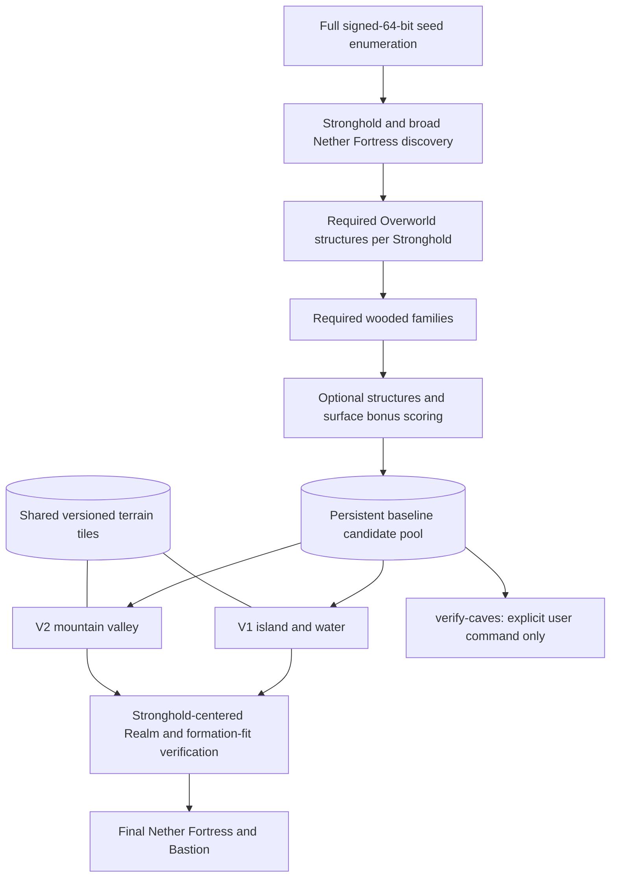

> **Current Realm target, 10 October 2026:** 4000×4000 discovery in both dimensions; 1536×1536 Overworld centered on the Stronghold; 896×896 Nether centered on exact Stronghold/8. See [COMPACT_SEARCH_IMPLEMENTATION_PLAN.md](COMPACT_SEARCH_IMPLEMENTATION_PLAN.md) and `config/realm.yaml`. The specifications, commands and measurements below describe earlier contracts; they do not override this target.

**Realm seed finder migration plan — implementation started 10 October 2026**

Status: implementation is authorized as an active goal on 10 October 2026. The immutable pre-change snapshot, measured profiles, new modules, and verification reports are in `runs/realm-implementation-2026-10-10/`. This plan implements the user's new baseline/V1/V2 contract and supersedes earlier target proposals for this new pipeline. Existing runs, evidence, and configurations remain historical records of their original contracts.

The user gave the implementation start signal and authorized parallel agents. Earlier hold statements below describe the historical planning stage and are superseded by this authorization. Final status and remaining verification limits will be recorded in `REALM_IMPLEMENTATION_RESULTS.md`.

**Agreed decisions — 9 October 2026**

- Initial discovery remains exactly 5000 × 5000 in each dimension, independently centered on its origin.
- The Overworld Realm and mandatory structure/biome evaluation square are both **2688 × 2688**, centered on each discovered Stronghold. They are never recentered on terrain or clipped to discovery bounds. This supersedes the earlier 2300 proposal; legacy 2304 configurations remain historical.
- Final Nether verification is **1024 × 1024**, centered on `(stronghold_x/8,stronghold_z/8)`, requiring Fortress AND Bastion. This supersedes earlier 900/928/1000 sizes for the new pipeline.
- The entire qualifying terrain formation must fit inside the Overworld border for an in-border result. Keep promising out-of-border results with their measured footprint, overflow, confidence, and minimum required larger Stronghold-centered square. No automatic border expansion.
- Docker Desktop is the selected BDS hosting approach on this Intel Mac. Native search workers remain on macOS; start with one BDS verification instance, not one server per search worker.
- Start worker measurements at 12–16 and test up to 36 logical threads on the 18-core host. Choose the default by sustained throughput and total memory measurements, not the highest worker count.
- Use approximately 25 GB as the working memory target and 30 GB as the combined scanner/Docker budget ceiling. Initial Docker VM allocation is approximately 4 vCPUs and 8 GB RAM, subject to measurement.
- Any terrain roughness is acceptable: no hard flatness or slope exclusion. Latest clarification removes V2's proposed flat/buildable-floor minimum as a rejection rule. A jagged, steep or uneven basin interior is acceptable when surrounding mountain geometry qualifies. Keep floor/buildability measurements descriptive; preserve V1's separately stated island-area requirement.
- Preserve the five custom wooded families below; do not invent a minimum patch-area requirement. A supported positive surface observation can establish family presence, with approximate observations retaining their evidence status.

Latest user revision: **retire the island-water-mountains variant (formerly V3) from the entire new implementation scope.** New search tasks, scoring, verification budgets, tests, commands, and result views cover V1 and V2 only. Historical legacy results remain readable; no existing source code is changed during this setup-only authorization.

Authorized setup update: Docker Desktop and official BDS 1.26.52.3 are installed in an isolated directory outside this repository. The follow-up investigation tested read-only streaming extraction, an audited restored-sky-marker persistence workaround, full chunk coverage in the measured regions, restart consistency and extraction speedups. See [investigation results](/Users/lucasraicu/Downloads/bedrock-verification-setup/investigation/INVESTIGATION_RESULTS.md). Production natural-ground masking, full geometry verification and seed-finder integration still require implementation and validation; the seed-finder implementation signal was received on 10 October 2026.

The expanded optimization/scaling mission is incorporated in the six delivery phases below. Detailed numbered sections describe components, not permission to start work.

**What will change**

| Area | Current system | Planned system |
|---|---|---|
| Discovery | Movable centers approximately -5000 to +5000, with geometry halos | Strongholds in exactly `[-2500,2500)` on both Overworld axes; initial Fortress discovery in the same-sized square in Nether units |
| Evaluation anchor | Selected terrain/border center | One separate baseline record per seed and qualifying Stronghold, with a 2688-square Realm centered on that Stronghold |
| Required structures | Stronghold and Fortress near the selected center; Bastion optional | Stronghold anchor plus Ancient City, Village, Trial Chamber, Mineshaft in its evaluation square; broad initial Fortress requirement; Fortress AND Bastion at the final Nether center |
| Biomes | Resource-family ranking bonus, at most five points | Two of five specified wooded families mandatory; 0/5/10/15 wooded bonuses plus the specified surface family/variant bonuses |
| Persistence | Completed seed jobs contain refined candidates; reports emphasize distinct-seed top lists | Every baseline-qualified seed/Stronghold pair committed before terrain, plus pending/rejected audit records and independent terrain tasks |
| Terrain | Three historical branches in one job sharing an eight-refinement budget | V1, V2 independently consume the same saved pool and have separate work/status/qualification/score records |
| Geometry evidence | Raw density; sea-level water proxy; 180 mountain/water rays | Actual ground/water data interface; 32 rays; connected components; relative relief |
| Cave work | Automatic Deep Dark hints at Y=-32 affect nomination ordering; cave families occur in the resource-weight denominator | No automatic underground biome-variety sampling or cave score; only explicit `verify-caves` |
| Verification | Chunkbase-supported predictions; actual-game checks optional | Prediction support remains labeled; pinned actual Bedrock generation is required for verified terrain and final Realm eligibility |

**Inspection findings and reusable code**

The entry point is `src/seed_search/cli.py`. `search.py` handles finite enumeration, multiprocessing, seed completion, and export. With landscape settings enabled, it dispatches to `landscapes.py`, which performs required-start screening, discovery, optional scans, structures-only inventory, nomination/refinement, terrain scoring, and resource scoring inside one seed job.

`structures.py` defines inclusive square membership, broad scans, movable center windows, and local prediction status. `config.py` hard-codes the old schema-4 sizes 2304/928 and the old mandatory structure policy. `storage.py` checkpoints seed-index results in SQLite with exact runtime/configuration identity. `reports.py` builds distinct-seed shortlists and maps. `terrain.py` and `native/bridge.c` estimate density-derived heights, coast connectivity, and surface biomes. `biomes.py` is the existing weighted resource inventory, not the new five-family policy.

Reuse signed-seed parsing, deterministic full64 enumeration, bounded multiprocessing, tested RNG handling, raw-placement/full-seed-viability separation, SQLite transactions, exact cache identities, report generation switches, regression fixtures, NumPy/SciPy connectivity, and map reuse. Retain the pinned vendor fork as a prediction provider where supported. Native rebuilding is necessary only if an owned native adapter actually changes, such as adding validated Buried Treasure exposure; it is not part of this planning turn.

The checkout already contains substantial tracked and untracked work. Preserve it. Do not reset, overwrite evidence, rewrite prior run configuration, or convert old checkpoints in place.

**Architecture**



**Evidence and failure semantics**

Represent support separately from result: `unsupported`, `unverified`, `validated_prediction`, and `actual_generation` describe providers/evidence. Result states include `present`, `confirmed_absent`, `unknown`, and `not_checked`. Attach edition, exact game/build identity, backend commit/binary hash, bounds, coverage, sampling resolution, timestamps, and evidence references.

Baseline processing states distinguish `prediction_qualified`, `verified_qualified`, `pending_verification`, and `confirmed_rejected`. An approximate negative, unsupported feature, unloaded chunk, finite-boundary contact, or missing result from the known incomplete Stronghold enumerator is unknown/deferred. It never becomes confirmed absence. Qualified prediction records are explicitly labeled and cannot be reported as actual-generation finalists.

The two-family rule passes when two distinct required families have supported positive surface detections. A sampled scan observing zero or one family has not proved absence: refine or retain pending status. Reject for zero/one families only when the provider and declared coverage support that conclusion. Keep observed family count and its possible upper bound separate, including score intervals for incomplete coverage. Likewise, an approximate terrain failure changes scheduling/near-match status, not permanent baseline eligibility.

Requiring an Ancient City does entail its Bedrock-specific generation validity check, which may consult underground biome data at a structure start. That necessary structure check is allowed. It must not trigger a cave-variety inventory, cave bonus, or an automatic `verify-caves` action.

**1. Shared configuration and version capabilities**

Add a new versioned profile, proposed schema 5, with explicit sections for discovery, baseline bounds/structures/biomes, optional bonuses, terrain providers, independent variants, final Nether verification, and manual caves. The intended target is stable Bedrock 26.52. Before creating the new run profile, verify the available stable release and report any newer release or unavailable target; pin the selected exact release/build and world-creation settings. Never silently migrate an existing run to a newer release. Never automatically choose `MC_NEWEST`, a preview, or an older model.

Add `capabilities.py` and a compatibility report command. Separate requested game version from predictor model, and require feature-specific evidence before treating a model mapping as validated. The current `MC_26_50` provider stays explicitly unverified for complete 26.52 generation until validated; it is not renamed 26.52. Read [REALM_GENERATOR_COMPATIBILITY.md](REALM_GENERATOR_COMPATIBILITY.md) for the current feature matrix and external dependency.

Keep legacy schema-3/4 handling behind its own pipeline dispatch. New validation must not mutate old geometry or mandatory structure meaning. Existing `search`, `rank`, `resume`, and `review` argument conventions remain available; add baseline/terrain/verification commands. The user's manual-only cave rule applies to every active profile: remove automatic cave-variety/Deep Dark nomination queries from legacy execution too, and report resulting policy/identity changes explicitly. Historical saved cave measurements remain readable. Old data stays readable, and incompatible resumes remain rejected. Migration creates a new run/schema rather than silently applying this contract to an old checkpoint.

Deliverable: capability matrix and configuration validation, with a large-search gate that requires this new policy's tests, measurements, and verification evidence rather than reusing the old readiness seal.

**2. Search boundaries**

Add `bounds.py` with a half-open rectangle type, exact width/area, integer iteration, contains/intersects, and provider-bound conversions. Discovery is exactly `[-2500,2500) × [-2500,2500)` separately in each dimension. For an anchor `(sx,sz)`, baseline bounds are exactly `[sx-1344,sx+1344) × [sz-1344,sz+1344)`. Anchors may be anywhere in the discovery square; their evaluation regions are not clipped.

Convert half-open maxima to `maximum-1` only at the existing inclusive native-scan interface; post-filter provider results using the new half-open predicate. Do not globally change the legacy `inside()` contract or legacy saved raster interpretation. Preserve precise coordinate conventions for Stronghold starts, website markers, locate coordinates, and footprints.

Keep three separately named extents: discovery bounds, mandatory baseline bounds, and terrain analysis footprint. Terrain halos can expand; mandatory membership never expands with them. New centers do not inherit the old eight-block snap requirement.


Chunk generation and border membership are separate: generate every 16 × 16 chunk intersecting the requested bounds, plus required analysis halos, then apply exact membership. Even widths provide integer Overworld half-widths; an arbitrary border need not be a multiple of 16. The chosen 2688 and 1024 widths also support whole-chunk radii of 84 and 32 if the installed border add-on uses that convention. Verify the actual add-on version, input units, fractional-center support, and edge semantics before supplying deployment settings. Divisibility of the width does not align edges when the Stronghold center is off the chunk grid. Report any add-on limitation without silently shifting the anchor or rounding the search contract.

Deliverable: edge tests including -2500 included, +2500 excluded, negative coordinates, and a Stronghold near a discovery edge whose valid evaluation square crosses it.

**3. Required structure filtering**

Add `baseline.py` and extend structure helpers with half-open/provider-aware scans. Per seed, discover Strongholds and broad Nether Fortress candidates once. Deduplicate supported anchor positions and process every anchor independently. For each anchor check Ancient City, Village, Trial Chamber, and Mineshaft in its 2688-square. Require generation-valid evidence at the level supported by each provider; retain rejected raw starts and disagreements for review.

Order mandatory checks using measured cost and rejection effectiveness. Start with discovery, then cheap required regional starts/viability, with Mineshaft scheduling tuned to the smaller square rather than the old 12304-wide envelope. Cache shared raw placements and overlapping regional results across anchors without sharing full-seed viability across siblings. Do not conflate all types occurring somewhere with a complete combination inside the same anchor square.

Confirmed absence rejects that pair; unsupported/incomplete prediction queues it for verification. An unresolved Stronghold discovery cannot mark the entire seed authoritatively empty. Store discovery coverage and pending seed-level work too.

Deliverable: multiple-Stronghold records, mandatory family checks, early-exit/deferred counts, and no false absence promotion.

**4. Biome-family filtering and bonuses**

Add a separate policy in `baseline_biomes.py`, retaining the old resource policy for legacy runs. Normalize native aliases (`wooded_mountains` → Windswept Forest, `jungle_edge` → Sparse Jungle, giant/tall variants → their stated modern names) with versioned mappings.

| Required wooded family | Members |
|---|---|
| Forest | Forest, Birch Forest, Flower Forest, Old Growth Birch Forest, Windswept Forest, Dappled Forest |
| Taiga | Taiga, Snowy Taiga, Old Growth Pine Taiga, Old Growth Spruce Taiga |
| Jungle | Jungle, Bamboo Jungle, Sparse Jungle |
| Dark/Pale | Dark Forest, Pale Garden |
| Cherry | Cherry Grove |

Count each family once. At least two pass. Wooded bonus is `5 × max(0, family_count-2)`, giving exactly 0/5/10/15 for 2/3/4/5 families. Savanna, Savanna Plateau, and Windswept Savanna always contribute zero eligibility credit, zero bonus, and zero penalty, including variant biome fit. Do not launch a Savanna exclusion query. Grove, Swamp, Mangrove, and Wooded Badlands do not silently become members of these five required families.

Sample surface data only after required structures. Coarse fixed-Y hints schedule work; positive surface coverage uses natural ground/water-surface Y with explicit provenance. Use progressive surface sampling where needed for the two-family decision. Scan budgets produce pending states, not false negatives. Surface observations and sampling gaps are saved before scoring; bonuses consume these observations without adding dedicated queries.

Use one primary family per canonical biome. Optional family defaults: Desert 3, Swamp 3, Snowy/Ice 2, Badlands 2, Mushroom 3, Plains/Meadow 1, Mountains/Highlands 2, Ocean 2, Rivers/Shores 1. Separate variant defaults: Pale Garden 3, Mangrove Swamp 3, Bamboo Jungle 2, Dappled Forest 2, Warm Ocean 3. Each optional family and each named variant is rewarded at most once per pair. For overlapping descriptions use a declared mapping, for example Snowy Taiga's primary family is Taiga; Grove maps to Mountains/Highlands; Snowy Plains maps to Snowy/Ice. Do not also credit their alternate descriptive families. Keep wooded +5 bonuses separately itemized.

Proposed optional structure defaults, subject to configuration: Monument 5, Outpost 5, Shipwreck 2, Ruined Portal 2, Buried Treasure 1, Monster Room 1. Reward presence once per type, not every repeated start. Buried Treasure needs a verified Bedrock adapter. Monster Rooms default to deferred/not checked and award no asserted presence bonus until evidence is supplied; no main-pass underground brute force.

Store raw detections, coordinates, coverage, canonical names, score components, policy version, and unsupported/unknown states. Add `rescore` to recompute scores from saved observations; it must not instantiate a generation provider. Normalization uses fixed configurable caps, not cohort-dependent maxima. Deferred optional evidence remains visible rather than being represented as confirmed absence.

**5. Persistent baseline storage**

Add `baseline_store.py` or a versioned extension to `storage.py`. Store seeds as signed decimal TEXT. Primary identity is `(seed,stronghold_x,stronghold_z)` within a run whose game/provider identity is fixed. Proposed tables: seed discovery progress, baseline pairs, structure observations, surface observations/tiles, per-stage tasks, variant results, verification evidence, and cave-check requests/results.

Commit each baseline pair and its observations before any variant starts. Atomic transactions also create independent V1/V2 tasks. A seed is complete only after all discovered anchors and their baseline tasks are committed; cancellation midway through multiple anchors cannot skip the others. Workers return results to the parent-owned writer. Unique constraints and idempotent task updates prevent duplicate pairs or duplicate variant centers on resume.

Persist every qualified pair, including low-scoring ones. Also retain pending pairs and rejection reasons. Top-N is an export convenience only. Use streaming/paginated database reads and incremental JSONL/CSV exports rather than loading every result into parent memory. SQLite is authoritative; recover exports from it after an interrupted write.

Each variant operates on the same declared pool revision/membership list. Newly qualified records receive both independent tasks; scheduling limits leave work pending. Rescoring may change rankings without invalidating generation observations or deleting pair records.

**6. Terrain raster and generation interface**

Add `terrain_provider.py` and `terrain_tiles.py`. The prediction provider exposes existing approximate density; a verified provider/importer exposes actual Bedrock 26.52 block/biome data and validated surface extraction. Provider methods declare which channels exist. Missing water depth or ground provenance is unknown, never fabricated from sea level or biome ID.

Recommended exact path: a pinned Bedrock runtime on a supported Windows/Ubuntu host, or imported world snapshots from that exact runtime, with a small extraction adapter. Pin executable/build, world seed as exact text, new-world settings, pack configuration, API version, and snapshot hashes. Validate seed round-tripping through generated world metadata, especially negative/high-bit seeds. Docker Desktop on the Intel Mac is the agreed hosting approach, using an Ubuntu x86_64 container and pinned official BDS binary inside Docker’s Linux VM. The authorized isolated setup now demonstrates official BDS 1.26.52.3, exact signed-seed round-tripping, small-region block extraction and measured load/readiness times. Reuse the bundled Docker CLI by absolute path. Production verification remains subject to complete coverage, stable observations and provenance checks.

The shared raster records coordinates and coverage, natural ground elevation, surface biome, water presence/surface/bottom/depth, connected-component labels, slopes, relief, and contiguous buildable areas. Actual block column extraction excludes foliage and uses structure masks/provenance where available; unknown natural-versus-structure surfaces stay unknown. Water comes from block/fluid data, including elevated lakes and waterlogged blocks under a declared classification policy. `getTopmostBlock()` alone is not natural ground. Do not strip structures by material guesswork or rewrite the generated world to manufacture a natural-height result.

Use 128-block ultra-coarse predictions, a regular 64-block center grid plus feature discovery across the complete anchor square, 32-block intermediate refinement, and promising-center refinement at 16 blocks. Record coverage gaps and scheduling uncertainty at every resolution. This center spacing is separate from horizontal terrain sample spacing: 16 coarse, 8 medium, 4 fine, with targeted finer connectivity/edge checks when narrow bridges or water connections remain uncertain. Classification at sampled resolution carries an uncertainty status; four-block samples alone do not certify the absence of one-block bridges.

Generate/cache adaptive halos beyond the evaluation square to resolve edge formations and ridges. Boundary contact or exhausted generation budgets leave unknown status and resumable expansion tasks. The center must remain in the mandatory anchor region, without any added maximum Stronghold distance. Feature-derived centers can be used anywhere inside it.

Cache key includes seed, dimension, actual game/provider identity, world settings, tile bounds, sampling lattice/spacing, extraction policy, channels, and evidence grade. V1/V2 share tiles, never silently mix exact and approximate channels, and do not regenerate terrain during rescoring/export.

Deliverable: synthetic and recorded-exact providers, tile reuse, explicit missing-channel handling, and an actual-runtime validation contract. An unavailable exact backend does not stop pure geometry development, but keeps actual qualification unverified.

**7–8. Independent terrain variants**

Add `variants/v1.py`, `v2.py` and shared metric helpers. Each consumes the same baseline IDs and can schedule its own center proposals. Remove the shared eight-refinement budget from the new pipeline; each variant gets its own explicit finite resumable work budget. A variant's failure never removes the baseline record or prevents another variant from running. Keep raw metrics and closest/below-threshold matches.

| Variant | Minimum qualification | Ideal targets | Geometry weights |
|---|---|---|---|
| V1 island/water | Diameter 250–750; water on ≥24/32 rays; median water width ≥48; one connected enclosing water body; separate island land component; buildable area ≥12000 | Diameter 300–700; ≥29/32 rays; water width ≥100; buildable area ≥20000 | Shape/buildability 30%; water enclosure/width 55%; access/usability 15% |
| V2 mountain valley | Ridges on ≥20/32 rays; relief ≥35 above representative interior elevation; ridge distance 300–850; no flat/buildable-floor minimum | ≥26/32 rays; relief ≥55; preferred ridge distance 350–750; roughness unrestricted | Keep enclosure/relief and access measures; the former 20% buildable-floor component is removed and remaining configured weights are normalized |

All thresholds are configuration values, not game constants. Use 32 equally spaced bearings (11.25 degrees), physically measured ray segments, connected components, and fractional cell footprint areas. The user accepts any terrain roughness. V2 has no required flat/buildable floor and no buildability score component; its former 12000 minimum and 24000 ideal floor targets are retired. V1 retains its island-area contract. Report slope, relief, headroom and buildability as measurements without adding a hard flatness/slope exclusion. Document liquid/ground classification. Do not import old basin settings as mandatory rules.

V1 accepts freshwater lakes and never requires mountains or an Ocean biome. Cheap 2D biome observations may prioritize work, but cannot permanently reject a saved baseline candidate for lacking Ocean IDs. Use coarse height/connectivity screening before fine density calculations and exact water verification. Prove separation using land connectivity and a common surrounding water component, not just ray counts. Save shoreline crossings, widths, water component IDs, buildable component areas, and isolation uncertainty.

V2 first proposes basin-like centers from the coarse height field and regular center grid, then refines promising centers to measure surrounding ridges. Use representative interior-relative ridge relief, ridge distance, angular coverage, connected ridge support, and largest uninterrupted angular gap. A basin need not have a flat floor: jagged, steep and uneven interiors remain eligible. Reject isolated spikes as ridge evidence using documented configurable support/continuity tests. Ridges may be linked across passes; do not require a dry land connection from interior to every mountain, because water is optional. Water on some portions does not automatically reject a candidate.

**9. Independent scoring and reporting**

Separate minimum qualification from ideal score. Normalize each metric to 0–100 using declared minimum/ideal curves, aggregate geometry with the table's weights, and compute each variant independently:

`overall = 0.80*geometry + 0.10*variant_biome_fit + 0.10*normalized_baseline_bonus_quality`.

Preferred biome sets follow the user's lists exactly; they reward fit after geometric qualification and do not gate terrain. Savanna has zero biome-fit contribution as well as zero baseline bonus. Use fixed preferred-family reward denominators, so adding Savanna detections cannot dilute a score through sample count or detected-biome count. Baseline quality uses fixed caps and once-per-family/type contributions so repeated optional structures cannot dominate geometry. Unknown inputs keep component statuses/intervals; no arbitrary numerical penalty masquerades as measured absence. Cave variety contributes nothing to any automatic denominator or score.

Export independent baseline/V1/V2 JSON/CSV and human-readable summaries. Each record includes signed seed, anchor, bounds, terrain center, required/optional starts and evidence, wooded detections/bonus, surface bonuses, qualification, underlying terrain metrics, score components, shared anchor-specific Nether status, border-fit state, formation footprint, overflow by edge, minimum expanded border size, provider/version confidence, pending work, and nearest matches. Baseline records remain complete independently of shortlist size. Rankings distinguish actual verified, supported prediction, and pending evidence.

**10. Final Realm and Nether verification**

The final Overworld Realm remains centered on the Stronghold `(sx,sz)`, with the exact 2688-square mandatory bounds. A terrain center is a feature-analysis location inside that square, not a replacement Realm center. Required Overworld structures stay inside the same square. Distinguish structure starts/markers from full structure footprints and access routes; the full-formation requirement does not silently become a full-footprint rule for every structure.

Use the exact converted Nether center `(sx/8,sz/8)` and half-open 1024-square bounds, extending 512 Nether blocks in each direction. Preserve fractional centers and negative-coordinate behavior. For integer Nether starts the exact membership predicate is `sx-4096 <= 8*x < sx+4096`, and likewise for Z. Provider integer scan bounds use ceiling of both half-open endpoints. Never snap the Stronghold or truncate its converted center for convenience.

Require both Fortress and Bastion supported by actual pinned Bedrock generation for verified final status. Broad initial Fortress discovery remains a separate 5000-square requirement. Cache final Nether verification per seed/Stronghold, pinned generation settings, and final region; V1/V2 centers sharing that anchor share the same Nether outcome. Different Stronghold anchors may have different outcomes. A failed final Nether check preserves baseline and terrain results but fails final Realm eligibility at that anchor under these bounds.

Require the complete formation footprint inside the Realm border for an in-border result: island and enclosing water for V1, valley and enclosing ridges for V2. Define a reproducible local formation footprint from the connected island/valley, relevant enclosing water belt, and supporting ridges; do not demand an entire connected ocean or unrelated mountain range fit. Record the extracted footprint and policy version. Ray coverage alone cannot certify that every part fits; unknown or incomplete footprints have unknown fit.

Keep `border_fit` (`within`, `outside`, `unknown`) separate from geometry qualification, generation evidence, and final Realm eligibility. Retain baseline survivors and promising outside formations in clearly marked expansion-option views. Save west/east/north/south overflow, measured footprint bounds, and the smallest larger centered square required to contain it. For a footprint expressed as half-open bounds `[xmin,xmax) × [zmin,zmax)`, the minimum integer half-width is `ceil(max(sx-xmin,xmax-sx,sz-zmin,zmax-sz))`; report twice that value, plus any larger add-on-compatible width. Incomplete footprints give only a lower bound. Never expand configured borders or mandatory membership automatically. A later approved larger border gets its own configuration/evaluation identity.

**11. Manually triggered cave checker**

Add `caves.py` and explicit `verify-caves --seed <seed> --stronghold-x <x> --stronghold-z <z>`. Its default horizontal region is the anchor's evaluation square, recorded in every result. Start at Y=0,-16,-32,-48; refine positive/uncertain areas under an explicit budget. Detect Lush Caves, Dripstone Caves, Sulfur Caves, and informational Deep Dark, recording XYZ, horizontal/3D distance, sampling coverage, backend identity, and evidence status.

Search, resume, normal terrain, reports, rescore, and final Nether verification must never enqueue or call this checker, including legacy profile execution. Remove automatic `deep_dark_hint()` usage and automatic cave-family score/denominator contributions from active pipelines; preserve historical recorded scores as historical evidence rather than rewriting them. Necessary Ancient City validity checks remain separate. Verify absence only with supported coverage; an unavailable cave provider returns unsupported/unknown. Cave results are stored separately and cannot change baseline/variant scores without a future explicit policy change.

**12. Tests, compatibility evidence, benchmarking, and release checks**

Add meaningful tests with the implementation of each phase, then run the full suite and end-to-end checks here. Keep legacy regression expectations and known disagreements intact; new evidence is separately versioned.

Acceptance coverage includes exact half-open 5000/2688 squares and the final 1024-square Nether region, unclipped edge anchors, independent multi-anchor records, all five mandatory Overworld types, broad initial Nether discovery, correct aliases/distinct families/+5 bonuses, Savanna neutrality, no baseline Ocean/Mountain requirement, once-per-family and variant rewards, weight-only rescore without generation, no artificial center-distance cap, extended halos without expanded mandatory membership, identical V1/V2 pool membership, failure in one variant/pass in another, shared tile reuse, synthetic island/peninsula/lake maps, buildable areas, relative ridge relief and angular gaps/spikes, unsupported/unloaded results not absent, exact negative/fractional Nether conversion, final Fortress+Bastion, no automatic cave inventory, and interrupted baseline/variant/export resume without losing pairs.

Authoritative integration fixtures need exact 26.52 world/build/settings and documented actual generated coordinates/blocks. Existing Chunkbase fixtures remain useful predictor comparisons, not actual-game fixtures. Include negative/high-bit seeds, multiple Strongholds, region edges, Dappled Forest, Sulfur Caves, disputed required structures, elevated lakes, thin land bridges, and both positive/negative terrain controls. A single nearest `/locate` result outside a square is not exhaustive proof of absence inside it. Validate runtime extraction methods against generated structures and loaded chunks; unsupported APIs cannot be substituted with fabricated observations.

Measure per-stage wall/CPU time, seeds and anchor pairs per second, confirmed rejection versus deferred counts, baseline survival, variant task completion/qualification, exact-backend failures, generation columns/chunks/time, cache reuse, memory, exports, and worker behavior. Choose adaptive pilots from their measured costs; no production sweep until new compatibility/readiness evidence is assembled. The historical ~700-input/hour rate does not predict this new architecture's throughput. Planning inspection ran `doctor` successfully and the current suite passed all 141 tests in 98.82 seconds; these verify the existing implementation, not this proposed architecture.

**Six implementation phases — authorized and in progress**

**Phase 1: Performance diagnosis and immediate optimization.** First profile fixed representative seed ranges under repeatable settings. Produce `PERFORMANCE_BASELINE.md` with seeds/second, separate Stronghold/Fortress/Village/Ancient City/Trial Chamber/Mineshaft costs, biome and approximate terrain costs, serialization/write costs, allocations, total process-tree memory, CPU utilization, and the five largest measured bottlenecks. Compare equivalent workloads before/after: historical full-search throughput and a new baseline-only scan are not a valid speedup comparison. Keep startup and steady-state costs distinguishable.

Measure filter cost and conditional rejection probability on representative candidates. Order by expected rejection benefit per cost while respecting dependencies; test whether broad Fortress discovery is useful early or cheaper later without dropping the requirement. Audit repeated contexts, queries, viability, full-region scans, allocation, logging, file writes, and Python/native transfers. Use batching, reusable buffers, bitsets, and existing caches where measurements justify them. Optimize compiled hot paths only with evidence, retaining a correctness reference and deterministic output. A 10× gain is aspirational, never a completion claim without measurements.

**Phase 2: Large-scale search engine and baseline migration.** Implement shared configuration/capabilities, bounds, required structures, biome policy, and persistent baseline storage in that dependency order. Add deterministic sequential and pseudorandom-permutation full64 coverage with explicit wrap/range rules and disjoint worker assignments. Document internal seed aliases separately for each operation, including low32 placement reuse versus full64 viability; report distinct effective inputs rather than inflating coverage claims.

Persist completed ranges, in-progress leases/assignments, configuration/build identity, counters, unsupported features, errors, and worker statistics. Use bounded job/result queues and batched SQLite transactions. Atomically commit results and completed coverage; recover incomplete assignments after crashes, accepting idempotent retries without duplicate records or skipped seeds. Completed ranges must not be rescanned after resume. Support graceful cancellation and reproducibility across worker counts. Keep the worker contract portable to another computer later without requiring distributed infrastructure now.

Read-only hardware inspection found an Intel Xeon W-2191B, 18 physical cores, 36 logical threads, and 64 GiB installed RAM. The user's available task budget is approximately 25–30 GB, not all installed memory. Existing workers are spawned processes, configured terrain-cache payloads are 64 MiB each, and current validation caps execution at 12 workers. Remove that cap for the new runner and permit measurements through 36, with one numerical-library thread per worker to avoid nested oversubscription. The 36 cache allowances sum to 2.25 GiB, but do not include Python/native contexts, temporary arrays, metadata, queues, or terrain data. Current benchmark memory reporting covers only the parent and must be replaced/supplemented with worker and aggregate measurements.

Benchmark 12, 16, 18, 24, 30, and 36 workers, beginning at 12–16 and increasing only while memory pressure and throughput permit; include a single-worker reference. Measure sustained seeds/second, CPU utilization, parent/worker peaks, aggregate resident memory with shared-memory caveats, system pressure/swap, storage, and stability. Keep approximately 25 GB as a working target and 30 GB as the combined scanner/Docker ceiling, recording units explicitly. Choose the fastest sustainable count within budget, not automatically 36; logical siblings share physical resources. Measure native scanning alone, BDS alone, then concurrent operation. Separate baseline, terrain, and verification concurrency budgets. Start Docker's VM at approximately 4 vCPUs and 8 GB with one BDS instance; these are proposed initial allocations, not measured requirements or allocations per scan worker.

**Phase 3: Fast rare-terrain detection.** Implement the shared prediction raster, feature/grid center proposals, V1, V2, independent scoring, and reports in that order. Adapt resolutions from 128/64 through 32/16 to 8/4 only where needed. Investigate continentalness, erosion, depth, and density through compatible providers; do not assume Java equivalence. Preserve every baseline survivor, separate predicted/verified scores, retain near matches and unusual partial matches, and expose outside-border expansion options. No unvalidated approximation may permanently eliminate a seed. Both variants consume the same declared baseline pool.

**Phase 4: BDS proof of concept.** An isolated installation/feasibility experiment and follow-up investigation were separately authorized before seed-finder implementation; agreements were accepted and official BDS 1.26.52.3 was tested. Reuse the read-only streaming extractor and the explicit, audited restored-sky-marker workaround for disposable verification worlds. The measured snapshots achieved complete chunk coverage; verify coverage for every new requested region rather than extrapolating that success. Check sampled stability and snapshot/API consistency because fluids can settle after loading. Pin the official server executable/build, Ubuntu image, world settings, seed, and extraction tooling. Docker Desktop itself uses a Linux VM; it is selected for reproducible orchestration, not an unmeasured speed advantage. Prefer Docker-managed storage for live world data and export stopped-world snapshots for reading; never mutate or unsafely read a live database.

Prove exact-seed fresh-world creation, spawn generation, distant unexplored chunk generation without players, supported controlled loading, clean shutdown, and saved-world extraction. Test 128 × 128 and 256 × 256 regions before scaling. Do not assume ticking areas generate all requested chunks. If headless arbitrary generation fails, report it and test a supported alternative before treating automation as available. Investigate compatible Bedrock LevelDB readers and version-matched Script API extraction. Record actual block/water columns, depth, surface biome, natural-ground provenance, missing cells, and generated chunk coverage. Compare extraction with direct matching-runtime block queries across several seeds, oceans/lakes/rivers, forests, mountains, negative coordinates, and chunk boundaries; document every mismatch. Missing coverage cannot be certified complete.

**Phase 5: Calibration and verification integration.** Compare predictions with generated height, land/water, island closure, ridge relief, and independent V1/V2 rankings. Verify top results, borderline cases, unusual partial matches, and random low-ranked cases under a configurable budget. Record selection probabilities and distinguish metrics on the selected verification sample from estimated population metrics. Report precision, recall, false negatives, sample sizes, and uncertainty only where ground truth and sampling support them; no claim of measured rare-event recall without sufficient positives. If missed formations are found, revise the detector and validate on held-out cases before aggressive pruning. Investigate a version-correct compiled surface predictor if needed without silently substituting Java generation. Reuse generated chunks across variants and expand footprints when coverage is incomplete. Implement final Stronghold-centered Nether verification and the explicit manual cave checker; routine verification must not enqueue cave variety.

**Phase 6: Final tests and scale benchmarks.** Add tests with each phase, then run regression, integration, restart/crash, and deterministic synthetic geometry suites. Include new 2688/1024 boundaries, off-grid Strongholds, negative/fractional conversion, shared Nether outcomes across terrain centers at one anchor, distinct outcomes across anchors, complete-formation fit versus geometry qualification, overflow/minimum expanded side, retained outside-border candidates, no hard slope exclusion, worker-count reproducibility, nonoverlapping ranges, crash recovery, and random/borderline verification selection.

Benchmark 10000 and 100000 seeds, then 1000000 if resource measurements justify it. Larger batches require evidence that they are practical. Report per-filter survival/rejection/deferred counts, distinct full/effective seed coverage, throughput and speedup on equivalent workloads, single-core/multicore scaling, memory, storage growth, BDS chunk-generation/extraction throughput, verification cost, and prediction quality. Derive 100-million/1-billion time estimates from measured rates with uncertainty and clearly distinguish baseline-only time from terrain/verification backlog. Each phase produces working code, relevant automated tests, and a concise report once authorized; failed experimental gates remain explicitly unproven.

Final reporting must list changed files, checkpoint recovery evidence, exact supported release/builds, V1/V2 status, BDS POC findings, predicted-versus-actual comparisons, remaining bottlenecks, practical batch sizes/resource allocations, and unsupported assumptions. Preserve working interfaces and historical results rather than rewriting the project.

**Proposed additive command surface**

Commands below describe the intended interface; they are not implemented or runnable yet. Existing global `--config` placement and signed-seed input remain unchanged.

```text
python -m seed_search --config <new-profile.yaml> compatibility
python -m seed_search --config <new-profile.yaml> benchmark
python -m seed_search --config <new-profile.yaml> baseline --count N --output <run>
python -m seed_search status --run <run>
python -m seed_search terrain --baseline-run <run> --variant v1|v2|all
python -m seed_search verify-terrain --run <run> --top 20 --variant v2
python -m seed_search verify-realm --run <run> --candidate <candidate-id>
python -m seed_search results --run <run> --variant v2
python -m seed_search verify-caves --seed <seed> --stronghold-x <x> --stronghold-z <z>
python -m seed_search rescore --run <run> --policy <score-policy>
python -m seed_search resume --run <run>
```

Commands using an existing run load its persisted game/provider configuration unless a compatible override is supplied. Normal search may orchestrate baseline plus both terrain tasks, but it always commits the baseline first and never includes cave checking.

**Completion boundary**

Deliver and report the six phases independently. Profiling precedes optimization; baseline persistence precedes independent terrain work; the BDS proof precedes any exact-generation claim. If an exact runtime remains unavailable, geometry/persistence can be implemented and tested after authorization, but actual terrain/water and verified Realm eligibility remain external-dependent and unverified. Documentation completion is not implementation completion. Implementation is active; completion requires the final tests, measured benchmarks, and capability report.
