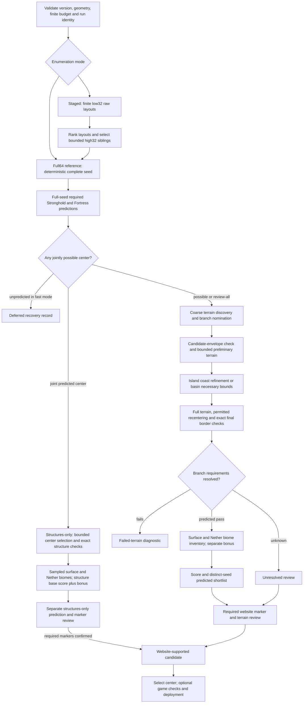

> **Current Realm target, 10 October 2026:** 4000×4000 discovery in both dimensions; 1536×1536 Overworld centered on the Stronghold; 896×896 Nether centered on exact Stronghold/8. See [COMPACT_SEARCH_IMPLEMENTATION_PLAN.md](COMPACT_SEARCH_IMPLEMENTATION_PLAN.md) and `config/realm.yaml`. The specifications, commands and measurements below describe earlier contracts; they do not override this target.

# Seed-selection workflow and structure contract

The 8 October 2026 implementation uses **2304/928**, all four categories and a bounded **lower32 → upper32** mode. The full64 reference is the recommended default after both independent controlled comparisons. Staged search remains available. Completed results and ETAs: [IMPLEMENTATION_RESULTS.md](IMPLEMENTATION_RESULTS.md). No production sweep has started. Implementation contract: [AUDIT_IMPLEMENTATION_PLAN.md](AUDIT_IMPLEMENTATION_PLAN.md); measured evidence: `runs/implementation-2026-10-08`.

## What counts as a suitable world

**Stronghold and Nether Fortress are mandatory.** Their eligible starts/markers must share a single chosen Overworld center and fit that center's respective Overworld/Nether squares. Bastion, Village, Trial Chamber, Mineshaft, Ancient City, Ruined Portal, Shipwreck, Monument and Outpost are preferences. More of these can improve a score; absence alone must not reject a world.

The user approved **four independent search categories**: structures-only, inner island with water and surrounding mountains, ocean island, and dry flat mountain basin without an inner island. Structures-only has no terrain requirement and gets its own shortlist, score and counts. A seed that fails an island or basin check may still qualify for structures-only after the required structures and common center are checked; it must remain a failure for that terrain category. Unreviewed predictions are candidates for inspection. Only completed branch-specific required website evidence produces a website-supported candidate; generated-game observations remain a separate stronger evidence category.

The center-search range is **X/Z each -5000 to +5000**, a 10,000 × 10,000 geometric search area. It is not the playable border or a spawn guarantee. Discovery samples this area plus context and uses finite budgets; it does not find every possible island or basin. Neither the first surviving layout nor the highest numerical score automatically becomes the deployed world. Select a reviewed candidate, retain its exact center, then configure the add-on and inspect safe spawn/portal access separately.

## Structure policy and seed dependencies

All eleven families below are already exposed by the current backend. The new work is staged enumeration, eligibility consistency and evidence handling, not adding support for these families from scratch.

| Family | Required? | Raw placement shareable by low32 today? | What each full64 sibling must still do | Current scoring role |
|---|---|---|---|---|
| Stronghold | **Yes** | **No** for the combined adapter | Village-associated iteration/biome acceptance plus static path; retain incomplete-recall status | Up to 5 total points plus required eligibility |
| Nether Fortress | **Yes** | Yes | Correct typed placement and current viability adapter; exact Nether border | Up to 8 total points with current optional-Bastion weight |
| Bastion | No | Yes | Biome/variant viability; keep rejected raw positions for review | Up to 2 total points |
| Trial Chamber | No | **No** | Its distinct RNG placement dependency and viability | Up to 5 total points |
| Mineshaft | No | **No** | Special chunk-range enumerator, inclusive end semantics | Up to 4 total points |
| Ancient City | No | Yes | Full-seed biome viability, including known disagreements | Up to 3 total points |
| Village | No | Yes | Full-seed biome viability | Shares 3 total points with the four following families |
| Ruined Portal (Overworld) | No | Yes | Full-seed placement viability | Secondary preference |
| Shipwreck | No | Yes | Full-seed placement viability | Secondary preference |
| Ocean Monument | No | Yes | Full-seed placement viability | Secondary preference |
| Outpost | No | Yes | Full-seed placement viability | Secondary preference |

For the terrain branches, Overworld structure points are 20% of the base score; Nether proximity is 10%. Terrain/wood categories account for the other 70%. Structures-only uses those same structure components as a separate base score out of 30, retains the two-point optional Bastion cap and leaves terrain qualification metrics null. The biome-diversity bonus adds up to five separately reported points in each category (combined maxima 35 / 105). Rank within category, evidence grade and sampling spacing. The low32 cache only reuses raw placement. Its eight-family membership does not establish that terrain, biomes or final structures repeat across high32 siblings.

The Stronghold adapter combines static starts with village-associated starts. A raw Village is neither a required feature nor proof of a viable Stronghold. A future safe raw Stronghold-candidate superset would need both paths, their exact marker offsets, boundary halos and proof of coverage. That is separate from the simple Village/Fortress filter in the latest Gemini text.

## Processing stages

**Finite seed/layout enumeration → full64 Stronghold + Fortress → shared possible center → coarse discovery + all structure viability → branch checks → exact final borders → surface/Nether biome inventory → base score + biome bonus → seed checkpoint → separate category shortlists → website review.**

Structures-only takes a separate branch after required structure viability: choose at most two jointly feasible centers → exact borders → sampled biome inventory → structure score. It bypasses island/basin qualification. Surface-height work for that inventory measures where biomes occur; it does not turn the branch into a terrain pass.

In staged mode the first arrow expands to **10,000 distinct low32 raw layouts → 48 top layouts + 16 deterministic exploration layouts → four unique high32 siblings each → 256 complete signed64 seeds**. Raw Fortress feasibility is a necessary model check; optional family proximity only schedules work. No Village substitutes for a Stronghold. Small sibling batches share raw placement cache entries; every sibling repeats full viability, terrain and biomes.

The raw phase checkpoints its cursor and selection heaps every 100 layouts, then freezes the final selection before full-seed work. An interruption can require recomputing the unfinished raw block; committed selection and full-seed IDs stay unchanged. The upper32 pass is a finite sibling sample, not enumeration of all 2³² upper halves. Per-seed checkpoint commits determine which siblings resume; paid work lost before a commit can run again.

| Step | Purpose and output | Failure/uncertainty handling |
|---|---|---|
| 1. Validate | Target edition/version/backend, dimensions, sample spacing, finite count, seed syntax and identity | Reject unsupported configuration before native work or checkpoint creation |
| 2A. Reference enumeration | SplitMix finalizer maps finite indices to signed64 seeds, reproducibly | No wrap or duplicate indices; supplied seeds validated separately |
| 2B. Staged enumeration | Enumerate finite low32 layouts, reuse verified raw structure math, select high32 siblings | Optional structure scores prioritize; all siblings still undergo terrain/full viability; discarded layouts are a sampling tradeoff |
| 3. Required prediction | Current fast mode scans Stronghold then Fortress before terrain | Missing Stronghold predictions are incomplete evidence; fast exclusions go to recovery, not proven absence |
| 4. Joint possible centers | Intersect required structure windows over eight-block Overworld centers; structures-only branch selects bounded centers here | A Stronghold on one side and Fortress on the other do not qualify unless a common center exists; structures-only still needs full viability, exact borders and marker review |
| 5. Discovery | Coarse biome/climate terrain hints nominate enclosed islands, ocean islands and mountain basins | Finite raster edges remain unknown; no biome label proves terrain shape |
| 6. Nomination/budget | Rank nominations, test required windows, distribute bounded work across enabled branches | Default 32 preliminary / 8 refined nominations; skipped work remains deferred, not failed terrain |
| 7. Preliminary terrain | Sample moderate-resolution heights; shadow experiment records safe island bounds before coast | Patch limit or boundary uncertainty is recorded; preliminary topology is not real block truth. Unknown cells cannot prove absence, and diameter/enclosure preferences alone cannot reject |
| 8A. Island coast | Refine transition/frontier land predictions, label components and select a closed component | Thin connections and boundary contact prevent a claimed separated prediction; one-block output remains model-derived |
| 8B. Basin bounds | Check conservative dry/gentle and lazy mountain upper bounds around permitted recenters | Only a proved impossibility rejects; incomplete rays remain possible; align with the full raster lattice |
| 9. Full terrain | Compute branch-specific landscape/wood metrics and permitted basin recentering | Full finite connectivity and actual threshold checks remain; Deep Dark is rank-only |
| 10. Final structures | Refilter all typed starts/viability to the final center's exact squares | Recentered terrain invalidates prior center eligibility; missing required evidence cannot be repaired by optional structures |
| 11. Score/checkpoint | Produce normalized scores or uncertainty intervals; parent atomically commits completed full seed | Known totals and interval review remain distinguishable; scheduling must not change predictions |
| 12. Export/review | Produce separate category packets and distinct-seed counts; validate required markers and category-specific terrain evidence | Failed or unconfirmed reviews route consistently; structures-only needs no terrain evidence and never counts as an island/basin pass |
| 13. Select/deploy | Choose a reviewed candidate and exact Overworld center; derive Nether center | Configure installed add-on size convention; natural spawn, portal arrival and accessible footprints need their own checks |

## Branch-specific terrain semantics

| Branch | Existing automatic checks | Scored or reviewed evidence |
|---|---|---|
| Structures-only | Full-seed Stronghold and Fortress predictions in squares sharing the selected center; terrain not required | Required-marker review; optional structures rank candidates; terrain metrics null and separate structure-only score |
| Enclosed inner island | Finite predicted coast separation and sampled component existence | Preferred 300–700 equivalent diameter; surrounding water/mountains, external woodland and buildability require score/review interpretation |
| Ocean island | Predicted separation; at least configured 0.50 ocean-biome and density-water fractions in a 1400-square window | Island/build-area wood supply, openness, buildability and optional mountain appearance |
| Mountain basin | Dry connected gentle floor, configured relief, dry connected mountain ring, permitted nearby-floor search | Woodland/accessibility and actual mountain appearance; no inner-island or enclosing-water requirement |

Current basin defaults: 96-block flat radius, ≥0.85 dry/gentle fraction, ≤16-block p90–p10 relief, slope ≤0.30, ring radius 800, relative-height setting 50, ring coverage ≥0.75. Unknown rays are not successes. Ocean buildability and enclosed-island preferences are not currently universal hard flatness filters; the plan preserves that meaning and makes status explicit. An enclosed-island prediction needs water/mountain appearance review before becoming a supported result. Structures-only intentionally skips terrain qualification; the other three lists do not inherit that exemption.

## Biome computation and diversity

Biome lookup at a known X/Y/Z is much cheaper in the measured pipeline than determining surface height or refining a coastline. The current three-seed scalar baseline spent 0.335–0.357 seconds on discovery (42,025 points including biome/climate/approximate-height work and component labeling), versus 35.5–77.0 seconds for complete analysis. This is not a standalone biome-only or surface-inventory timing. Evidence: `runs/simd-test-2026-10-08/full-*-scalar-0-0.json`.

Terrain candidates already contain sampled surface biomes and `biome_inventory`; counting distinct IDs/coverage reuses those arrays and requires no new native queries. Usefulness-weighted diversity ranking is implemented across all four categories; its policy is in [BIOME_DIVERSITY_PLAN.md](BIOME_DIVERSITY_PLAN.md). Structures-only centers receive surface-height/biome sampling at spacing 16, plus a separately labeled coarse fixed-Y inventory. Fixed-Y results must not be called a verified surface inventory. Keep surface, cave and Nether inventories separate, record spacing/coverage, and count only samples inside the final playable border.

Default scope is every structure-qualified full64 seed. Count distinct resource/environment families with editable weights, saturating sampled-extent credit and a separate bonus of up to five points. Required structures and each terrain category’s requirements still control eligibility. Failed-seed inventories can be retained as optional diagnostics; raw low32 layouts cannot receive a biome score before high32 is chosen.

## Exact target geometry

For selected center `(X,Z)`:

- Overworld: `[X−1152, Z−1152, X+1152, Z+1152]`.
- Nether center: `(X/8, Z/8)` exactly, because both Overworld coordinates are multiples of eight.
- Nether: divided center ±464 on each axis.
- Structure membership is an axis-aligned square test, not a distance circle. Proximity affects scores separately.
- Starts, website markers, entrances and complete structure footprints are different objects. A marker on a border may qualify mathematically while access extends outside. Keep this distinction in the inspection packet.

The Nether side is **928 = 2304/8 + 2×320**, superseding the earlier 640 proposal. Its center follows the selected Overworld center, not a separate Stronghold anchor.

The installed add-on's per-dimension settings and boundary behavior must agree with those intended squares. No score silently moves the border after the user selects a candidate.

## Extra structure work prompted by the latest Gemini text

The [second attachment](runs/system-audit-2026-10-08/GEMINI_STRUCTURE_FOLLOWUP.txt) repeats the staged-search idea but introduces an unauthorized Village requirement and overstates speed/coverage. The implemented P1–P5 contract includes:

1. Separate raw-placement and viable-placement APIs and annotate their family/RNG dependencies. Reject unsupported low32 families explicitly; do not trust a caller-supplied name to bypass the allowlist.
2. Return feasible center regions or sufficient diagnostics from the raw selector so layout quality is based on a **shared feasible center**, not unrelated nearest structures. Keep boolean checks available for cheap early tests. Prevent unbounded Cartesian window growth by merging/pruning contained rectangles or using a bounded spatial method, validated against the simple reference.
3. Preserve typed placement decisions: a rejected Bastion must never be relabeled Fortress. Preserve Mineshaft end-chunk semantics, Trial Chamber upper-bit sensitivity, full-seed Ancient City/Bastion viability, negative coordinates and exact borders.
4. Cache raw layouts across nearby sibling work, but rerun full viability for each sibling. Measure per-family cost and conditional rejection before changing Fortress/Stronghold ordering. Optional viability can be deferred until needed for scoring if equivalent results and review evidence are retained; the old structure stage is only about 0.87% of worker time, so prioritize simplicity unless the new raw phase changes that balance.
5. Add required-structure review routing and per-marker border-distance/footprint-unknown fields to final packets. Marker conventions in regression must not expand acceptance borders.
6. Count raw layouts, full seeds, unique terrain candidates, required-predicted candidates, website-supported candidates and actual game observations separately. Report the paid work for optional structures; never call it zero overhead.

## Operational evidence

Every run should retain the exact mode/budgets, seed/layout IDs, config and predictor/runtime identity, decision reasons, per-stage counts/costs, checkpoint, candidate metrics, raw/viable/confirmed structure records, and review provenance. Preserve deferred seed lists for new bounded `review_all` runs; a different config cannot resume an existing fast-mode run.

All four approved categories are enabled, with independent bounded nomination/output budgets. Basic failure/deferred records remain saved for auditability. Report distinct seeds separately from category memberships: one seed can qualify in multiple lists. Early island filtering will first run in shadow mode, with any unsafe or unprofitable bound kept out of rejection logic; details are in P3b of the implementation plan.
