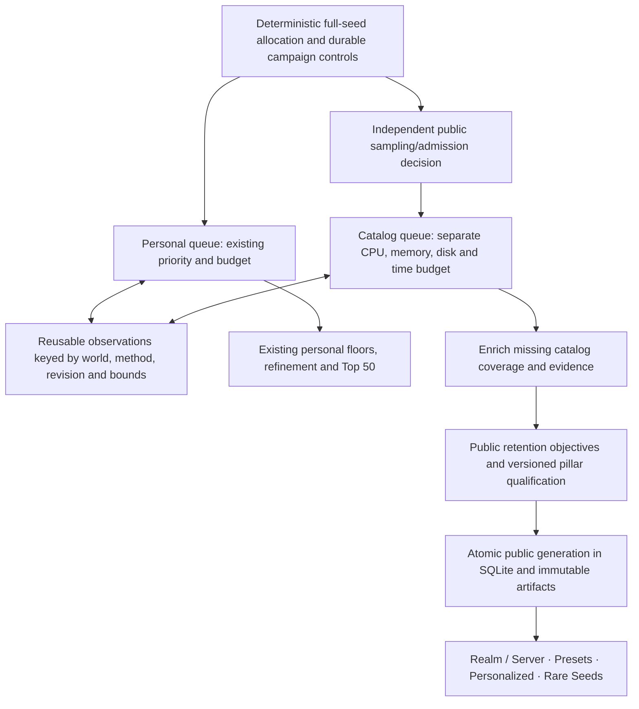

# Minecraft Bedrock Seed Platform: Public Catalog Master Plan

**Completed local automation milestone (2026-10-21):** [release report](../../../reviews/public-automation-scope-2026-10-21/RELEASE_REPORT.md) and [implementation contract](../../../PUBLIC_CATALOG_AUTOMATION_PLAN.md). The existing UI now serves the four pillars from an independently automated CPU pipeline, with calibrated2048/4096/8192 Realm boards and preserved personal scoring. The older baseline descriptions below are historical; the release report and CODEX_HANDOFF.md describe the live state. GPU, custom engine, hosting and payment activation remain separate.

**Scope simplification (2026-10-21):** Lucas authorized removing difficult,
terrain-dependent or materially expensive products. Direct-Drop Portal, Badlands
Spine, Mega Cherry Grove, Triple Mineshaft and Deep Dark Void are removed from
the current registry/UI, leaving17 supported rare records. Historical IDs and
snapshots remain readable. See the [current scope and checks](../../../reviews/accuracy-advanced-products-2026-10-21/PLAN.md).

**Reconciled:** 2026-10-20, following the four-pillar review and Lucas's approval to apply the engineering corrections.  
**Product:** Four public discovery experiences in the existing Sweep application, alongside Lucas's personal Realm search.  
**Current storage:** Separate SQLite metadata, checksummed compressed observations, immutable segmented manifests, packed layout summaries and rebuildable indexes.  
**Future serving experiment:** A compiled, versioned `.seedcat` index/export if representative measurements justify it. A new durable database engine is not a prerequisite.  
**Compute available:** Two hosts described by Lucas: 192 CPU cores + 8 V100s, and 48 CPU cores + 8 V100s; an 18-core iMac. GPU kernels, fleet throughput and production capacity remain unmeasured.

## 0. Authority and implemented baseline

Personal search behavior follows the versioned configuration/source and [MASTER_SEED_BLUEPRINT.md](../../../MASTER_SEED_BLUEPRINT.md). The current public query/storage vocabulary follows [PUBLIC_CATALOG_SYSTEM_SPEC.md](../../../PUBLIC_CATALOG_SYSTEM_SPEC.md) and [docs/catalog/v1](../v1/README.md). This plan reconciles the four-pillar product vision with those contracts; it does not silently change the runtime registry, scoring, entitlements or capability flags. Conflicting historical examples in [MASTER_PLATFORM_SPECIFICATION.md](../../specs/MASTER_PLATFORM_SPECIFICATION.md) remain proposals.

The historical pre-automation [private pilot](../PRIVATE_PILOT.md) implemented a Catalog tab, editable category filters, details/maps, comparison, local favorites and snapshot-pinned sharing. It contains **200 natural worlds / 48,600 layouts**, with raw-coordinate rederivation and exact query/index checks. It currently presents eight category presets and sixteen scoring profiles; those are not the Sweet 16 product launchpad or four separate pillar screens. The personal sweep does not yet feed the public store through a verified live branch.

[Validation evidence](../../../reviews/catalog-private-pilot-2026-10-20/REPORT.md): all 215 Catalog tests passed; the full run had 1,488 passes and one unchanged personal-pipeline timing assertion failure, which passed its isolated rerun. Browser QA was explicitly deferred by Lucas. Public hosting, billing, spawn activation and whole-feature game certification remain gated.

## 1. Four product pillars, one public observation store

A pillar is a discovery and qualification policy over shared world observations. It is not another database or another full extraction of the same world. One world may qualify for several pillars; its membership retains the qualifying layout and policy revision.

| Pillar | Audience and experience | Gameplay track | Qualification and ranking contract |
|---|---|---|---|
| **1. Realm / Server Seeds** | Hosts selecting rich multiplayer worlds, with a seed dossier and optional border deployment tools | Track B: bordered worlds; Overworld sides 2048, 4096, 8192 | Reuse the explicitly pinned personal blueprint's mandatory floors, four-Y/Nether checks and 1,250-point scoring where applicable. Preserve the personal 2048 policy unchanged. Larger-border qualification/scoring must have explicit versioned definitions before publication; never silently rescale the personal policy. |
| **2. Presets — Sweet 16** | One-click choices across Jackpot, Speedrun, Builders, Ocean and Combat themes | Track A: infinite vanilla; no border/radius configuration form on the launchpad | Convert the sixteen named presets in the master platform specification into versioned predicates, exact distances, anchor reference, ranking and evidence requirements. A preset with unsupported predicates stays unavailable with its reason. |
| **3. Personalized Selection** | Players combine Required and Preferred features, counts, distances and importance | Track A by default, with an explicit Track B option when supported | All Required predicates match the same anchor; Preferred rows rank eligible layouts. Select each world's best eligible saved anchor before global ranking. Current pilot limits remain the v1 limits until a separately versioned extension passes checks. |
| **4. Rare Seeds — Hall of Fame & Records** | Browse unusual combinations, proximity extremes and density champions | Track A: infinite vanilla | Convert the record descriptions in the master platform specification into explicit metrics, scopes, evidence predicates and deterministic ties. State the searched population; these are records within that population, not proof of a global Minecraft record. |

“Certified Realm God Seeds” remains a possible product label only for records with the required scoped verification evidence. A predicted qualifying seed is labeled predicted, regardless of payment tier. Membership in Pillar 1 alone is not certification.

### Versioned product registries

Each future preset/record definition must contain a stable ID, revision, display name, track, dimension, anchor policy, geometry, Required predicates, ranking/ties, coverage/evidence requirements and availability gate. Pillar 1 additionally binds its exact blueprint/configuration digest. Record entries retain metric value and evidence references; pillar membership alone cannot substitute for those facts.

The descriptions in the platform specification supply product intent, not every executable predicate. For example, “coastal village,” “touching mushroom fields,” “igloo basement,” “quad huts” and farm suitability need their own observable tests. Until implemented, do not infer those predicates from a nearest biome witness or a predicted structure start. Guaranteed 150/200/300-block presets also cannot round to the current 256/512/1024 scopes.

Capacity, pricing and licensing below are product proposals. Their implementation follows these shared contracts and does not alter personal search.

## 2. Two independent branches while personal search runs

Branch before any personal-only rejection. A public seed may be rejected under the declared public sampling/retention policy, but never solely because it fails Lucas's personal requirements.

### Producer, reuse and checkpoint contract

1. Work identities include campaign/shard, full signed-64 seed, edition, exact build/settings and predictor/extractor revisions. Shared observations additionally bind dimension, method, bounds and coverage. A matching seed number alone is not enough for reuse.
2. A personal result can contribute compatible facts already computed. Early personal exits often leave missing features; the public queue must enrich those scopes or record them as unknown. Personal failure is never encoded as a completed public zero.
3. Public scheduling also sees its declared independent seed population, including personal failures. A tap on personal winners alone would bias Presets, Personalized and Records. Separate campaigns remain possible and reuse compatible saved observations.
4. The producer uses a bounded durable handoff with task ID, observation references and per-feature status. Duplicate delivery is idempotent. A task is acknowledged only after durable public ownership/checkpointing. No unbounded in-memory survivor stream.
5. Reserve personal resources first. When catalog admission or storage reaches its budget, pause new public work and persist the deferred shard frontier/ranges with an explicit stop reason; do not block the personal worker or silently lose promised public coverage. Use declared deterministic sampling/shard ranges rather than storing a row for every personal reject. An intentional public skip is recorded under the public sampling policy.
6. Personal and catalog have independent queue ownership, failure reporting and resume checkpoints. A catalog error must not change personal scores, candidate ordering or completion accounting. A stopped personal worker must not mark a public task complete.
7. Publish public generations independently from personal checkpoints. Never let a worker overwrite or merge the personal database. Defaults keep live catalog harvesting off until an opt-in integration test passes the baseline parity and crash/replay gates.

Acceptance includes a seed that fails personal floors but qualifies for a public preset, partial observations requiring enrichment, duplicate handoff, catalog backpressure, producer death between publication and acknowledgement, and identical personal output with catalog harvesting disabled/enabled under a fixed schedule. This bridge is planned, not already implemented by the private pilot.

## 3. Gameplay tracks and anchor geometry

**Track A — infinite vanilla:** Search a declared area around an anchor; the Minecraft world continues outside it. Presets and Rare Seeds use fixed, documented scopes without exposing border controls. A travel circle and a square are different predicates. Theme labels such as Walking/Horse/Elytra are descriptive, not measured travel-time promises.

**Track B — bordered deployment:** Overworld side lengths are exactly **2048, 4096 and 8192**, using half-open squares `[Cx - S/2, Cx + S/2) × [Cz - S/2, Cz + S/2)`. Deployment scripts/addons are a later tested capability. The current research UI's square search scope does not install or enforce a game border.

**Near-base queries:** Current v1 uses closed horizontal circles of radius **256, 512 or 1024**, intersected with the selected square. Custom sliders and Track A-only circles require a versioned geometry/query extension and exact spatial evaluation. Do not silently equate a 2048 square with a 1000-radius circle.

**Nether:** The proposed 1024-side Nether window needs its own explicit center and dimension. The 8:1 coordinate transform explains nominal coverage only when centers align. It does not guarantee the game's selected/linked portal lands within a border or is safe. Portal placement, linking margins and enforcement require separate evidence. Nether filtering is not enabled in the current 23-feature pilot.

### Anchor choices

- **Recommended settlement:** Evaluate the 81 saved grid centers `[-976,-768,-512,-256,0,256,512,768,976]²`. Choose the best qualifying center for the actual request. One preselected “densest base” cannot represent every later preference combination.
- **Origin:** `(0,0)`; explicitly not world spawn.
- **Estimated world spawn, planned:** The [retained audit](../../../reviews/spawn-validation-2026-10-17/README.md) compared `estimateSpawn` with BDS 1.26.52.3 default-world spawn on 108 worlds. Maximum observed horizontal displacement was 11.31 blocks (reported conservatively as within 11.32); median routine+applySeed time was 3.83 ms in that cohort. The earlier 3.04 ms timing is a separate smaller sample. These are empirical observations, not a universal ±11-block guarantee or fleet throughput estimate.

Estimated spawn stays fixed at the saved estimator X/Z, with source/revision/evidence. Exact initial-player placement, spawn Y and safe terrain remain unvalidated. Activate this anchor only after coverage, integration, build acceptance and complete-record cost checks. If spawn influences retention, evaluate it on the declared public population before final admission; enriching only settlement winners would bias spawn results.

### One maximum envelope, several derived views

For the current settlement grid and 8192-side square, the nominal union is `[-5072,5072)²`, tiled outward to `[-5120,5120)²`. Extract compatible observations once over that union and derive all smaller squares; no three complete extractions are required. Planned spawn-centered or larger travel scopes may extend beyond it: schedule bounded extra coverage or mark that layout unavailable.

Future GPU screening must cover the declared union or prove a conservative rejection bound for every relevant anchor/objective. Origin-centered masks cannot stand in for settlement/spawn masks. Unknown coarse evidence is not proof of absence; a coarse biome miss cannot justify an exact exclusion claim.

## 4. Save world facts once; derive summaries per layout

| Layer | Identity / retained information | Purpose |
|---|---|---|
| World | Edition + exact build + settings + full seed; stable content identity | Deduplicate compatible worlds; keep seeds as strings in JavaScript/JSON |
| Observation | World + predictor/extractor/method/registry revision; dimension, absolute int32 coordinates, sampled X/Y/Z biome facts, coverage and evidence | Reuse extraction and independently rederive facts |
| Anchor | World + dimension + anchor kind + integer X/Z + provenance | Preserve origin, each settlement center and any supported spawn reference |
| Layout summary | Observation + anchor + geometry revision + square side or supported travel scope | Counts, distances, witness references and complete/unknown state for that layout |
| Derived index | Ordered layout payload identities + policy/geometry/registry/index revisions | Candidate selection over the same layout rows |
| Pillar membership | Snapshot + pillar/preset/record revision + qualifying layout + score/metric + evidence | Browse multiple pillars without duplicating observations |
| Published generation | Immutable root and ordered segment manifests; source/policy identities and checksums | Stable paging, sharing, atomic promotion and recovery |

The existing pilot stores **81 × 3 = 243 layouts/world**, with a **364-byte packed summary payload per layout**, plus metadata and shared raw observations. That is 88,452 summary payload bytes/world before compression and metadata, not a one-card/world storage promise. New dimensions, radii, spawn layouts or feature slots require explicit schema/coverage revisions and measured sizing.

A nearest-distance value and one count cannot answer “three villages within 512 blocks.” Use the existing per-scope counts for supported thresholds or exact coordinate evaluation for an extended request. Missing coverage is unknown, not absence. Summaries can be rebuilt from raw observations; they are not copies of generated blocks.

Stable world identities are distinct from sequential row IDs. A compiled generation may assign dense row IDs for lookup, but URLs, cursors, caches and retained references must bind the generation and stable world/layout identities. Deduplication must not merge different builds/settings just because their seed strings match.

## 5. Feature registry and layout-row indexes

The current registry has **23 Overworld features**: fourteen predicted structure-start inventories and nine sampled biome families. Keep their existing IDs, slots, scope and coverage semantics. An igloo start does not certify its basement.

The earlier 31-feature/35-bit proposal is a **future registry extension**, not the implemented schema:

| Proposed additions | Gate |
|---|---|
| Nether fortress and bastion; five Nether biomes | Versioned dimension/anchor/geometry contracts, extraction/parity and coverage evidence |
| Stronghold | Versioned Overworld predicate, current predictor recall limitations and scoped verification; not an End-dimension observation |
| Four pillar flags | Rebuildable membership summaries; qualifying layout, revision and evidence remain authoritative |

Indexes select **layout rows**, not unqualified world-wide OR flags. For one row, AND Required conditions and OR biome alternatives within their own Required row. Index counts/thresholds and coverage as needed. Keep Preferred rows out of the mandatory intersection. Only then rank eligible layouts, select each world's best layout and take the global TopK.

Separate bitmap planes for three border sides alone do not solve anchor or count semantics. A village at center A and a mansion at center B must not create a same-anchor match. Biome witnesses support positive sampled presence, not reliable absence or complete biome area. Current segmentation, payload hashes and index revision bindings remain required.

## 6. Public retention: bounded objectives and measured loss

Personal rejection and public retention are independent. Public selection uses versioned specialist, feature-pair, multi-feature, diversity, preset/record and stable unbiased-sample objectives. Include dedicated objectives for advertised biome families, including mangrove and badlands. Unknown features do not compete as completed zero results. Pins and the reference sample remain independent of personal qualification.

A fixed-capacity heap bounds entries for one objective; total memory also includes every objective's key, candidate payload, maps, checkpoint state and shared observations. An observed-mask table needs a global capacity and explicit eviction policy. Rejecting one already-scored candidate costs a root comparison; computing its features, anchor scores and objective memberships is not O(1).

A bounded catalog **cannot guarantee the best answer to every future 1–12-feature query**, distance slider or count threshold. A world with many feature-presence bits does not necessarily satisfy those features around the same anchor or under every distance/count constraint. Evaluate held-out nonempty preservation, TopK recall/regret, coverage and retention fraction with honest denominators.

### Capacity scenarios, not proven unique-world yields

The earlier 70k/1M scenarios retain product planning value: P1 30k/100k leaderboard slots; P2 4k/16k slots; P3 about 60k/850k slots; P4 5k/50k slots. Cross-objective and cross-pillar overlap is measured, not predicted as a guaranteed unique-world total. These are not launch requirements for the current 200-world pilot.

For a future 31-feature registry, singles `31×3×100=9,300`, pairs `465×3×25=34,875`, and eight-core diversity cells `256×3×10=7,680` total **51,855 pilot slots** before the mask/sample allocation. Reserving 8,145 further slots gives 60,000. At the larger example, 46,500 + 209,250 + 307,200 = 562,950; 19,136 masks × 3 × 5 adds **287,040**, yielding **849,990**, not 850,000. Any remaining ten slots need an explicit allocation. Core feature lists, mask caps, objective keys and sample budgets must be frozen before the experiment; these illustrative allocations do not replace the current v1 retention policy.

Select every objective's best eligible anchor per world before deduplicating winners. Checkpoints retain input frontier, pending work, objective state, source/policy identities and cumulative budgets; heap winners alone cannot replay an interrupted campaign exactly. Publish new generations atomically, and retain the previous generation until replacement is verified.

## 7. Query behavior, scoring and compiled serving experiments

Current queries retain `catalog-query-v1`: supported counts 1–16, at most12 rows, near radii 256/512/1024, same-anchor Required semantics, importance 1/3/5 for Preferred rows, and the existing deterministic score/tie contract. Informational percentage rounding never changes ordering. Zero Preferred rows use the selected scoring profile.

The proposed continuous distance curve is a later **versioned preference utility**, not an automatic replacement for count fulfillment or a way to soften Required limits. Its implementation must define missing/unknown evidence, beyond-scope distances, `D=Rmax`, invalid slider bounds, exact ties and feature-specific count handling. For `0≤D<Rmax`, a proposed eligible-distance term is 1 when `d≤D`, and `max(0.10,1−0.90(d−D)/(Rmax−D))` when `D<d≤Rmax`; a missing witness has no positive observed-presence credit. An unsupported predicate is rejected or explicitly unavailable, not silently rounded.

### Storage decision

1. Continue SQLite for metadata, queue/checkpoints and generation publication, with checksummed compressed observations and packed summaries in immutable artifacts.
2. Measure realistic record sizes, query selectivity, cold/warm p50/p95, ingestion, restore, cache overhead and required scope precision.
3. Experiment with packed arrays, memory mapping and compiled indexes only against the same fixed workload and exact reference oracle. A `.seedcat` serving artifact is rebuildable from canonical data and does not automatically replace durable storage.
4. Adopt an optimized format only after version/endian/offset/bounds/checksum, publication/recovery, identity binding and exact-query parity checks. Bind layout-to-world mappings and observation references; account for all layouts and process overhead in RAM estimates.

**Correction to the retired card sketch:** the previous packed `SeedCatWorldCard96` fields sum to **98 bytes**, not96. Its one base coordinate, one distance vector and one count vector are insufficient for the promised anchors/borders. Even uint8 distances in 16-block units top out at 4,080 blocks, below the 4,096 side-to-edge distance and farther square corners; they cannot certify exact threshold membership. Do not implement that sketch as the storage contract. Quantized fields may only be conservative prefilters with correct unknown/saturation handling and exact refinement of every potential winner; refining only an approximate Top50 can lose true winners.

The previous `<0.5ms` search, `2ms` map, `110MB` RAM, compression and `600M seeds/sec` figures are unmeasured aspirations. A leaderboard offset can be indexed in O(1), but response serialization, evidence/detail access, entitlement checks and network latency still require measurement. Map generation is separately cached/budgeted, not part of extraction or a promised2ms capability.

For comparison, current paired200-world measurements were about **2.41s Origin / 5.38s Recommended cold-service**, and about **13ms cached**; OS cache may be warm. The declared small workload does not forecast production performance. A 1,000-identity fabricated test covers only6,000 layouts and is labeled synthetic. Do not multiply these timings or GPU scenarios into fleet guarantees.

## 8. Commercial proposal and evidence boundaries

The original pricing remains a proposed product model, with billing/runtime flags disabled:

| Capability | Free Visitor | Explorer Plus: proposed $4.99/month or $2.99/7 days | Realm Master: proposed $9.99 one-time single-seed package |
|---|---|---|---|
| Sweet16 presets | Top250 per preset | Up toTop1000, where populated | Up toTop1000, where populated |
| Rare/record lists | Top10 per list | Wider populated lists | Wider populated lists |
| Personalized filters | Up to3 rows, proposed20 queries/day | Up to12 rows, proposed200 queries/day | Same supported query vocabulary; package entitlement explicit |
| Search scopes | Proposed smaller-scope access | All supported scopes | All supported scopes |
| Realm discovery | Top3 showcase and one matcher roll/day | Browsing, proposed20 reveals/day | One selected seed dossier entitlement, not ownership of every catalog record |
| Border script pack / exports | Proposed restricted access | Proposed watermarked exports | Proposed border pack and dossier; independently tested |

Quota and pricing policy must be versioned before activation. Feature rows, feature alternatives and underlying distinct feature count need explicit charging rules; the current runtime has no paid entitlement adapter. A larger filter count must not silently switch the player into a different pillar or weaken a predicate.

Access checks belong on the server and bind account entitlements, query/detail, sharing, exports and caches. A world may qualify for multiple pillars: define an explicit access classification; do not exclude every P1 member from free search merely because a membership bit is set. Publicly disclosed seeds cannot be made secret again by a later membership change.

Billing requires verified/idempotent webhooks, ownership checks, UTC counters and tested concurrency. A payment webhook confirms a purchase event, not independent real-world identity. Reveal quotas, limited browsing and watermarks can discourage bulk extraction; they do not mathematically prevent copying or multi-account collection. Watermarks cannot substitute for access controls. No public launch is authorized by this plan edit.

Every result retains evidence-scoped labels: **Predicted structure start**, **Sampled Y63 biome witness**, **Estimated world spawn** with a link to cohort statistics, or **Observed BDS fact** with exact build/settings/method/bounds. Avoid universal `±11m`, “basement verified,” “safe spawn,” “zero hostiles,” portal-safety or “certified world” claims without their own observations. Paid tiers do not bypass evidence gates.

## 9. Staged execution and acceptance

The phase labels below describe this reconciled roadmap, not permission to start every stage or a claim that the old custom-engine/CUDA phases are complete.

| Stage | Deliverable | Acceptance / scope |
|---|---|---|
| **A. Reconcile contracts — completed** | Preserve four pillars; explicit two-branch flow, per-layout storage/query/evidence rules and SQLite-first staging | Link to source/evidence; resolve contradictory guarantees; preserve runtime behavior |
| **B. Four-pillar private UI and registry adapters** | Organize the existing Catalog into Realm/Server, Presets, Personalized and Rare entry points; translate existing product definitions into versioned configurations | Supported predicates execute exactly; unavailable predicates are labeled; no fabricated leaderboards/certification; personal Sweep state preserved. Browser QA remains deferred until separately resumed. |
| **C. Opt-in CPU dual-harvest bridge** | Independently scheduled public work, reusable facts, bounded durable handoff, enrichment and independent resume | Identical personal results with catalog off/on; personal-failure/public-success fixture; backpressure/crash/duplicate replay tests; preserve the live personal process during development |
| **D. Spawn and broader feature/evidence integration** | Estimated-spawn layout coverage/cost; separately versioned Nether/stronghold and richer preset/record predicates | Reuse retained108-world audit; measure complete-record overhead and missing envelopes; exact player placement/structure certification remain separate gates |
| **E. Larger CPU/storage measurements** | Fixed representative workloads; staged larger natural and synthetic populations, retention and recovery tests | Freeze source, cohorts, requests and resource caps first. Grow only after smaller preflight; a10,000-world campaign needs a concrete approved budget, not this roadmap alone. Player demand requires real supplied requests. |
| **F. Specialized serving format experiment** | Optional packed/mmap indexes or `.seedcat` export over canonical SQLite/artifacts | Measured benefit, full-layout sizing, exact threshold/rank parity, checksums, bounded reads and recovery; no automatic durable-engine replacement |
| **G. One-V100 experiment, then fleet scaling** | Scoped CUDA kernels, then scheduler for the two8-V100 hosts if justified | CPU/GPU predictor parity including boundaries and conservative admission; measure actual survivor packet bytes, CPU enrichment and queue pressure. Single-device evidence precedes16-device scaling; no1-trillion campaign implied. |
| **H. Public service and commerce** | Approved hosting, accounts, billing, quotas, exports and operational recovery | Scope-specific game evidence, entitlements/idempotency, connected-browser acceptance, monitored capacity and recoverable publication. Production flags stay off until these gates pass. |

Implementation plans for B onward specify owned files, dependency order, High Gemini critiques, worker assignments, resource limits and acceptance before significant code changes under the project workflow. Lucas's approval here covers reconciliation of this master plan; it does not start GPU jobs, a new database engine, a larger seed campaign, billing or a public deployment.

Subsequent implementation approval: Lucas explicitly approved the reviewed
[StageB/C plan](../../../reviews/catalog-four-pillars-bridge-2026-10-20/PLAN.md). Private
four-pillar screens, product/evidence gates, five offline Origin-circle previews
and the opt-in CPU campaign handoff/explicit worker are implemented. See
[execution evidence](../../../reviews/catalog-four-pillars-bridge-2026-10-20/REPORT.md)
and [usage](../FOUR_PILLARS_AND_HARVEST.md). This does not attach to the
already-running personal scan. Browser acceptance remains deferred, Sweet16/Realm
activation remains evidence-gated, and stagesD–H retain their own prerequisites.
