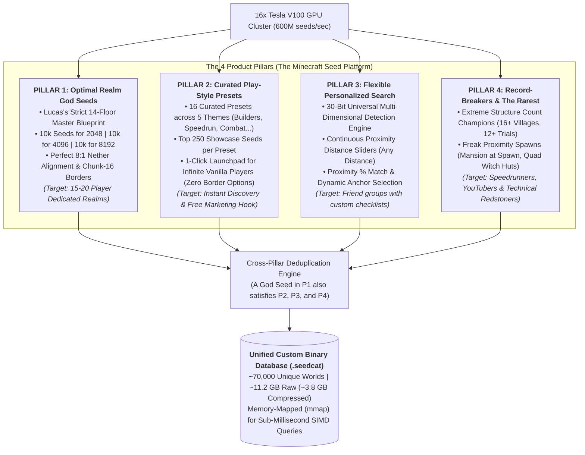
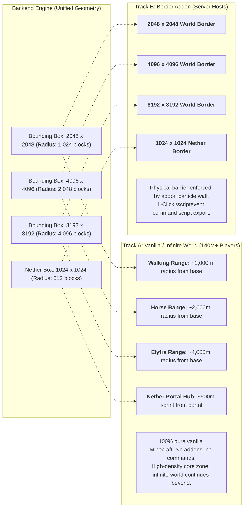
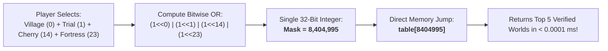
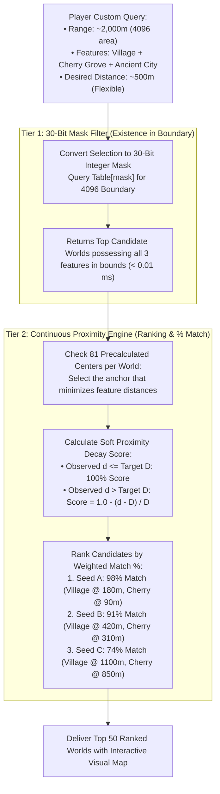

# Minecraft Seed Platform: Master Systems, Product & Architecture Specification

**Status:** Proposed product vision and experimental architecture; not a production capability statement
**Platform:** Minecraft Bedrock Edition 1.21+ (Pinned `MC_26_50` / Live BDS Target 1.26.52.3)  
**Date:** October 2026  
**Hardware Target:** 16x Nvidia Tesla V100 GPUs + 240 Host CPU Cores + Lightweight In-Memory Web Host  

---

> **Implementation authority (2026-10-20):** [docs/PROJECT_STATUS.md](../PROJECT_STATUS.md)
> records implemented versus proposed capabilities. The existing personal runtime
> follows `MASTER_SEED_BLUEPRINT.md` and versioned code/configuration; public pilot
> semantics follow `PUBLIC_CATALOG_SYSTEM_SPEC.md` and `docs/catalog/v1/` contracts.
> This document preserves the four-pillar product vision, but conflicts with pilot
> feature/retention/payment controls remain product decisions, not implementation
> authorization. A bounded CPU research extractor/SQLite/query reference is now
> implemented; see `src/seed_search/catalog/` and `scripts/catalog_reference.py`.
> The bounded100-world retention/recovery validation is also implemented; its
> [measured results](../../reviews/catalog-validation-2026-10-20/REPORT.md) apply to that
> developer corpus and do not validate the fleet scenarios below.
> The CUDA fleet pipeline, `.seedcat` engine, checkout and public production service
> remain unimplemented. This reference does not enable the four product pillars.
>
> **Reconciliation update (2026-10-20):** [Public_Catalog_Master_Plan.md](../catalog/proposals/Public_Catalog_Master_Plan.md)
> is the staged four-pillar engineering plan. Its SQLite-first storage, per-layout
> indexing, independent personal/catalog branches and evidence gates supersede
> conflicting technical examples below. The private Catalog now has200 worlds,
> segmented serving and API/UI; four-pillar entry points and the live harvest bridge
> remain future work. Named presets/record descriptions below supply product intent
> for versioned predicates, not automatic guarantees or enabled capabilities.
>
> All fleet rates, retained-world counts, compression sizes, query latencies and
> hosting economics below are **unmeasured scenarios**, not benchmark results or
> acceptance guarantees. Historical CPU screening numbers concern different
> policies/cohorts and must not be treated as current public-record throughput.
> Required filters stay hard predicates at one anchor; soft proximity may rank
> Preferences only. Only 2048, 4096 and 8192 side lengths are planned. Estimated
> world spawn is distinct from observed spawn and exact initial-player placement.

## Product vision: at-a-glance proposal

> [!IMPORTANT]
> **The 7 Core Decisions That Define This Platform:**
> 
> 1. **The 4-Pillar Product Ecosystem:**
>    * **Pillar 1 (Optimal Realm God Seeds):** 10k seeds per border size (30k slots) evaluated under Lucas's strict 14-floor master blueprint. Locked behind the Vault.
>    * **Pillar 2 (Curated Presets):** 16 curated cards on the homepage with the top 250 showcase seeds each (6k slots). **100% Free • Infinite Vanilla • Zero World Border Options**.
>    * **Pillar 3 (Flexible Personalized Search):** Universal multi-criteria search where players customize any combination of 30 features and distances with a continuous proximity % match score.
>    * **Pillar 4 (Hall of Fame & World Records):** Top 100 seeds across 50 statistical record categories (e.g., 22+ Villages, 0m Mansion at spawn, Quad Witch Huts) for massive viral distribution.
> 
> 2. **Dual-Mode Experience (Unified Backend Geometry, Zero Code Duplication):**
>    * **Track A (For 140M+ Infinite Vanilla Players):** Branded as **Exploration Travel Radius** (Walking ~1,000m, Horse ~2,000m, Elytra ~4,000m). Infinite vanilla terrain continues beyond with zero commands or addons needed. Presets and Records strictly use Track A.
>    * **Track B (For Server Admins):** Branded as **World Borders** (2048, 4096, 8192 Overworld + 1024 Nether) with 1-click `/scriptevent` command script export. Strictly used for Pillar 1 and optional Pillar 3 toggle.
> 
> 3. **The 30-Bit Universal Feature Signature (`uint32_t`):**
>    * All 14 Overworld structures + 9 Overworld biomes + 2 Nether structures + 5 Nether biomes = **30 bits**.
>    * Fits 100% into a single 32-bit unsigned integer. A presence mask is a possible prefilter. It cannot alone answer count/distance constraints or arbitrary superset queries; end-to-end ranking complexity and latency must be measured.
> 
> 4. **Continuous Proximity ("No Rigid Distance Walls"):**
>    * The 30-bit mask checks feature existence inside the exploration boundary.
>    * Distances are evaluated dynamically using a soft decay curve: features within target distance get 100% score; Preferred features slightly further may receive a lower utility. A Required distance remains a strict eligibility test and is never automatically relaxed.
>    * Universal math across **Recommended Base** (81 candidate centers), **World Spawn**, and **Origin (0,0)**.
> 
> 5. **Illustrative Cluster Sweep Scenario (unmeasured):**
>    * **Assumed Raw Throughput:** **$\mathbf{600,000,000 \text{ seeds/sec}}$** is an unvalidated scenario input; no CUDA kernel or fleet measurement establishes it.
>    * **Runtime for 36 Billion Seeds:** **$\mathbf{60 \text{ seconds (1 minute)}}$**.
>    * **Runtime for 1 Trillion Seeds:** **$\mathbf{27.7 \text{ minutes}}$**.
>    * The 800M/600M rates, 25% penalty and derived times are hypothetical. Public observations are often not computed before personal rejection; a complete public record has additional extraction cost and independent admission.
> 
> 6. **Database Numbers & Custom Layout (`.seedcat`):**
>    * Cross-pillar deduplication condenses ~101,000 category slots into **~70,000 unique physical worlds**.
>    * The **~11.2 GB raw (~3.8 GB compressed)** estimate is provisional; instance coordinates, alternate anchors, coverage, versions, indexes and recovery overhead must be measured on actual records.
>    * Memory-mapped (`mmap`) into RAM for sub-millisecond query execution on a standard \$20/month cloud host.
> 
> 7. **Monetization & Single-Seed Asset Licensing:**
>    * **Never expose the full 10k leaderboard:** Only Ranks #1–#3 are shown publicly as proof.
>    * **Asset-Specific Licensing:** 1 Purchase = 1 Seed dossier (never mass CSV dumps).
>    * **Anti-Scrape Limits:** Max 15–20 reveals per day for paid Plus users.
>    * **Watermarking:** Purchaser username and order ID are visibly and steganographically stamped onto all exported maps and PDF dossiers.

---

## 1. Reported hardware fleet and performance measurement proposal

### 1.1 The Available Hardware Fleet
As established in `PUBLIC_CATALOG_SYSTEM_SPEC.md` (Line 354), the production platform has access to:
* **Host 1 (Primary Cluster Node):** 192 CPU cores + **8x Nvidia Tesla V100 GPUs** (SXM2 / PCIe).
* **Host 2 (Secondary Cluster Node):** 48 CPU cores + **8x Nvidia Tesla V100 GPUs** (SXM2 / PCIe).
* **Local Dev Machine:** 18-core / 36-thread Intel Xeon W-2191B iMac Pro (Baseline).
* **Total Cluster Compute:** **240 Host CPU cores + 16x Tesla V100 GPUs (81,920 CUDA cores combined)**.

### 1.2 Side-by-Side Comparison of the 4 Architectures

The following four architectures are analytical scenarios, not completed matched benchmarks. Even the CPU column is a historical-policy estimate; Phase 2 evidence must identify its exact current workload:
1. **Config 1: Current Baseline (iMac CPU Only)**  
   Personal 2048x2048 14-floor blueprint running on 36 OpenMP threads with Clang PGO+LTO and SQLite WAL.
2. **Config 2: Baseline Enhanced to Fastest Architecture (Personal 2048 on 16x V100s)**  
   Personal 2048x2048 14-floor blueprint with maximum register-level early-out running on the 16x V100 GPUs.
3. **Config 3: Baseline with All Web Features on CPU Fleet (240 Cores, NO GPUs)**  
   Full Web Framework (4 Pillars, 30 features, multiple radii) running purely on the 240 host CPU cores.
4. **Config 4: The Complete Architecture (Web Features + 16x V100 GPUs + CPU Pipeline)**  
   Full Web Framework evaluated in CUDA registers on the 16x V100 GPUs, streaming survivors via PCIe DMA to the 240 host CPUs for table indexing.

| Metric | Config 1: Current Baseline (iMac CPU) | Config 2: Personal 2048 on 16x V100s | Config 3: Web Features on CPU Fleet (240 Cores) | Config 4: Web Features on 16x V100s (New Arch) |
|---|:---:|:---:|:---:|:---:|
| **Hardware Used** | 18-core Xeon iMac | 16x Tesla V100 GPUs | 240 CPU Cores | **16x V100 GPUs + 240 CPUs** |
| **Throughput per Unit** | $\approx 225\text{K seeds/s}$ | $\approx 50\text{M seeds/s / V100}$ | $\approx 4.8\text{K seeds/core/s}$ | **$\approx 37.5\text{M seeds/s / V100}$** |
| **Total Cluster Throughput** | **$\mathbf{225,000 \text{ seeds/s}}$** | **$\mathbf{800,000,000 \text{ seeds/s}}$** | **$\mathbf{1,152,000 \text{ seeds/s}}$** | **$\mathbf{600,000,000 \text{ seeds/s}}$** |
| **Time for 36 Billion Seeds** | $44.4\text{ hours}$ | **$45.0\text{ seconds}$** | $8.68\text{ hours}$ | **$\mathbf{60.0 \text{ seconds (1 min)}}$** |
| **Time for 1 Trillion Seeds** | $51.4\text{ days}$ | **$20.8\text{ minutes}$** | $10.05\text{ days}$ | **$\mathbf{27.7 \text{ minutes}}$** |
| **Speedup vs Baseline** | $1.0\times$ (Control) | **$3,555\times$** | $5.12\times$ | **$2,666\times$** |
| **Harvest Yield** | ~10k Realm Seeds | ~10k Realm Seeds | ~70k Web Catalog | **Full 4-Pillar Database (.seedcat)** |
| **Re-Sweep Required for Web?**| Yes | Yes | No | **NO (1-Pass Complete)** |

### 1.3 Unvalidated throughput assumptions requiring experiments

#### Hypothesized 800M-to-600M throughput delta (not measured)
1. **Warp Divergence & Instruction Execution:**
   * In **Config 2 (Personal 2048 only)**: Threads evaluate the strict 14 floors in waterfall order. Because 75% of seeds fail the Woodland Mansion check, almost the entire 32-thread warp terminates in $\sim 10$ cycles. Average thread cycles: **$\approx 20\text{ cycles}$**.
   * In **Config 4 (Web Platform Ingestion)**: Threads evaluate the 30-bit feature mask. Because different threads qualify for different pillars (Thread 0 hits a 20-Village record, Thread 5 hits a Cherry Blossom preset, Thread 12 hits personal realm), the warp remains active slightly longer before all 32 threads exit. Average thread cycles: **$\approx 32\text{ cycles}$**.
2. **The 25% Mathematical Cost:**
   $$\frac{20\text{ cycles}}{32\text{ cycles}} \approx 62.5\% \longrightarrow \mathbf{800\text{M seeds/s} \times 75\% = \mathbf{600\text{M seeds/s}}}$$
3. **The Practical Economics:**
   On the 16x V100 cluster, 1 Trillion seeds takes **27.7 minutes** instead of **20.8 minutes**. For an extra **6.9 minutes of GPU run time**, you capture all 4 Pillars, populate 50 record leaderboards, build the entire 16-preset catalog, and eliminate weeks of future GPU re-sweeps.

#### Illustrative seed-ID transfer arithmetic (not an extraction-bandwidth measurement)
* At a $0.01\%$ survival rate:
  $$\text{Surviving Seeds} = 600,000,000 \times 0.0001 = 60,000 \text{ seeds/sec}$$
  $$\text{Data Transfer} = 60,000 \times 8 \text{ bytes (uint64\_t)} = \mathbf{480 \text{ KB/sec}}$$
* Across two hosts (Host 1 and Host 2), each host transfers only **$\approx 240 \text{ KB/sec}$**.
* A single PCIe 3.0/4.0 x16 link provides $16\text{ GB/sec}$. Transferring 240 KB/sec utilizes **$< 0.002\%$** of available PCIe bandwidth. This seed-ID-only arithmetic does not measure observation payloads, synchronization, PCIe transfer overhead, CPU validation or storage, and establishes no stall guarantee.

---

## 2. The 4-Pillar Product Ecosystem



---

## 3. Dual-Mode Experience: Infinite Vanilla Worlds vs. Bordered Realms

A single underlying spatial geometry serves both infinite vanilla players and hardcore server administrators through differentiated presentation:



### Pillar-to-Track Mapping Matrix

| Pillar | Mode / Track | Border Options Shown? | Target Audience |
|---|---|---|---|
| **Pillar 1: Optimal Realm God Seeds** | **Track B (Border Addon)** | ✅ **YES** (2048, 4096, 8192 options + `/scriptevent` scripts) | Dedicated SMP/Realm server hosts |
| **Pillar 2: Curated Play-Style Presets** | **Track A (Infinite Vanilla)** | ❌ **NO BORDERS** (Zero border dropdowns, 100% infinite vanilla) | Casual players seeking instant 1-click themed starts |
| **Pillar 3: Flexible Custom Search** | **Dual (Track A Default)** | ⚙️ **Optional Toggle** (Defaults to Travel Radius; Addon toggle for hosts) | Players/crews with custom feature wishlists |
| **Pillar 4: Record-Breakers & Outliers**| **Track A (Infinite Vanilla)** | ❌ **NO BORDERS** (Pure statistical records & freak spawns) | YouTubers, speedrunners, technical redstoners |

### The 8:1 Nether Coordinate Synchronization
Because 1 block in the Nether equals 8 blocks in the Overworld:
$$\text{Radius}_{\text{Nether}} \times 8 = 512 \times 8 = \mathbf{4,096 \text{ blocks in the Overworld}}$$
A single **$1024 \times 1024$ Nether border (512m radius)** naturally covers Overworld travel up to an **8192 border (4096m radius)**. Portals built anywhere inside the Overworld boundary are mathematically guaranteed to land inside the Nether boundary.

---

## 4. Pillar 2: Curated Play-Style Presets ("The Sweet 16 Launchpad")

> [!IMPORTANT]
> **NO World Border Options for Presets (100% Pure Infinite Vanilla):**  
> Curated Presets have **ZERO world border dropdowns, ZERO travel radius selectors, and ZERO configuration forms**. A player clicks a card, immediately sees the top verified seeds with exact coordinates, copies a seed, and plays infinite vanilla Minecraft.

> [!NOTE]
> **Feasibility & Geometry Integrity (Why No "True Survival Islands" in v1):**  
> True survival islands (a lone 20-block island surrounded by vast open ocean) require 2D/3D surface heightmap and coastline contour extraction. Because v1 uses a 64-block horizontal $Y=63$ biome lattice and predicted structure bounding boxes, claiming an isolated island without elevation data would risk landing players on a continental peninsula. Therefore, true survival islands are gated for a future terrain update. In v1, ocean gameplay is anchored to **mathematically verified aquatic structures** (Shipwreck Bay, Mushroom Haven & Ocean Monument).

### The 16 Curated Presets Across 5 Themes

| Theme | Preset Name | Guaranteed Features within Range | Player Appeal |
|---|---|---|---|
| **🎰 Jackpot & God Starts** | **The Six-Pack** | Village + Ruined Portal + Desert Pyramid + Outpost + Trial + Ancient City $\le$ 300m | Ultimate kitchen-sink god seed |
| | **The Loot Run** | Ancient City + Trial Chamber $\le$ 200m | Rapid underground weapon/armor progression |
| | **Mansion Village** | Woodland Mansion + Plains Village $\le$ 300m | Instant totem of undying + raid base |
| **⚡ Speedrun & Fast Starts** | **The Triple Start** | Village + Shipwreck + Ruined Portal $\le$ 200m | Instant iron, food, obsidian sub-3 min |
| | **Temple Rush** | Desert Pyramid + Ruined Portal $\le$ 150m | Classic sub-5 min Nether entry |
| | **Nether Duo** | Nether Fortress + Bastion Remnant $\le$ 200m of portal | Blazes + Piglin bartering sub-10 min |
| **🌸 Builders' & Biomes** | **Cherry Blossom Haven** | Cherry Grove + Plains Village $\le$ 150m | Pink petals, honey, cozy base |
| | **Alpine Meadow** | Mountain Meadow + Cherry Grove $\le$ 300m | Flat high-altitude plateau with vistas |
| | **Bamboo Temple** | Bamboo Jungle + Jungle Pyramid $\le$ 300m | Infinite bamboo wood + pandas |
| | **❄️ The Frozen Frontier** | Snowy Village + Igloo + Ice Spikes + Ruined Portal $\le$ 300m | Instant potion curing + packed ice |
| | **🏜️ Badlands & Desert** | Badlands (Mesa) + Desert Pyramid + Village + Trail Ruins $\le$ 300m | Terracotta, gold, Sniffer eggs, archeology |
| **🌊 Ocean & Aquatic** | **Shipwreck Bay & Village**| Coastal Village + 2 Shipwrecks in bay $\le$ 200m | Instant buried treasure maps + ocean start |
| | **Mushroom Haven** | Mushroom Fields touching Ocean Monument $\le$ 300m | 100% hostile-free base + prismarine farm |
| **⚔️ Combat & Outposts** | **Villagers & Pillagers** | Plains Village + Pillager Outpost $\le$ 300m | Bad Omen raid farm starter |
| | **Witch Next Door** | Plains Village + Swamp Hut $\le$ 200m | Automated redstone/glowstone/potion farm |
| | **Safe Nether Outpost** | Warped Forest (zero hostiles) + Bastion $\le$ 200m of portal | Piglin bartering with 0% risk of Hoglin attacks |

---

## 5. Pillar 4: The Hall of Fame & World Records (Statistical Outliers)

Pillar 4 tracks the absolute statistical extremes discovered across the 1-trillion seed GPU sweep across **50 Leaderboards** (Top 100 seeds each = 5,000 slots). Like Presets, all seeds in Pillar 4 are **100% pure infinite vanilla** (zero borders):

### Hall 1: 🏆 Maximum Structure Density Champions ("The Megacities")
1. **The Megacity (Most Villages):** Top 100 seeds with the most Villages (18 to 24+ Villages within 2,000m).
2. **The Trial Gauntlet (Most Trial Chambers):** Top 100 seeds with 14 to 18+ Trial Chambers.
3. **The Deep Dark Metropolis (Most Ancient Cities):** Top 100 seeds with 6 to 8+ Ancient Cities clustered in deep slate.
4. **The Outpost Siege (Most Pillager Outposts):** Top 100 seeds with 8 to 10+ Pillager Outposts.
5. **The Nether Fortress Empire:** Top 100 seeds with the most Fortresses within 500m of the starter portal.
6. **The Bastion Fleet:** Top 100 seeds with 4 to 5+ Bastion Remnants clustered together.
7. **The Ruined Kingdom (Most Ruined Portals):** Top 100 seeds with 16+ Ruined Portals.
8. **The Desert Dynasty (Most Desert Pyramids):** Top 100 seeds with 8 to 10+ Desert Temples.
9. **The Sunken Armada (Most Shipwrecks):** Top 100 seeds with 12 to 15+ Shipwrecks along coastlines and ocean floors.

### Hall 2: 🤯 Freak Proximity Spawns ("Impossible" Day-1 Starts)
1. **The 0m Woodland Mansion Spawn:** Spawning with a Woodland Mansion directly touching or within 50 blocks of spawn (odds: $< 1 \text{ in } 500,000$).
2. **The 0m Ancient City Spawn:** Spawning directly above an Ancient City at $Y=-51$ beneath world spawn.
3. **The 0m Ocean Monument Spawn:** Spawning on a sandbar directly facing an Ocean Monument within 50m.
4. **The Quadruple Structure Overlap:** 4 structures physically colliding or within 100m of each other at spawn (e.g. Village + Desert Pyramid + Pillager Outpost + Ruined Portal).
5. **The Direct-Drop Nether Portal:** Building a portal at $(0,0)$ drops you straight inside a Nether Fortress corridor or Bastion treasure room.

### Hall 3: ⚙️ Technical Redstone & Automated Farm Wonders
1. **The Quad Witch Hut (The Holy Grail):** 4 Swamp Huts located close enough to be simultaneously loaded by a single AFK player within a 128-block sphere (40,000+ drops/hour).
2. **The Triple / Double Ocean Monument Farm:** 2 or 3 Ocean Monuments within loading radius for massive automated prismarine and guardian XP generation.
3. **The Fortress + Bastion Overlap:** A Nether Fortress and Bastion Remnant generating within 64 blocks of each other (dual wither skeleton skull farm + automated piglin bartering in one chunk loading zone).
4. **The Intersecting Triple Mineshaft:** 3 separate Mineshafts colliding into an insane subterranean cave spider spawner matrix.

### Hall 4: 🌍 Biome Rarity & Extreme Exploration Wonders
1. **The "All-Biome" 1,000m Sprint:** Seeds containing 14+ distinct biome families within a 1,000m walking radius of spawn (ideal for speedrunners completing the *"Adventuring Time"* achievement).
2. **The Mega Cherry Grove:** The single largest contiguous Cherry Grove biome discovered in the sweep (spanning over 1,200 blocks across mountain peaks).
3. **The Badlands Continental Spine:** Massive, unbroken Badlands / Mesa continent stretching across multiple kilometers with endless exposed terracotta and gold mineshafts.
4. **The Endless Deep Dark Void:** Continuous Deep Dark cave trench connecting multiple Ancient Cities underground.

---

## 6. The 30-Bit Universal Multi-Dimensional Bitmask

The entire feature set of Minecraft is mapped to a single 32-bit unsigned integer (`uint32_t`):

```text
================================= OVERWORLD (Bits 0 - 22) =================================
[Bit 00] Village              [Bit 06] Desert Pyramid      [Bit 12] Shipwreck
[Bit 01] Trial Chamber        [Bit 07] Jungle Temple       [Bit 13] Mineshaft
[Bit 02] Ancient City         [Bit 08] Swamp Hut           [Bit 14] Cherry Grove
[Bit 03] Woodland Mansion     [Bit 09] Igloo               [Bit 15] Mushroom Fields
[Bit 04] Ocean Monument       [Bit 10] Trail Ruins         [Bit 16] Bamboo Jungle
[Bit 05] Pillager Outpost     [Bit 11] Ruined Portal       [Bit 17] Desert
                                                           [Bit 18] Badlands
                                                           [Bit 19] Snowy Terrain
                                                           [Bit 20] Mangrove Swamp
                                                           [Bit 21] Forest / Birch
                                                           [Bit 22] Plains / Meadow

================================== NETHER (Bits 23 - 29) ==================================
[Bit 23] Nether Fortress      [Bit 25] Nether Wastes       [Bit 28] Soul Sand Valley
[Bit 24] Bastion Remnant      [Bit 26] Crimson Forest      [Bit 29] Basalt Deltas
                              [Bit 27] Warped Forest

*(Bits 30 & 31 reserved for future capability expansion)*
```

### Experimental presence-mask indexing (not complete ranked-query complexity)


---

## 7. Two-Tier Search Engine: Mask Existence + Continuous Proximity

To prevent rigid distance cutoffs from eliminating high-quality seeds, the engine separates **feature existence** from **proximity ranking**:



### Universal Anchor Coordinates & The "Borderless Vanilla" Model

> [!TIP]
> **Why the World Border Does NOT Constrain Vanilla Players:**  
> For 99% of normal players, there is **no world border** in their game. The world generates infinitely out to 30 million blocks with zero addons or commands. The bounding boxes ($2048, 4096, 8192$) exist purely as the **Search / Exploration Envelope** (how far the player wants to travel from their home base).

Every distance calculation uses Euclidean block geometry from the active anchor $(X_A, Z_A)$:
$$d = \sqrt{(X_F - X_A)^2 + (Z_F - Z_A)^2}$$

The user selects between three intuitive Starting Anchors:
1. **`Recommended Base` (Centroid in Envelope):** Our solver evaluates all 81 precalculated candidate centers in `[-976, 976]²` and picks the location with the absolute highest structure density and biome accessibility. Best for players who want the ultimate home base location.
2. **`World Spawn`:** Sets $(X_A, Z_A) = (X_{\text{spawn}}, Z_{\text{spawn}})$. Evaluates all features relative to where the player naturally steps into the world on Day 1.
3. **`World Origin (0,0)`:** Sets $(X_A, Z_A) = (0, 0)$. Evaluates features relative to the absolute map center coordinate (ideal for mapmakers and coordinated SMP nether hub builders).

---

## 8. High-Throughput Cluster Ingestion Architecture

```mermaid
flowchart TD
    subgraph "Phase 1: CUDA Streaming Kernel (16x V100s @ 600M seeds/sec)"
        Stream["Trillion-Seed PRNG Generator"] --> PRNG["Evaluate 16 Structures & 14 Biomes in Registers"]
        PRNG --> Mask30["Compute 30-Bit Signature Integer"]
        Mask30 --> Filter{"Meets Admission Threshold?"}
        Filter -- "No (Common terrain, 0 dungeons)" --> Discard["Drop in Registers (0 bytes written)"]
        Filter -- "Yes (Meets Realm, Preset, Combo, or Record)" --> Compaction["Block-Level CUDA Stream Compaction"]
    end

    subgraph "Phase 2: Host Tracking Table (240 CPUs, <400 MB RAM)"
        Compaction -->|PCIe DMA (240 KB/s)| RingBuffer["Pinned Host RAM Buffer"]
        RingBuffer --> DirectArray["Direct Array: Table[2^30] (Sparse Hash / Dense Buffer)<br>O(1) Direct Indexing in ~10 ns"]
        DirectArray --> Heaps["Maintain Top-K Min-Heaps:<br>• Pillar 1: Top 10k Realm Heaps (3 sizes)<br>• Pillar 2: Top 250 Preset Heaps (16 presets)<br>• Pillar 3: Top 5 Combinatorial Heaps (~100k masks)<br>• Pillar 4: Top 100 Record-Breaker Heaps (50 leaderboards)"]
    end

    subgraph "Phase 3: Database Serialization"
        Heaps -->|End of Run| DedupEngine["Deduplicate ~101,000 Slots by Seed ID"]
        DedupEngine --> MasterSeeds["Final Corpus: ~70,000 Unique Worlds"]
        MasterSeeds --> Extractor["One-Time Full Extraction Pass (~2 hours):<br>• Absolute structure coordinates<br>• Y=63 64-block stride biome lattice<br>• Precomputed 81 centers x 46-byte distance cards"]
        Extractor --> DBFile[("catalog.seedcat (11.2 GB)")]
    end
```

---

## 9. Storage Sizing & Custom Binary Layout (`.seedcat`)

### Per-Seed Data Allocation
* **Raw Structure Starts:** ~250 coordinates $\times$ 10 bytes = **2.5 KB**
* **Y=63 Biome Grid (64-block stride, $160 \times 160$ samples):** **51.2 KB**
* **81 Center Layout Cards:** 81 centers $\times$ 46 bytes = **3.7 KB**
* **Metadata & Headers:** **0.6 KB**
* **Total per World:** $\approx \mathbf{150 \text{ KB raw}}$ ($\mathbf{\sim 50 \text{ KB compressed}}$).

### Catalog Totals (After Cross-Pillar Deduplication)
* **Pillar 1 (Realm God Seeds):** 30,000 slots $\rightarrow$ ~22,000 unique worlds
* **Pillar 2 (Curated Presets):** 6,000 slots $\rightarrow$ ~4,000 unique worlds
* **Pillar 3 (Flexible Combinations):** ~60,000 slots $\rightarrow$ ~40,000 unique worlds
* **Pillar 4 (Record Outliers):** 5,000 slots $\rightarrow$ ~4,000 unique worlds
* **Total Unique Physical Seeds:** $\mathbf{\approx 70,000 \text{ Worlds}}$
* **Total Disk Footprint:** $\mathbf{11.2 \text{ GB uncompressed}}$ ($\mathbf{\sim 3.8 \text{ GB compressed with Zstandard}}$).

---

## 10. Complete Web Interface Specification

### Navigation Hierarchy
```text
[Header: LOGO | Bedrock 1.21.x | Search Mode: (•) Infinite Vanilla  ( ) Bordered Realm | User / Quota]
├── / (Home / Landing): Hero Search, 16 Preset Cards, Top 3 Realm God Teasers, Hall of Fame Records
├── /realms (Pillar 1): Certified Realm God Vault, "Roll a God Seed" Randomizer, Starter Vibe Filter
├── /search (Pillar 3): Full Flexible 30-Bit Workspace, Split-Pane Sliders, Synchronized 2D Map
├── /records (Pillar 4): Hall of Fame Leaderboards (Max Villages, Max Trials, Quad Huts)
├── /seed/{id} (Detail): Full Single-World Dossier, Alternate Base Locations, Addon Script Export
└── /library: User Saved Worlds, Custom Seed Collections, Daily Digest Alerts
```

### Pillar 1: Realm God Seed Launcher Interface
```text
+-----------------------------------------------------------------------------------------------+
|  CERTIFIED REALM GOD SEEDS                                                                    |
|  Guaranteed in every seed: Stronghold, Mansion, Fortress, 2 Bastions, 2 Ancient Cities,       |
|  Villages >=6, Trials >=8, and Chunk-Aligned Borders. Zero resource depletion.               |
+-----------------------------------------------------------------------------------------------+
|                                                                                               |
|  1. Playable Area / Border:       [ 1,000m (2048) ]   [ (2,000m (4096)) ]   [ 4,000m (8192) ] |
|                                                                                               |
|  2. Starting Location:           [ (Start Directly at Base) ]   [ Normal World Spawn ]        |
|                                                                                               |
|  3. Starter Base Vibe (Optional): [ (Surprise Me) ]  [ Cherry Mountain ]  [ Ocean ]  [Valley] |
|                                                                                               |
|                 [ 🎲 ROLL A CERTIFIED GOD SEED ]    or    [ View Top 3 Free Showcase ]        |
+-----------------------------------------------------------------------------------------------+
|  REVEALED RESULT (Rank #14 in 4096 Category):                                                 |
|  Seed: 849204810294   (Bedrock 1.21.x)                                Score: 1,180 / 1250 pts |
|  Base Anchor: X: 512, Z: 256  [Copy /tp]                              Addon Center: Chunk #32 |
|                                                                                               |
|  OVERWORLD HIGHLIGHTS:                        NETHER HIGHLIGHTS (Within 500m of Portal):      |
|  • 9 Villages within exploration range        • Nether Fortress at X: 64, Z: 32 (85m walk!)   |
|  • 11 Trial Chambers                          • 2 Bastion Remnants inside portal radius       |
|  • 2 Ancient Cities in Deep Dark              • Warped Forest & Crimson Forest adjacent       |
|  • Woodland Mansion at 380m                   • Chunk-aligned border particle walls           |
|                                                                                               |
|  [ Download Server Addon Scripts ]   [ Export Branded Discord Map Pack ]                      |
+-----------------------------------------------------------------------------------------------+
```

### Pillar 2: Curated Play-Style Presets Interface (1-Click Launchpad)
```text
+-----------------------------------------------------------------------------------------------+
|  CURATED PLAY-STYLE PRESETS  (100% Free • Pure Infinite Vanilla Worlds • 1-Click Discovery)   |
+-----------------------------------------------------------------------------------------------+
|  [ 🌸 Cherry Blossom ]  [ 🎰 The Six-Pack ]  [ ⚡ Triple Start ]  [ ❄️ Frozen Frontier ]      |
|  [ 🏜️ Badlands Empire]  [ 🌊 Shipwreck Bay ] [ ⚔️ Raid Farm    ]  [ 🔥 Safe Nether   ] ...    |
+-----------------------------------------------------------------------------------------------+
|  SELECTED: 🌸 Cherry Blossom Haven (Cherry Grove + Plains Village <= 150m)                   |
|                                                                                               |
|  #1  Seed: 59281048201948   [ Copy Seed ]    [ View Interactive 2D Map ]                      |
|      Spawn: X: 120, Z: -64                                                                    |
|      • Plains Village at X: 160, Z: -40 (52m from spawn!)                                     |
|      • Cherry Grove Blossom Mountain at X: 180, Z: 20 (95m from spawn!)                        |
|                                                                                               |
|  #2  Seed: -1928401928401   [ Copy Seed ]    [ View Interactive 2D Map ]                      |
|      Spawn: X: -32, Z: 180                                                                    |
|      • Plains Village at X: 10, Z: 190 (43m from spawn!)                                      |
|      • Cherry Grove Blossom Valley at X: -90, Z: 240 (85m from spawn!)                        |
+-----------------------------------------------------------------------------------------------+
```

### Pillar 3: Flexible Personalized Search Interface
```text
+-----------------------------------------------------------------------------------------------+
|  PLAY STYLE:  (•) Infinite Vanilla World      ( ) World Border Addon                          |
|  Starter Radius: [ 1,000m (Walking) ]  [ (2,000m (Horse)) ]  [ 4,000m (Elytra) ]              |
+-----------------------------------+-----------------------------+-----------------------------+
| CONDITIONS PANEL                  | MATCHING WORLDS (Top 50)    | SYNCHRONIZED INTERACTIVE MAP|
|                                   |                             |                             |
| Overworld Structures:             | > World #1  (96% Match)     | +-------------------------+ |
| [x] Village >= 2   Near ~500m [X] |   Seed: 849204810294        | | [4096 Starter Boundary] | |
| [x] Trial Chamber  Near ~500m [X] |   Base: X: 512, Z: -256     | |     (1000m Ring)        | |
| [x] Ancient City   Inside Area    |   * 3 Villages @ 180m, 390m | |       (500m Ring)       | |
|                                   |   * Cherry Grove @ 95m      | |         [ Base: 512,-256] | |
| Overworld Biomes:                 |   * Trial Chamber @ 620m    | |  * Village                | |
| [x] Cherry Grove   Near ~250m [X] |   [Copy Seed] [Compare]     | |  # Trial Chamber          | |
|                                   | --------------------------- | |  ~ Cherry Grove (Sampled) | |
| Nether Objectives:                | > World #2  (91% Match)     | +-------------------------+ |
| [x] Nether Fortress Near Portal   |   Seed: -401928401924       | Alternate Bases in Seed:    |
| [x] Warped Forest   Near Portal   |   Base: X: 0, Z: 768        | [ Base 2: (0, 0) ] [Base 3] |
|                                   |                             |                             |
| [ + Add Feature ] [ Reset ]       |                             | Anchor Mode:                |
| [       SEARCH WORLDS       ]     |                             | [ (Base) ] [Spawn] [Origin] |
+-----------------------------------+-----------------------------+-----------------------------+
```

### Pillar 4: Hall of Fame & World Records Interface (/records)
```text
+-----------------------------------------------------------------------------------------------+
|  HALL OF FAME & WORLD RECORDS  (Bedrock 1.21.x • Powered by 1-Trillion Seed GPU Sweep)        |
+-----------------------------------------------------------------------------------------------+
|  SELECT LEADERBOARD:                                                                          |
|  [ 🏆 Most Villages (22) ]  [ ⚡ Most Trials (16) ]  [ 🏰 Mansion at Spawn ]  [ 🧙 Quad Huts ]|
|  [ 🏛️ Ancient City Cluster ] [ 💀 Fortress Overlap ] [ 🌸 Mega Cherry Grove ] [ 🌊 Sunken Fleet]|
+-----------------------------------------------------------------------------------------------+
|  CURRENT LEADERBOARD: 🏰 0m Woodland Mansion at Natural Spawn                                |
|                                                                                               |
|  #1  Seed: 84920194810294   [ Copy Seed ]    [ View Interactive Map ]  Distance: 18 blocks!   |
|      Spawn: X: 144, Z: -208  |  Biomes: Dark Forest + Meadow                                  |
|      Dossier: You literally spawn looking at the front entrance cobblestone steps.            |
|                                                                                               |
|  #2  Seed: -3901928401928   [ Copy Seed ]    [ View Interactive Map ]  Distance: 34 blocks!   |
|      Spawn: X: -64, Z: 512   |  Biomes: Dark Forest + Birch Forest                            |
|      Dossier: Mansion roof overhang directly above Day-1 spawn coordinate.                    |
|                                                                                               |
|  #3  Seed: 10492840192849   [ Copy Seed ]    [ View Interactive Map ]  Distance: 42 blocks!   |
|      Spawn: X: 0, Z: 12      |  Biomes: Dark Forest + Plains                                  |
+-----------------------------------------------------------------------------------------------+
```

---

## 11. Commercial Protection, Anti-Scraping & Monetization

### Asset-Specific Licensing (The Anti-Leak Guarantee)
* **1 Purchase = 1 Seed License:** Purchasing the Realm Master Bundle unlocks the dossier, coordinate sheets, and addon scripts for **that single chosen seed only**. Users never obtain bulk database access.
* **Daily Reveal Limits:** Paid Plus accounts are restricted to revealing full coordinate dossiers for a maximum of **15 to 20 seeds per day**, preventing automated web scraping.
* **Dynamic Watermarking:**
  * **Visible Watermark:** Every exported map PNG and PDF dossier contains permanent footer stamps:  
    `Licensed to: [Username] | Order #[ID] | Single-Realm License`.
  * **Invisible Watermarking:** The purchaser's account ID is steganographically embedded into image pixel LSBs and zero-width text formatting. Any unauthorized online distribution can be traced back to the exact user account.
* **Cloud-Only Raw Geometry:** Raw binary observation matrices stay behind the server firewall; user browsers receive only compressed viewport rendering coordinates.

### Commercial Tier Matrix

| Feature | Free Visitor ($0) | Explorer Plus ($4.99/mo or $2.99/wk) | Realm Master Bundle ($9.99 One-Time) |
|---|---|---|---|
| **Presets (Pillar 2)** | Full Access (Top 250) | Full Access (Top 250) | Full Access (Top 250) |
| **Realm God Seeds (Pillar 1)** | Top 3 Showcase Seeds | Full Vault Access (10k seeds) | **Single Seed Full Claim & License** |
| **"Roll a God Seed"** | 1 Roll / Day | Unlimited Rolls | Unlimited Rolls |
| **Search Sliders (Pillar 3)** | Up to 3 Filters | **All 30 Sliders Unlocked** | **All 30 Sliders Unlocked** |
| **Searches per Day** | 20 / day | 200 / day | 200 / day |
| **Maximum Search Range** | 1,000m (2048) | 4,000m (8192) | 4,000m (8192) |
| **Interactive Map & Compare** | Basic View (2 Worlds) | Advanced View (5 Worlds) | Advanced View (5 Worlds) |
| **Addon Scripts (`/scriptevent`)**| Locked | Locked | **1-Click Command Script Pack** |
| **Branded Discord Map Pack** | Locked | Locked | **High-Res PNG/PDF Dossier** |

