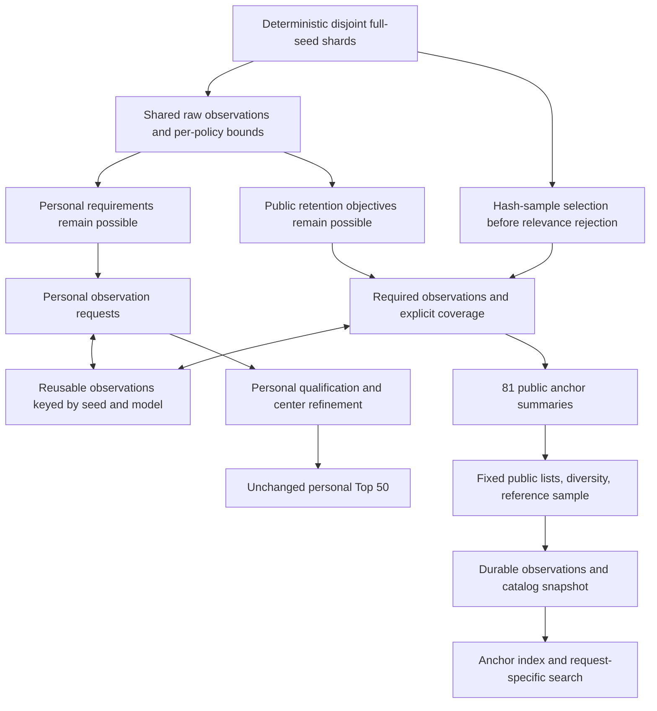

# Public catalog, dual admission, and V100 fleet review

Date: 2026-10-17. Reviewed working tree at HEAD `02f041e`, including uncommitted changes. This is an architecture review, not an implementation or fleet benchmark.

Hardware supplied by Lucas: one server with 192 CPU cores and eight V100s, another with 48 CPU cores and eight V100s, and an 18-core iMac. These are reported core counts, not independently inspected hardware. RAM, SSD/network capacities, V100 memory sizes/form factors, and physical-core versus hardware-thread counts remain unspecified.

## Recommendation

Build the catalog branch. Use `PUBLIC_CATALOG_IMPLEMENTATION_PLAN.md` as the starting product contract. Revise `DUAL_HARVEST_GPU_CATALOG_ARCHITECTURE.md` before implementation: its shared rejection gate, observation-cost assumptions, storage record, and numerical forecasts conflict with that contract.

I agree with building a specialized catalog storage/query layer if that is what “our own database” means. I would own the feature schema, retention, indexes, and query algorithm while using established components for durability and file encoding. I would not start by writing a general storage engine. There is no measurement yet showing that database mechanics, rather than feature extraction or insufficient summaries, are the limiting factor.

The central product choice is **how much future query coverage you intend to preserve**. A custom database cannot recover features that were never extracted or worlds discarded by an earlier policy.

## Findings

### P1 — The shared GPU gate discards valid catalog candidates

`DUAL_HARVEST_GPU_CATALOG_ARCHITECTURE.md:79–87` requires raw villages >=6, mansion >=1, and trials >=8 before either consumer sees a seed. That discards, for example, an excellent village/cherry seed without a mansion. It also excludes candidates for biome-only requests and for the unbiased reference sample.

The current native engine has this problem even without a GPU: `native/blueprint_dynamic.inc:1078–1187` exits on personal preflight, mansion, outpost, other structure floors, and Nether requirements before completing the inventories. Biome-prefix construction is deferred until a center has passed personal structure floors (`:1295–1300`). In public mode, the `feasible` region clamped by personal Nether/mansion requirements is also unsafe as a bound on public observations.

**Change:** personal rejection stops personal work only. Public objectives must have independent liveness and bounds. A seed can stop entirely only when it cannot enter any public list/cell under the pinned policy, cannot enter the reference sample, and cannot qualify personally. A broad biome-only objective may require biome work even when every structure objective has failed. A heuristic can prioritize that work; it cannot claim exact rejection without a sound bound.

“We cannot reject catalog seeds” needs a narrower definition: we can reject according to a declared public retention policy; we cannot reject merely because Lucas would not want the seed. Keeping a bounded catalog necessarily discards some potentially useful worlds.

### P1 — Sharing computed observations is useful; computing them is not free

The architecture's `<25 ns` / “zero measurable drag” claim (`:50–66`) counts comparisons but omits extraction. `NBAnchor` currently has 13 core observation slots plus five optional slots and separate stronghold data; its biome masks are `unsigned int`, not the stated complete 64-bit biome inventory (`native/blueprint_batch.h:8–38`). Many observations do not exist for rejected seeds.

**Change:** separate acquisition from policy. Use a lazily populated, versioned observation object whose fields carry coverage and completion status. Both policies can consume the same completed field; either can independently request additional work. Never interpret an unevaluated field as zero. Do not run the current personal evaluator to completion merely to obtain public data: public launch does not require its stronghold, Nether, or personal-center work.

### P1 — The 64-byte record cannot answer the launch queries

`CatalogRecordV1` really does total 64 bytes, but it holds one center, one count and one quantized nearest distance per category. The public plan promises 81 anchors, three radii, counts up to 16, and biome witnesses with spatial provenance.

Counterexample: three starts at distances `[128, 200, 300]` and three at `[128, 900, 950]` have the same count within 1024 and the same nearest distance. Only the first satisfies “three within 512.” No decoder or faster index can reconstruct the missing information. A world-level cherry bit also cannot answer cherry within 256 of a particular anchor.

**Change:** separate three representations:

1. World observations: structure coordinates/variants and biome samples or witnesses, stored once with model, bounds, and evidence identity.
2. Anchor summaries: derived counts at every supported radius, biome-witness presence/distances, coverage, and revision.
3. Search index: rebuildable arrays/bitmaps over anchor IDs, pointing back to world IDs.

For the fixed launch controls, exact per-radius counts are enough for structure predicates and count utilities; nearest-distance tie breaks need additional exact values. If arbitrary radii become a requirement, retain coordinates or sufficiently many ordered distances. Keep unsaturated counts where retention ranks by actual count. A primary archetype or a single 0–1250 score cannot replace request-specific scoring.

### P1 — Current “CERTIFIED” can mean no BDS verification happened

`scripts/bds_verify_finalist.py:61–64` only changes a status to `READY_TO_PROVISION` when Docker responds. It does not provision BDS, generate chunks, or inspect LevelDB. Line 78 can nevertheless return `CERTIFIED` based solely on predictive heuristics, including when Docker was explicitly skipped. It also enumerates strongholds in a larger square and reports that count under `counts_in_window`.

`scripts/calibrate_player_weights.py:143–170` measures accuracy on the training pairs and labels it `cross_validation_accuracy`. Its fallback pairs are five synthetic examples (`:27–75`), not observed player judgments. This does not establish calibrated player utility.

**Change:** distinguish implemented code, validated prediction, and actual-world evidence. Use a predictive status for passing heuristics; reserve BDS-verified claims for recorded, bounded actual-generation checks. Report training accuracy under its actual name and use held-out players/seeds for calibration. Do not use `IMPLEMENTATION_PLAN.md`'s “all pillars verified” banner as evidence that the public catalog has a working certification service.

The isolated verification probe in `checks.json` executes the existing verdict function with a stubbed passing heuristic and skipped Docker. It reproduces `SKIPPED` plus `CERTIFIED`; it does not validate any real Minecraft structure.

### P2 — Retention is well specified, but needs protection for the actual query menu

The public plan's exact bounded lists, world deduplication, deterministic merge rules, and hash reference sample are strong choices. Keep them. Do not replace these with the architecture's undefined “upper tier,” changing under-representation thresholds, or a guessed retained percentage.

However, the specialist buckets protect structures, while the UI advertises particular biomes. The diversity cell protects only four biome attributes; a mangrove or badlands result can receive no dedicated protection. A general biome-variety score does not preserve the best mangrove-plus-village layouts. Saturating play-style scores also create large ties as more seeds are scanned.

**Change:** add objectives for each advertised biome family and near-anchor distance, and targeted feature pairs justified by tester requests. Recalculate capacities rather than assuming the current 70,384 cap survives unchanged. Measure whether existing profiles contribute distinct results; merge redundant directions where appropriate. Allocate capacity by query-family coverage and marginal improvement, not an arbitrary percentage of scanned seeds.

No finite collection of profiles guarantees the best answer for every future request, even for positive preferences. Hard constraints make this especially clear: a moderately scored world can be the only world satisfying a new combination.

Maintain four explicit outcomes: exact ranking within the published catalog; measured retention recall against a fully observed reference cohort; predictor agreement with the game; and no promise of exhaustive seed-space coverage. These are different properties.

### P2 — Public filtering must join features on the same anchor

Village near anchor A and cherry near anchor B do not satisfy a request requiring both near one settlement. Intersect predicates on anchor IDs, score matching anchors, then group by world and select its best matching anchor. The public plan already describes this correctly; preserve it in the bitmap implementation.

Verifying only an initial top-25 pool does not establish an exact top-5. Either score all eligible anchors with sufficient exact summaries or use valid bounds and continue fetching until no unseen candidate can outrank the answer. Quantized values may be conservative prefilters, with exact rechecks, but cannot silently define exact boundaries.

### P2 — The positive edge of the 81-anchor grid needs a boundary decision

The personal window is half-open, while “within R” normally includes equality. With coverage `[-2000,2000)` and an anchor at X=976, a closed 1024-radius query includes X=2000, which is outside the observed region. Seventeen of the 81 anchors touch an excluded positive boundary in at least one axis.

**Change:** define the circle predicate explicitly, then extend observation coverage through that endpoint, move the extreme public anchors inward, or mark those anchor/radius combinations incomplete. Do not transfer personal square coverage rules implicitly to public circles.

## Product scope: flexible queries over a clear observation contract

Keep these launch choices from the public plan: Bedrock only; exact game/build labels; recommended settlement distinct from spawn; Must have versus Prefer; three fixed radii; request-relative scores; explicit unknowns; grouping alternative centers by seed; and evidence displayed per fact. Keep terrain, loot, portal integrity, and biome absence unavailable until supported.

Start the beta with the most useful validated controls and an advanced view for the broader menu. Use versioned data-driven feature definitions so adding a validated feature does not require another scoring-engine rewrite. Every UI control should map to an available observation, defined spatial predicate, uncertainty rule, and index field.

The 81 anchors are a reasonable pilot approximation, not a fundamental limit. Near small structures or biomes, a good center between saved anchors can be missed by a 256-radius request. Later test deterministic anchors at villages, rare-biome witnesses, or other observed points, with per-world budgets and spatial deduplication. Compare query coverage before replacing the reproducible 81-anchor baseline. Do not promise arbitrary-center optimization at launch.

Offer “search our catalog” as the immediate product. Saved requests can influence future campaign priorities without changing the request silently. An arbitrary on-demand global search is a separate queued compute product with a separate cost model. Validate user demand before billing work; the proposed prices are not evidence of willingness to pay.

## Recommended execution graph

This is one coordinated system with independent policy decisions. It need not be one enormous synchronous kernel. Separate queues let expensive public biome work continue after personal rejection and let a paused public queue leave personal mode usable.

## Using the actual 16-V100 fleet

With available hardware, a CPU reference extractor and a single-V100 parity/performance experiment can proceed in parallel as engineering tracks. A long iMac-only sequence is unnecessary. First establish exactness on one GPU, then scale through 2, 4, and 8 on one host, then both hosts. Do not start with all 16 GPUs and guess which stage limits throughput.

The 192-core/eight-GPU server has four times the reported CPU cores per GPU of the 48-core/eight-GPU server. Equal raw-seed allocations will not necessarily finish equally. Schedule measured work units dynamically, with bounded queues and backpressure. Workers on either server may request additional shards; they must use the same acceptance semantics. Do not tighten admission on the smaller server to control its queue.

Use GPUs for whichever measured stage benefits: raw structure placement, batched biome/climate queries, or both. Treat one-thread-per-seed as a candidate layout, and compare it with region/point batching. `ss_first3` already has a roughly 399-step dependent initialization recurrence (`native/filters.inc:11–17`); tiny state does not mean tiny computation. Profile register use, spills, branch behavior, data movement, and full output costs. For seed-sensitive noise decisions, compare GPU results against the pinned CPU predictor across boundary cases before trusting an optimization. Investigate lower-32 placement reuse only for features whose dependency has been established; full-seed viability still needs evaluation.

V100 exists in 16/32 GB and PCIe/NVLink forms; do not carry over the document's assumed PCIe 4.0 link without inspecting the servers. See [NVIDIA's V100 specifications](https://images.nvidia.com/content/technologies/volta/pdf/tesla-volta-v100-datasheet-letter-fnl-web.pdf?ncid=no-ncid). Pinned buffers and asynchronous overlap are reasonable techniques, subject to device capabilities and measurement, as described in [NVIDIA's CUDA best-practices guide](https://docs.nvidia.com/cuda/cuda-c-best-practices-guide/).

Use the iMac for development, reference comparisons, administration, and personal browsing as convenient. Keep scan data and durable worker spools on the compute hosts. There is no requirement for continuous all-to-all communication between GPUs for independent seed shards.

Measure these separate units: input seeds/s; raw placement work/s; fully extracted public worlds/s; new retained worlds/hour; useful query coverage gained/hour; verification jobs/hour; bytes/world; and complete pipeline wall time. Also report personal throughput with public mode disabled and enabled. Reject-heavy personal throughput is not public extraction capacity.

For combined measured GPU screening rate G, a fraction q requiring expensive CPU completion, C available CPU cores, and mean c CPU-seconds per such candidate, stable processing requires `G*q*c <= C`, before operational headroom. This is a planning bound, not a fleet prediction. Build an equivalent budget for persistence and compaction.

The architecture's own 100 million inputs/s assumption needs 360 seconds to screen 36 billion inputs. Its 3.6 million CPU candidates need 36–72 seconds at the stated 50k–100k candidate/s, if that conditional rate actually holds. Perfect overlap is bounded by the slower stage. “Under 40 seconds” therefore cannot describe that end-to-end campaign at that GPU rate. Public survival fractions and full-extraction costs remain unmeasured.

## Storage: build the specialized index; keep durable foundations

SQL is a query language, not a throughput class. DuckDB itself uses SQL. The useful decision is which data belongs in transactional metadata, immutable bulk observations, and serving indexes.

| Responsibility | Pilot recommendation | Graduation criterion |
|---|---|---|
| Personal checkpoints/results | Keep the existing isolated store | An observed personal-store bottleneck |
| Public manifests, leases, membership, accounts | One service-owned transactional store; SQLite can start locally | Measured contention or operational need for a server database |
| Worker output | Local durable batches with shard IDs and checksums | Change encoding after measured output costs justify it |
| Bulk public observations | Compressed artifacts in the pilot; partitioned immutable Parquet is a scale candidate | Extraction volume and query benchmarks |
| Public serving | Exact anchor summaries; arrays/bitmaps when useful | A measured baseline fails the declared latency/cost target |
| Rebuild/analytics | DuckDB over snapshots | Validate against the same reference answers |

For two machines, use local worker stores plus a coordinator API or idempotent manifest ingestion. Do not mount a SQLite WAL file on shared storage and have both machines open it: [SQLite documents the same-host requirement and single-writer behavior](https://www.sqlite.org/wal.html). If independently mutable transactional services become necessary, a server database is a reasonable evolution; this review does not establish the need for one today.

[DuckDB supports projection/filter pushdown over Parquet](https://duckdb.org/docs/current/data/parquet/overview), so benchmark it before adding another query engine. Choose and pin its concurrency mode explicitly; [current concurrency documentation](https://duckdb.org/docs/current/connect/concurrency) distinguishes embedded and remote arrangements. The architecture's casual sharing of files is not a concurrency design. Publish immutable dataset generations and keep readers on a pinned manifest, rather than continually rewriting a single `catalog.parquet` under readers.

If a custom binary format later wins, define magic, format/model/schema versions, byte order, counts/lengths, checksum, and complete/truncated-file behavior. `#pragma pack` controls padding; it does not define an endian conversion protocol. Also, `np.fromfile` is not a memory-map API; [NumPy documents its raw binary portability limitations](https://numpy.org/doc/stable/reference/generated/numpy.fromfile.html). Use the appropriate mapping mechanism deliberately.

A specialized database can be a good long-term project: immutable columns, distance/count indexes, bitmaps, and request-aware ranking are relevant custom work. Durability, locking, compaction recovery, schema migration, and backup restore also become your responsibility if you replace the underlying engine. An embedded library such as [RocksDB](https://rocksdb.org/) is another possible durable foundation if measured needs call for keyed incremental updates; it does not supply this catalog's multidimensional query algorithm automatically.

### Sizing must follow the query representation

The architecture's 36 million *worlds* at 64 bytes is 2.304 GB, but its public contract also has up to 81 anchors/world. At 36 million worlds that is 2.916 billion anchor rows. An illustrative 64 bytes/anchor would already be 186.624 GB before world observations, index overhead, evidence, or replicas. This is not a prediction that every anchor must be stored in that layout; it shows why one tiny world row is the wrong sizing basis.

As a second transparent example, 14 features × 3 radii × 2-byte counts is 84 bytes/anchor: about 0.479 GB across 70,384 pilot worlds and 244.944 GB across 36 million worlds, before other data. Shared coordinates, sparse summaries, smaller safe count fields, compression, and fewer validated anchors may change those costs substantially. Measure them. Neither the 50 MB pilot estimate nor the 3 GB serving estimate is currently supported for the promised representation.

Ingest rate depends on **retained bytes**, not raw seeds/s alone. Maintain exact bounded retention and avoid long-term row-per-rejected-seed storage. Retain deterministic shard receipts so discarded worlds can be reprocessed under a new policy. Reprocessing still costs compute; a receipt is not a stored feature inventory.

Keep the public plan's fsync/rename/manifest reconciliation requirements. Add fencing tokens for leases, idempotent replay and duplicate handling, snapshot-safe garbage collection, bounded spool/backpressure, and crash/restart tests during publication and compaction. Low commit frequency alone proves neither zero conflicts nor crash durability.

## Changes to the four documents

| Document | Keep | Change |
|---|---|---|
| `PUBLIC_CATALOG_IMPLEMENTATION_PLAN.md` | Independent policies, exact user predicates, evidence limits, bounded retention, full-observation reference and held-out recall tests | Add advertised-biome retention objectives; resolve closed-circle boundaries; size all anchors/observations; allow a single-V100 experiment alongside the CPU reference on the available fleet |
| `DUAL_HARVEST_GPU_CATALOG_ARCHITECTURE.md` | Asynchronous batches, independent final consumers, bulk storage plus serving-index separation | Remove shared personal rejection, free-extraction claims, unsupported performance/compression figures, and 64-byte authoritative-record assumption; define coordinator, snapshots, backpressure, and benchmark gates |
| `IMPLEMENTATION_PLAN.md` | Native center-refinement work and explicit declared-grid scope | Correct all-pillars-complete/certified and cross-validation claims; distinguish a Docker readiness hook from a working BDS oracle; separate historical design proposals from current implemented behavior |
| `MASTER_SEED_BLUEPRINT.md` | Frozen personal geometry, floors, score, and ordering | Make it explicitly personal; mark obsolete optimization diagrams as historical proposals; remove guaranteed-biome inference from structure viability; derive floor counts from config (currently 13 keys, despite repeated “14” labels); reconcile benchmark versions |

For the master blueprint specifically, section 7's “2 Fortresses” preflight conflicts with the active minimum of one, and the proposed skipping of biome families based on structures conflicts with the source comment at `native/blueprint_dynamic.inc:128–129`. Do not port those historical shortcuts to CUDA as if they were the current proven algorithm.

## Concrete next work

1. Freeze the current personal policy and deterministic fixtures. Correct misleading certification/status labels before exposing evidence to catalog users.
2. Implement the isolated observation/anchor/request contracts and a 100-world complete CPU extraction benchmark. Include random personal rejects and known useful specialists. No personal floor may truncate this reference extraction.
3. In parallel with that reference work, inventory the servers and benchmark one V100 against the same raw-placement/observation outputs. Run scaling experiments only after parity and complete-output costs are known. This recommendation describes parallel engineering tracks; no additional agents or remote runs were launched in this review.
4. Build the 10,000-world reference and a fixed query corpus, including every launch biome, strict 256-radius combinations, alternative centers, and requests that personal floors would reject. Keep random and deliberately rare cohorts distinguishable when reporting population statistics.
5. Implement the revised retention rules and exact search over saved anchors. Compare against the unretained reference. Use smaller capacity experiments, then a larger-than-capacity reference before claiming production retention quality, as the public plan already requires.
6. Benchmark SQLite/artifacts and DuckDB/Parquet on the actual summaries. Introduce custom binary segments or bitmap serving only for a demonstrated benefit. Validate crash recovery and restoration.
7. Run a free beta, use unmet requests to guide capacity/extraction work, then scale ingestion on the fleet. Defer subscriptions and any exhaustive-search promise until the catalog is useful and its operating costs are measured.

## Verification performed and limits

Read the four requested plans, current v3 configuration, native preflight/lazy extraction, anchor layout, persistence interfaces, capabilities, verification/calibration scripts and their tests, and the existing native-refinement benchmark report. Checked current primary documentation for storage/GPU claims. Added `verify_review.py` and `checks.json` for repeatable arithmetic, the lossy-summary counterexample, boundary coverage, and isolated certification control flow. Source hashes identify the reviewed inputs.

No production source or original plan was changed. No full regression suite, fresh native throughput run, BDS generation, remote server access, GPU kernel, or fleet benchmark was performed. The existing refinement report's roughly 116k native / 104k durable inputs/s are historical, mostly rejection measurements with zero retained candidates in those benchmark cohorts, not public extraction measurements. Hardware-specific speed and storage forecasts remain open experiments.
