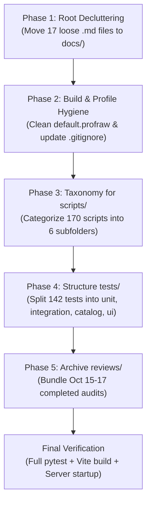

# Repository Organization & Cleanup Plan
*Post-Execution Refactoring Roadmap • Safe, Non-Destructive Structural Cleanup*

---

## 1. Overview & Objective

Over the course of rapid development, benchmarking, and multi-agent coordination (Codex + Antigravity), the repository working tree has accumulated:
* **22 loose markdown files** in the root directory.
* **170 loose scripts** in `scripts/`.
* **142 loose test files** (mixed Python `.py` and Node `.cjs`) in `tests/`.
* **45 historical directories** in `reviews/`.
* **Ephemeral build artifacts** (e.g., `default.profraw`).

**Primary Objective:** Transform the workspace into a clean, modular, and professional repository structure **without breaking** active Python import paths, CFFI/OpenMP native builds, Vite frontend proxies, or test runners.

> [!IMPORTANT]
> **Safety Timing Gate:** This plan must **NOT** be executed while Codex is actively writing code or running tasks. It should only be executed once the current active milestones are completed, verified, and idle.

---

## 2. Guiding Principles & Non-Negotiable Safeguards

1. **Zero Source Code Breakage:**
   * Python package code inside `src/seed_search/` and native code inside `native/` and `vendor/cubiomes-bedrock/` will **not** have their relative import paths changed.
2. **Git Commit Safety:**
   * Reorganization will occur on a dedicated git branch (`chore/repo-cleanup`) with atomic commits for each phase. If anything breaks, a single `git switch main` instantly restores the current state.
3. **Preserve All Evidence (Never Delete Historical Proof):**
   * No audit logs, baseline outputs, or diagnostic reports are deleted. They are categorized into structured subdirectories (`docs/audits/`, `docs/specs/`, `reviews/archive/`).
4. **Verification Gates:**
   * Every phase requires running the test suite (`pytest`) and the frontend build (`npm run build`) before proceeding to the next.

---

## 3. The 5-Phase Organization Roadmap



---

### Phase 1: Root Directory Decluttering

Currently, the root directory has 22 markdown files, making it hard to find active documentation. 

#### Target Root State (Only 6 Primary Entry Points Retained at Root):
1. [`README.md`](file:///Users/lucasraicu/Downloads/minecraft-seed-searcher/README.md) — Main repository documentation and quickstart.
2. [`AGENTS.md`](file:///Users/lucasraicu/Downloads/minecraft-seed-searcher/AGENTS.md) — System rules and agent delegation workflow.
3. [`CODEX_HANDOFF.md`](file:///Users/lucasraicu/Downloads/minecraft-seed-searcher/CODEX_HANDOFF.md) — Active operational handoff (pruned to ~150 lines).
4. [`MASTER_SEED_BLUEPRINT.md`](file:///Users/lucasraicu/Downloads/minecraft-seed-searcher/MASTER_SEED_BLUEPRINT.md) — Live active seed scoring specification.
5. [`SERVER_SETUP_GUIDE.md`](file:///Users/lucasraicu/Downloads/minecraft-seed-searcher/SERVER_SETUP_GUIDE.md) — Complete 20-player BDS deployment guide.
6. `REPO_ORGANIZATION_PLAN.md` — This plan.

#### Files to Relocate:

| Current File at Root | New Clean Destination | Purpose / Description |
| :--- | :--- | :--- |
| `MASTER_PLATFORM_SPECIFICATION.md` | `docs/specs/PLATFORM_SPECIFICATION.md` | Core engine platform architecture |
| `CATALOG_WEB_ARCHITECTURE_AND_INTERFACE_SPEC.md` | `docs/specs/WEB_ARCHITECTURE_SPEC.md` | Web UI & API architecture |
| `DUAL_HARVEST_GPU_CATALOG_ARCHITECTURE.md` | `docs/specs/GPU_HARVEST_ARCHITECTURE.md` | Future GPU architecture proposal |
| `DIAGRAMS.md` | `docs/specs/SYSTEM_DIAGRAMS.md` | Architectural Mermaid diagrams |
| `PUBLIC_CATALOG_SYSTEM_SPEC.md` | `docs/catalog/SYSTEM_SPEC.md` | Public catalog system specification |
| `PUBLIC_CATALOG_PLAYER_POLICY.md` | `docs/catalog/PLAYER_POLICY.md` | Player retention & quota policy |
| `PUBLIC_CATALOG_AUTOMATION_PLAN.md` | `docs/catalog/AUTOMATION_PLAN.md` | Automated sweep & harvest plan |
| `PUBLIC_CATALOG_IMPLEMENTATION_PLAN.md` | `docs/catalog/IMPLEMENTATION_PLAN.md` | Step-by-step catalog roadmap |
| `PUBLIC_CATALOG_BIOME_EXPANSION_PLAN.md` | `docs/catalog/BIOME_EXPANSION_PLAN.md` | 56-biome expansion plan |
| `Public_Catalog_Master_Plan.md` | `docs/catalog/proposals/ARGON_MASTER_PLAN.md` | Gemini Argon external proposal |
| `MASTER_SEED_BLUEPRINT_1664_V2.md` | `docs/blueprints/archive/BLUEPRINT_1664_V2.md` | Superseded seed blueprint v2 |
| `CENTER_WEIGHT_RESEARCH.md` | `docs/research/CENTER_WEIGHT_RESEARCH.md` | Center-weight algorithm research |
| `AUDIT_CONTEXT.md` | `docs/audits/AUDIT_CONTEXT.md` | Pre-flight audit context |
| `AUDIT_CRITICAL_CODE.md` | `docs/audits/AUDIT_CRITICAL_CODE.md` | Core algorithm audit bundle |
| `AUDIT_SOURCE_BUNDLE.md` | `docs/audits/AUDIT_SOURCE_BUNDLE.md` | Aggregated source audit bundle |

---

### Phase 2: Build & Profile Hygiene

1. **Remove Ephemeral Dump Files:**
   * Delete `default.profraw` (an LLVM clang instrumentation file generated during C compiler profiling).
2. **Update `.gitignore`:**
   Add explicit rules to prevent development artifacts from showing up in `git status`:
   ```gitignore
   # Profiling & Instrumentation
   *.profraw
   *.profdata
   *.gcov

   # Temporary test outputs
   /exports/temp/
   /outputs/scratch/
   .pytest_cache/
   ```

---

### Phase 3: Categorizing the 170 Scripts in `scripts/`

Currently, `scripts/` contains 170 scripts in a single flat directory. Group them into logical subfolders:

```text
scripts/
├── catalog/          # Ingestion, harvest, and products (catalog_harvest.py, catalog_job.py, catalog_accuracy.py, etc.)
├── bds/              # Bedrock Dedicated Server probes & lifecycles (bds_verify_finalist.py, predictor_lifecycle_bds.py)
├── probes/           # C native sampling probes & builders (biome_node_probe.c, biome_sampling_probe.c)
├── generalization/   # Generalization audits & observers (generalization_audit.py, generalization_observer.js)
├── calibration/      # Player weight & size calibration (calibrate_catalog_sizes.py, fit_catalog_calibration.py)
├── maintenance/      # Re-anchoring, migration, and re-indexing (reanchor_catalog.py, migrate_catalog_biomes.py)
└── legacy/           # One-off pilot builds (build_count_pilot.py, profile_phase2.py)
```

*(Note: Create backward-compatible forwarding wrappers or update CLI entries in `src/seed_search/` if any Python module directly invokes a script path).*

---

### Phase 4: Structuring the 142 Test Files in `tests/`

Currently, `tests/` contains a mix of 142 `.py` and `.cjs` files. Organize them into clear testing layers:

```text
tests/
├── unit/             # Fast pure-Python math, configs, and scoring tests
├── integration/      # Native CFFI bridge, dynamic blueprint, and OpenMP parity tests
├── catalog/          # Catalog HTTP API, reserve policy, and query tests (existing folder expanded)
├── bds/              # Game evidence, exact Y elevation, and storage reader verification
└── ui/               # Node/CJS frontend contract and telemetry render tests (*.cjs)
```

* **Configuration Update:** Update `pyproject.toml` so pytest automatically discovers tests in all subdirectories without requiring flags:
  ```toml
  [tool.pytest.ini_options]
  testpaths = ["tests"]
  python_files = ["test_*.py"]
  ```

---

### Phase 5: Archiving Completed Reviews in `reviews/`

The `reviews/` directory contains 45 folders from past development milestones.

1. **Keep Active & Recent Reviews in Root of `reviews/`:**
   * `reviews/biome-expansion-plan-2026-10-22/` (Current active milestone)
   * `reviews/accuracy-advanced-products-2026-10-21/` (Spawn correction milestone)
2. **Move Superseded Reviews to `reviews/archive/`:**
   * Group historical folders by date:
     * `reviews/archive/2026-10-15/` (split-audit, disk-budget, kernel-preflight)
     * `reviews/archive/2026-10-16/` (native-refinement, center-weights)
     * `reviews/archive/2026-10-17/` (catalog-architecture, argon-review)
     * `reviews/archive/2026-10-20/` (phase12, phase3-reference, predictor-corrections)

---

## 4. Execution Step-by-Step Checklist

When you are ready to execute this plan (once Codex is finished):

- [ ] **Step 1:** Confirm Git tree is committed or clean:
  ```bash
  git status
  ```
- [ ] **Step 2:** Create a dedicated reorganization branch:
  ```bash
  git checkout -b chore/repo-cleanup
  ```
- [ ] **Step 3:** Execute Phase 1 (Move root docs to `docs/specs/`, `docs/catalog/`, `docs/audits/`).
- [ ] **Step 4:** Execute Phase 2 (Remove `default.profraw`, update `.gitignore`).
- [ ] **Step 5:** Execute Phase 3 (Organize `scripts/` into subdirectories).
- [ ] **Step 6:** Execute Phase 4 (Organize `tests/` into `unit/`, `integration/`, `bds/`, `ui/`).
- [ ] **Step 7:** Execute Phase 5 (Archive historical review folders).
- [ ] **Step 8:** Run the complete verification suite:
  ```bash
  .venv/bin/python -m pytest tests/
  npm --prefix web-ui run build
  ```
- [ ] **Step 9:** Merge `chore/repo-cleanup` into `main` after verification passes.

